# Scout database reference

Scout requires keel `tenant_management`, which declares direct dependencies on keel `core` and `geo`. Install the groups from the same pinned `github.com/nauticana/keel` module in dependency order: `core`, `geo`, `tenant_management`, then Scout. Keel supplies `business_partner`, users and sessions, authorization, consent, metadata-driven REST, and `table_sequence_usage`. `agent_tenant` is a one-to-one child of `business_partner`, and Studio actor fields reference `user_account`; Scout does not copy either YAML definition.

The diagrams below show Scout-owned tables. A keel-owned table appears only as a bare stub when a Scout relation points at it — `business_partner` and `user_account` — because it is a dependency rather than part of the agent domain. Generate both layers together as documented in the [engineering reference](engineering-reference.md#generate-dialect-specific-ddl).

The YAML files under `schema/` are authoritative. This document explains ownership and relationships; it is not another schema source.

## Module dependency graph

Scout's schema is seventeen selectable modules declared in `schema/dependency.yml`. A downstream generates only the modules its product uses; selecting a module means selecting every module it points to, transitively.

- Every node is a schema module, labeled with the number of tables it owns.
- An arrow points from a module to a module it depends on because at least one foreign key crosses that boundary.
- Only direct dependencies are drawn. An edge already implied by a longer path is omitted — `release` also holds foreign keys into `agent`, `catalog`, and `tenancy`, but reaches all three through `runtime`, so drawing them again would say nothing new. Likewise `evaluation` keys into `model` (a comparison arm's text model) and `runtime` (a reviewed turn) but reaches both through `knowledge` and `release`. `schema/dependency.yml` keeps the complete list.
- `agent` is the waist of the platform: `catalog`, `tenancy`, `prompt`, and `model` sit under it, and every product-facing module above reaches them through it. Its only direct key into `prompt` is a draft comment anchored to a prompt section.
- `agent_authorization` and `configuration` carry the principal and configuration-inheritance primitives; both sit directly on `agent` because they key on `agent_profile` and `agent_version`.
- `skill` holds versioned procedures an agent loads on demand, and the platform catalog tenants copy them from. It sits on `tool` because a skill lists the tools its procedure uses. A skill version also names the golden set version that gates it, as plain columns: the reference is optional, so it is verified by the application, not by a foreign key.
- `approval` holds the durable human-in-the-loop record of a turn; `mcp_confirmation` holds an MCP tool call a person confirms, linked to keel's maker-checker `approval_request` when one decides it. `configuration` also owns `audit_event`, because every decision record is attributable to a scope and the runtime, the tool gateway, and guardrails all write one without the rollout schema.

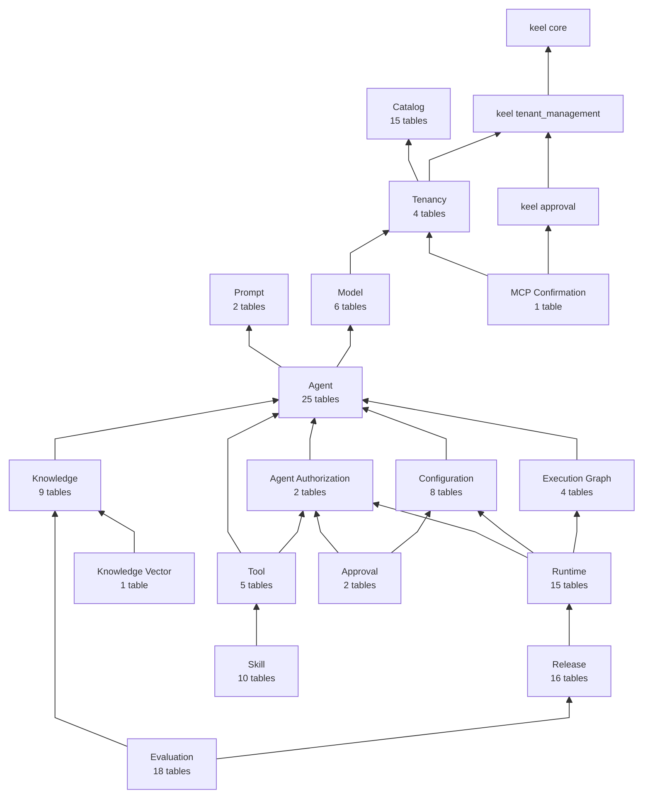

Every module that ships reference data also writes seed rows into keel `core` tables — constants, REST metadata, authorization objects, and configuration flags — which is an application-level dependency rather than a foreign key, so it is not drawn.

Selecting modules is how a deployment stays small: Agent Studio authoring and publication needs `catalog`, `tenancy`, `prompt`, `model`, `agent`, and `configuration` — 60 Scout tables — while the full platform is 143. The [engineering reference](engineering-reference.md#generate-dialect-specific-ddl) lists the common combinations and the exact generator invocation.

`knowledge_vector` is separable for a second reason: it is the only module whose table uses PostgreSQL `VECTOR` and `TSVECTOR`. A MySQL deployment, or one running retrieval on an external vector store behind `contract.KnowledgeVectorIndex`, simply omits the module; whole reads and ingestion without an embedder need only `knowledge`.

## Module contents

The same modules with their tables and the foreign keys inside each one, again with transitively implied edges omitted. Columns are left out here; the ER diagrams further down carry columns and relationship names, and are organized by concept rather than by module.

```mermaid
%%{init: {"flowchart": {"curve": "linear", "nodeSpacing": 30, "rankSpacing": 55, "diagramPadding": 12}, "themeVariables": {"fontSize": "12px"}}}%%
flowchart RL
    subgraph catalog["Catalog"]
        direction BT
        currency["currency"]
        priority_class["priority_class"]
        turn_status["turn_status"]
        idempotency_status["idempotency_status"]
        reservation_status["reservation_status"]
        rollout_status["rollout_status"]
        usage_category["usage_category"]
        config_scope_kind["config_scope_kind"]
        config_resource_kind["config_resource_kind"]
        audit_decision_outcome["audit_decision_outcome"]
        approval_status["approval_status"]
        approval_risk_tier["approval_risk_tier"]
        agent_state["agent_state"]
        mcp_confirmation_status["mcp_confirmation_status"]
        release_activation_state["release_activation_state"]
    end

    subgraph tenancy["Tenancy"]
        direction BT
        agent_tenant["agent_tenant"]
        tenant_runtime_policy["tenant_runtime_policy"]
        tenant_current_policy["tenant_current_policy"]
        tenant_quota["tenant_quota"]
    end
    tenant_runtime_policy --> agent_tenant
    tenant_current_policy --> tenant_runtime_policy
    tenant_quota --> agent_tenant

    subgraph prompt["Prompt"]
        direction BT
        prompt_section["prompt_section"]
        prompt_baseline["prompt_baseline"]
    end
    prompt_baseline --> prompt_section

    subgraph model["Model"]
        direction BT
        model_provider["model_provider"]
        model_definition["model_definition"]
        model_capability["model_capability"]
        model_route["model_route"]
        model_price["model_price"]
        tenant_model_access["tenant_model_access"]
    end
    tenant_model_access --> model_definition
    model_definition --> model_provider
    model_price --> model_definition
    model_capability --> model_definition
    model_route --> model_definition

    subgraph agent["Agent"]
        direction BT
        agent_type["agent_type"]
        agent_type_version["agent_type_version"]
        agent_capability_package["agent_capability_package"]
        agent_type_capability["agent_type_capability"]
        agent_version_quarantine["agent_version_quarantine"]
        agent_profile["agent_profile"]
        guardrail_config["guardrail_config"]
        agent_draft["agent_draft"]
        agent_alias["agent_alias"]
        agent_studio_event["agent_studio_event"]
        agent_create_request["agent_create_request"]
        agent_template_catalog["agent_template_catalog"]
        agent_template_catalog_version["agent_template_catalog_version"]
        agent_template["agent_template"]
        agent_template_version["agent_template_version"]
        agent_template_publication["agent_template_publication"]
        agent_draft_origin["agent_draft_origin"]
        agent_version["agent_version"]
        agent_deployment["agent_deployment"]
        safety_event["safety_event"]
        agent_governance["agent_governance"]
        agent_draft_guardrail["agent_draft_guardrail"]
        agent_draft_comment["agent_draft_comment"]
        agent_publish_review["agent_publish_review"]
        agent_release_activation["agent_release_activation"]
    end
    agent_type_version --> agent_type
    agent_type_capability --> agent_type_version
    agent_type_capability --> agent_capability_package
    agent_profile --> agent_type
    agent_version_quarantine --> agent_version
    agent_version --> guardrail_config
    agent_studio_event --> agent_profile
    agent_create_request --> agent_profile
    agent_alias --> agent_profile
    agent_draft --> agent_profile
    agent_deployment --> agent_version
    guardrail_config --> agent_profile
    safety_event --> agent_profile
    agent_governance --> agent_draft
    agent_draft_guardrail --> agent_draft
    agent_draft_comment --> agent_draft
    agent_draft_comment --> prompt_section
    agent_publish_review --> agent_version
    agent_release_activation --> agent_version
    agent_template --> agent_type
    agent_template_version --> agent_template
    agent_template_version --> agent_type_version
    agent_template_version --> agent_profile
    agent_template_publication --> agent_template
    agent_template_catalog_version --> agent_template_catalog
    agent_draft_origin --> agent_draft
    agent_draft_origin --> agent_template_version
    agent_draft_origin --> agent_template_catalog_version

    subgraph agent_authorization_module["Agent Authorization"]
        direction BT
        agent_permission["agent_permission"]
        delegation_grant["delegation_grant"]
    end
    agent_permission --> agent_profile
    delegation_grant --> agent_profile

    subgraph configuration_module["Configuration"]
        direction BT
        config_scope["config_scope"]
        config_scope_binding["config_scope_binding"]
        effective_agent_release["effective_agent_release"]
        audit_event["audit_event"]
        platform_restriction_layer["platform_restriction_layer"]
        platform_current_restriction["platform_current_restriction"]
        tenant_restriction_layer["tenant_restriction_layer"]
        tenant_current_restriction["tenant_current_restriction"]
    end
    config_scope_binding --> config_scope
    effective_agent_release --> config_scope
    effective_agent_release --> agent_version
    audit_event --> config_scope
    platform_current_restriction --> platform_restriction_layer
    tenant_current_restriction --> tenant_restriction_layer

    subgraph approval["Approval"]
        direction BT
        turn_approval_request["turn_approval_request"]
        turn_approval_decision["turn_approval_decision"]
    end
    turn_approval_request --> effective_agent_release
    turn_approval_decision --> turn_approval_request
    turn_approval_decision --> delegation_grant

    subgraph tool["Tool"]
        direction BT
        tool_profile["tool_profile"]
        tool_version["tool_version"]
        tool_egress_rule["tool_egress_rule"]
        agent_tool_binding["agent_tool_binding"]
        tool_credential_binding["tool_credential_binding"]
    end
    tool_credential_binding --> tool_profile
    tool_credential_binding --> delegation_grant
    tool_version --> tool_profile
    agent_tool_binding --> tool_version
    tool_egress_rule --> tool_version

    subgraph execution_graph_module["Execution Graph"]
        direction BT
        execution_graph["execution_graph"]
        execution_step["execution_step"]
        execution_graph_entry["execution_graph_entry"]
        execution_transition["execution_transition"]
    end
    execution_graph_entry --> execution_step
    execution_step --> execution_graph
    execution_transition --> execution_step

    subgraph knowledge["Knowledge"]
        direction BT
        knowledge_base["knowledge_base"]
        knowledge_base_version["knowledge_base_version"]
        knowledge_document["knowledge_document"]
        knowledge_chunk["knowledge_chunk"]
        agent_knowledge_binding["agent_knowledge_binding"]
        agent_knowledge_document["agent_knowledge_document"]
        knowledge_document_manifest["knowledge_document_manifest"]
        knowledge_base_alias["knowledge_base_alias"]
        knowledge_source_event["knowledge_source_event"]
    end
    knowledge_base_version --> knowledge_base
    knowledge_document --> knowledge_base_version
    knowledge_source_event --> knowledge_base
    knowledge_base_alias --> knowledge_base_version
    knowledge_document_manifest --> knowledge_document
    knowledge_chunk --> knowledge_document
    agent_knowledge_binding --> knowledge_base_version
    agent_knowledge_document --> agent_knowledge_binding

    subgraph knowledge_vector["Knowledge Vector"]
        direction BT
        knowledge_chunk_vector["knowledge_chunk_vector"]
    end

    subgraph runtime["Runtime"]
        direction BT
        agent_conversation["agent_conversation"]
        conversation_turn["conversation_turn"]
        conversation_turn_detail["conversation_turn_detail"]
        step_checkpoint["step_checkpoint"]
        session_snapshot["session_snapshot"]
        step_idempotency["step_idempotency"]
        step_loop_entry["step_loop_entry"]
        turn_queue["turn_queue"]
        turn_dead_letter["turn_dead_letter"]
        budget_reservation["budget_reservation"]
        usage_event["usage_event"]
        turn_feedback["turn_feedback"]
        agent_run["agent_run"]
        agent_ops_event["agent_ops_event"]
        agent_work_item["agent_work_item"]
    end
    session_snapshot --> step_checkpoint
    turn_dead_letter --> turn_queue
    turn_queue --> conversation_turn
    conversation_turn_detail --> budget_reservation
    conversation_turn --> agent_conversation
    step_checkpoint --> conversation_turn
    usage_event --> conversation_turn
    usage_event --> config_scope
    usage_event --> model_definition
    turn_feedback --> conversation_turn
    agent_work_item --> delegation_grant
    agent_work_item --> agent_work_item
    step_idempotency --> conversation_turn
    step_loop_entry --> step_idempotency
    budget_reservation --> conversation_turn

    subgraph release["Release"]
        direction RL
        rollout_stage["rollout_stage"]
        platform_release["platform_release"]
        release_bundle["release_bundle"]
        tenant_ring["tenant_ring"]
        tenant_ring_member["tenant_ring_member"]
        contract_test_case["contract_test_case"]
        contract_test_run["contract_test_run"]
        contract_test_result["contract_test_result"]
        platform_rollout["platform_rollout"]
        platform_rollout_state["platform_rollout_state"]
        platform_rollout_transition["platform_rollout_transition"]
        platform_rollout_bypass["platform_rollout_bypass"]
        agent_version_pin["agent_version_pin"]
        experiment_cohort["experiment_cohort"]
        agent_pilot_member["agent_pilot_member"]
        conversation_release["conversation_release"]
    end
    contract_test_run --> platform_release
    conversation_release --> platform_release
    tenant_ring_member --> tenant_ring
    platform_rollout_transition --> platform_rollout_state
    platform_rollout --> platform_release
    platform_rollout --> tenant_ring
    platform_rollout_state --> platform_release
    platform_rollout_state --> rollout_stage
    platform_rollout_state --> tenant_ring
    platform_rollout_bypass --> platform_rollout_state
    contract_test_result --> contract_test_case
    contract_test_result --> contract_test_run
    release_bundle --> platform_release

    subgraph evaluation["Evaluation"]
        direction BT
        golden_set["golden_set"]
        human_review_item["human_review_item"]
        golden_set_version["golden_set_version"]
        golden_case["golden_case"]
        agent_golden_set["agent_golden_set"]
        golden_example["golden_example"]
        golden_query["golden_query"]
        evaluation_baseline["evaluation_baseline"]
        evaluation_baseline_output["evaluation_baseline_output"]
        evaluation_manifest["evaluation_manifest"]
        evaluation_run["evaluation_run"]
        evaluation_run_subject["evaluation_run_subject"]
        evaluation_result["evaluation_result"]
        gate_decision["gate_decision"]
        evaluation_sample["evaluation_sample"]
        agent_gate_decision["agent_gate_decision"]
        agent_gate_decision_run["agent_gate_decision_run"]
        evaluation_comparison["evaluation_comparison"]
    end
    human_review_item --> golden_set
    golden_set_version --> golden_set
    golden_case --> human_review_item
    agent_golden_set --> golden_set
    golden_example --> golden_set_version
    golden_query --> golden_set_version
    evaluation_baseline --> golden_set_version
    evaluation_baseline_output --> evaluation_baseline
    evaluation_baseline_output --> golden_example
    evaluation_manifest --> golden_set_version
    evaluation_run --> evaluation_manifest
    evaluation_run_subject --> evaluation_run
    evaluation_run_subject --> evaluation_baseline
    evaluation_result --> evaluation_run
    evaluation_result --> golden_example
    gate_decision --> evaluation_manifest
    agent_gate_decision --> golden_set_version
    agent_gate_decision_run --> agent_gate_decision
    agent_gate_decision_run --> evaluation_run
    evaluation_comparison --> evaluation_run
    evaluation_comparison --> golden_example

    subgraph skill["Skill"]
        direction BT
        skill_catalog_profile["skill_catalog_profile"]
        skill_catalog_version["skill_catalog_version"]
        skill_catalog_tool["skill_catalog_tool"]
        skill_catalog_example["skill_catalog_example"]
        skill_profile["skill_profile"]
        skill_version["skill_version"]
        skill_tool["skill_tool"]
        skill_example["skill_example"]
        skill_requirement["skill_requirement"]
        agent_skill_binding["agent_skill_binding"]
    end
    skill_catalog_version --> skill_catalog_profile
    skill_catalog_tool --> skill_catalog_version
    skill_catalog_example --> skill_catalog_version
    skill_version --> skill_profile
    skill_version --> skill_catalog_version
    skill_tool --> skill_version
    skill_tool --> tool_profile
    skill_example --> skill_version
    skill_requirement --> skill_version
    agent_skill_binding --> skill_version

```

## Storage boundaries

| State | Authoritative location |
|---|---|
| Tenants, policies, immutable definitions, graph metadata, usage, rollout, audit indexes | Relational database |
| Large definitions, turn content, checkpoints, and audit payloads | Object storage by URI and digest |
| Hot session and graph entries | Cache backed by durable relational/object state |
| Turn dispatch and reply frames | Durable queue and short-lived reply broker |
| Embedding vectors | Tenant-partitioned vector index |
| Compiled effective configuration | `effective_agent_release`, frozen at publication |
| Governed decisions and their evidence | `audit_event` typed columns; redacted payloads in object storage |
| Pending human decisions | `turn_approval_request` / `turn_approval_decision` |
| Provider credentials | keel secret provider |

All relational identifiers are lowercase. Tenant-owned relations carry `partner_id` in every foreign key toward `agent_tenant`, so keel's generic CRUD treats each as partner-specific and pins it to the caller's partner at any depth; `agent_ops_event` reaches `business_partner` directly. Go types keep the name `TenantID` for the same value. Portable structured payloads use canonical JSON stored as `TEXT`; runtime result cards deliberately use PostgreSQL `JSONB` because the durable ledger already relies on PostgreSQL transaction and locking primitives.

`execution_step.step_kind_code`, `tenant_runtime_policy.capacity_class_code`, and Studio prompt language columns use keel constant domains through `constant_lookup`; none is a foreign key or a Scout-owned table. Closed code lists that Scout's code switches on, such as `config_scope_binding.merge_mode_code`, `turn_approval_request.output_class_code`, and `mcp_confirmation.channel_code`, are keel constants too, seeded by the owning module and enforced by a check; a catalog table remains where a code carries attributes or products add codes, as `usage_category` does. A closed code list uses 1- or 2-character codes whose captions come from `constant_value`; language codes and the words inside authored JSON, such as guardrail rules and approval routing, keep their full values. Every column a `constant_lookup` row names has a check listing exactly its domain's codes, which a repository test enforces. The execution kinds are `M` (model), `T` (tool), `K` (knowledge), `A` (agent), `W` (wait), and `L` (tool loop); the capacity classes are `S` (shared) and `D` (dedicated).

## REST relationship names

Keel uses each foreign-key constraint name as the generated parent-side relation field, and `rest_api_child.constraint_name` selects that exact relation. These names are therefore API contracts. An owning relationship uses the plural child collection; a second path to another parent adds a role that explains the collection from that parent's perspective.

| Parent | Foreign key / relation field | Child objects |
|---|---|---|
| `business_partner` | `agent_tenants` | `agent_tenant[]` |
| `agent_tenant` | `agent_profiles` | `agent_profile[]` |
| `agent_profile` | `agent_versions` | `agent_version[]` |
| `agent_profile` | `agent_studio_events` | `agent_studio_event[]` |
| `agent_profile` | `agent_publish_reviews` | `agent_publish_review[]` |
| `agent_draft` | `agent_draft_comments` | `agent_draft_comment[]` |
| `agent_draft` | `agent_draft_origins` | `agent_draft_origin[]` |
| `agent_version` | `stable_agent_deployments` | `agent_deployment[]` |
| `agent_version` | `canary_agent_deployments` | `agent_deployment[]` |
| `agent_version` | `agent_release_activations` | `agent_release_activation[]` |
| `agent_version` | `restore_version_publish_reviews` | `agent_publish_review[]` |
| `execution_step` | `outgoing_execution_transitions` | `execution_transition[]` |
| `execution_step` | `incoming_execution_transitions` | `execution_transition[]` |
| `config_scope` | `child_config_scopes` | `config_scope[]` |
| `config_scope` | `config_scope_bindings` | `config_scope_binding[]` |
| `agent_type` | `agent_type_versions` | `agent_type_version[]` |
| `agent_type` | `typed_agent_profiles` | `agent_profile[]` |
| `agent_type` | `agent_templates` | `agent_template[]` |
| `agent_template` | `agent_template_versions` | `agent_template_version[]` |
| `agent_template` | `agent_template_publications` | `agent_template_publication[]` |
| `agent_template_catalog` | `agent_template_catalog_versions` | `agent_template_catalog_version[]` |
| `agent_version` | `agent_version_quarantines` | `agent_version_quarantine[]` |
| `delegation_grant` | `grant_work_items` | `agent_work_item[]` |
| `agent_work_item` | `child_work_items` | `agent_work_item[]` |
| `agent_profile` | `agent_permissions` | `agent_permission[]` |
| `authorization_role` | `permitted_agents` | `agent_permission[]` |
| `effective_agent_release` | `released_turn_approval_requests` | `turn_approval_request[]` |
| `turn_approval_request` | `turn_approval_decisions` | `turn_approval_decision[]` |
| `tool_profile` | `tool_credential_bindings` | `tool_credential_binding[]` |
| `skill_version` | `skill_version_tools` | `skill_tool[]` |
| `skill_version` | `skill_version_examples` | `skill_example[]` |
| `skill_version` | `skill_version_requirements` | `skill_requirement[]` |
| `skill_catalog_version` | `skill_catalog_derivations` | `skill_version[]` |

The YAML foreign-key definitions are the complete relationship-name registry. The `agent`, `model`, `prompt`, and `runtime` seeds register lookups for their principal relations in `foreign_key_lookup` — `agent_profiles`, `agent_drafts`, `agent_aliases`, `agent_versions`, `agent_deployments`, `agent_release_activations`, `agent_studio_events`, `agent_publish_reviews`, `agent_draft_comments`, `model_definitions`, `model_capabilities`, `model_routes`, `model_prices`, `prompt_baselines`, `agent_run_versions`, and `tenant_agent_ops_events`; every `foreign_key_lookup` or `rest_api_child` seed references those names verbatim. Renaming one is an API compatibility change even when its columns do not change.

## Tenant and model governance

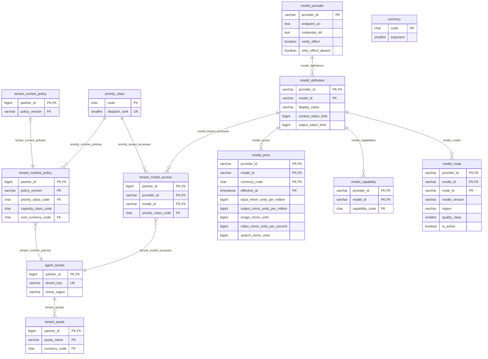

`tenant_runtime_policy`, `tenant_quota`, and `model_price` reference `currency`; those edges are omitted from the diagram to keep the layout readable. Policies are immutable by `(partner_id, policy_version)`, and `tenant_current_policy` changes only the active pointer.

## Agent, tool, and execution control plane

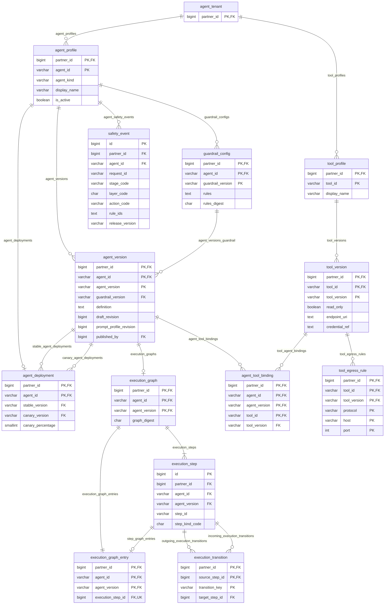

Agent, guardrail, and tool versions are immutable. A release's `guardrail_config` version is the digest of the rule set it froze, so releases with identical rules share one row. `safety_event` records one guardrail intervention — stage, layer, action, rule ids, and the release and policy versions — never the inspected content; `agent_id` is set when the inspected principal is an agent, which is how events are paged per agent. `agent_deployment` holds stable and canary pointers. The compiled graph is normalized into steps, one entry, and directed transitions so publication can validate references before runtime traffic arrives.

### Skills

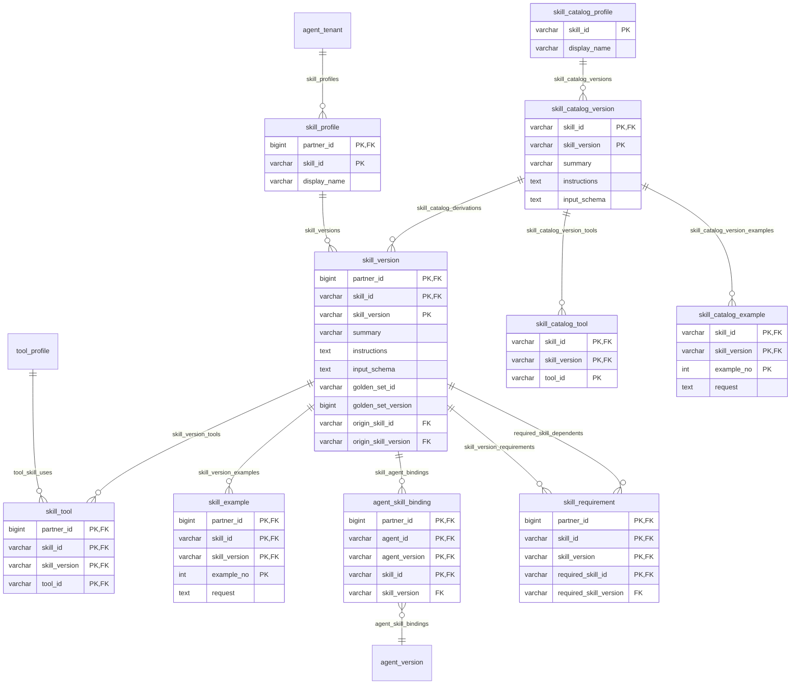

A skill version is immutable like a tool version. `skill_tool` names tools by id, not version: the agent release pins the versions, and publication refuses a release that binds a skill without binding every tool it lists and `use_skill`. `summary` is the one line the agent sees in the skill index; `instructions` reach the model only when it calls `use_skill`. `skill_example` rows seed the selection cases of the golden set the version names; Scout stores that reference and builds the cases, and leaves running the selection eval and gating the publish on it to the application.

`skill_requirement` names another tenant skill version the procedure relies on; both ends are real versions, and a release binding the skill must bind the required one at that version. Because a requirement must exist before the version naming it, the graph cannot cycle. The `skill_catalog_*` tables hold platform versions no tenant owns; a tenant copy names its origin through `origin_skill_id`/`origin_skill_version`, indexed so a withdrawal finds every copy. Catalog tool ids are plain values: tools are tenant-owned, and each copy names tools its tenant registered.

## Agent Studio authoring

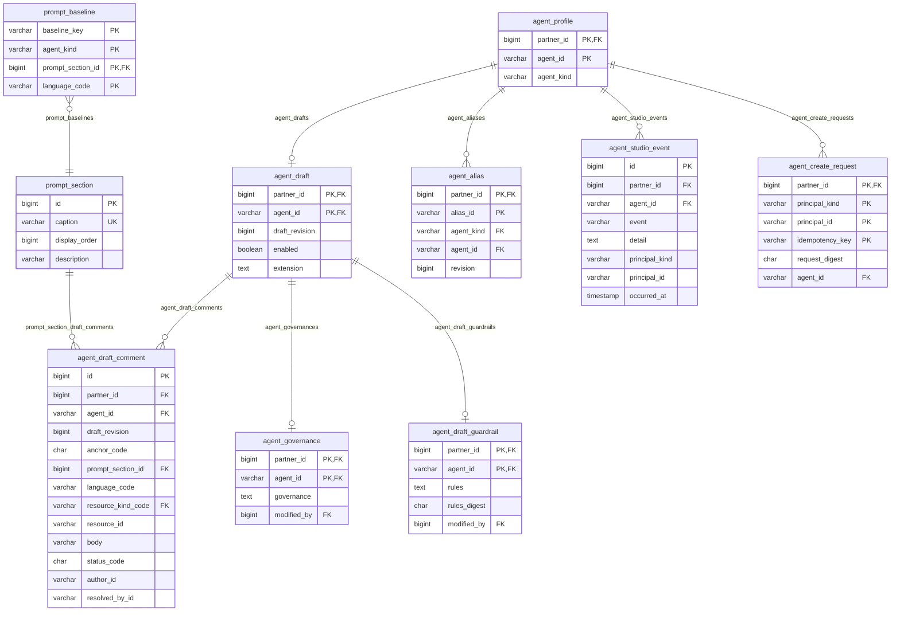

`agent_alias.revision` guards both alias changes and tenant defaults for that logical kind, preserving one shared optimistic token. Agent overrides are guarded by `agent_draft.draft_revision`. Platform baseline selection is supplied by `PromptBaselineSelector`; baseline data remains product-owned.

`agent_governance` and `agent_draft_guardrail` are optional draft sections behind the same `draft_revision`, and publication freezes both into the release. `agent_governance.governance` is one canonical Charter `AgentDefinition` fragment with the declared trigger channels, validated and frozen whole; fields an enterprise source owns are never stored. `agent_draft_guardrail.rules` are the agent's own guardrail rules; the release also pins them, merged with its type's, as its `guardrail_config` version. `agent_draft_comment` is a remark on one draft revision, anchored by `anchor_code` to the whole draft, a prompt section (optionally one language), or a setting (`resource_kind_code` and `resource_id`); it stays `O` (open) until someone resolves it. Its author and resolver, like the governance and guardrail editors in `modified_by`, are recorded for audit.

Publication freezes compiled languages and source provenance into `agent_version.definition`. Release metadata records the source revisions, change summary, publisher, publication time, and optional restored version without duplicating live draft rows. `agent_studio_event` keeps queryable lifecycle actions with the acting principal — a person's `user_account.id` or a service's id, so it has no foreign key — and their time. `agent_create_request` is a Studio create's idempotency record: the request digest and the agent it created, keyed by tenant, principal, and key. An archived agent has `agent_profile.state_code` `X` (archived): it admits no work, keeps its releases, and can return to `S` (suspended).

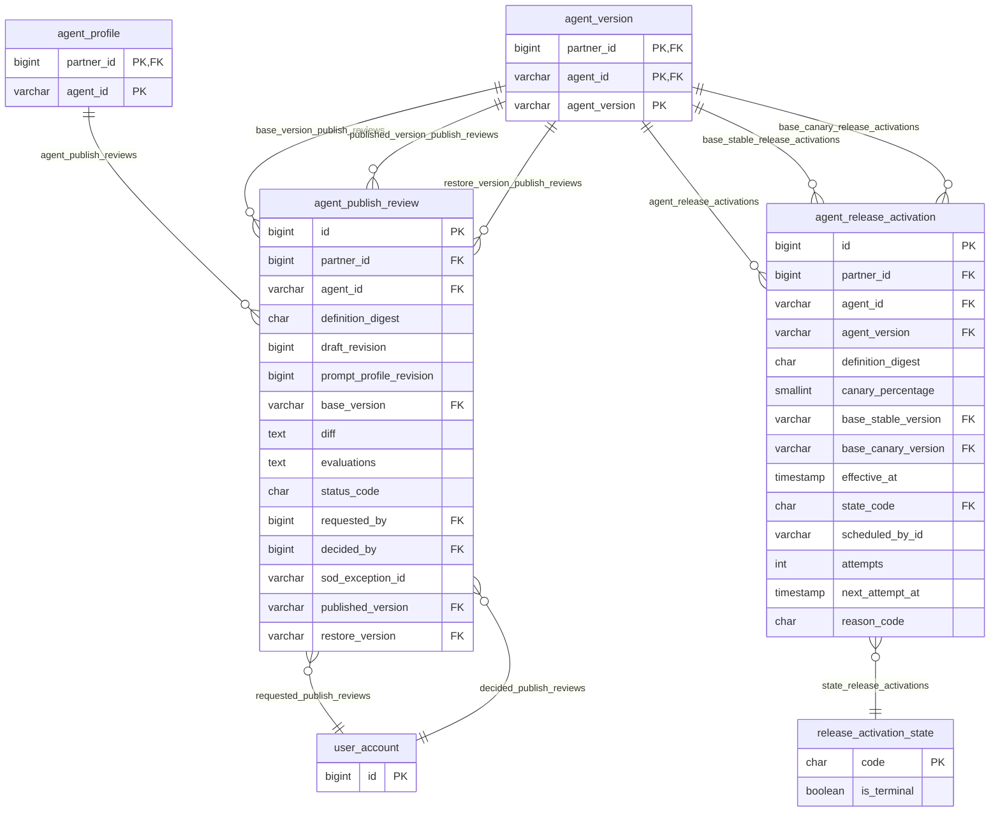

`agent_publish_review` asks a second person to approve publishing one exact draft, identified by `definition_digest`. It keeps the draft and prompt-profile revisions, the stable release the diff is taken against (`base_version`), the diff, and optional evaluation results. A new request supersedes one still `R` (requested), and the approver must not be the requester. When the agent's separation policy requires a review, publication needs the latest review approved for the same digest, refuses while any `agent_draft_comment` is open, and consumes the review by setting `published_version`; `sod_exception_id` is the separation-of-duties exception under which a requester may publish their own approved review.

A restore review is the same row with `restore_version` set: it approves restoring that published version over the release active when it was requested (`base_version`), recording the version's digest, its frozen revisions, and the diff from the active release. Publish and restore reviews are separate tracks, so a new request supersedes only an open review of its own kind. When the separation policy requires restore review, a restore needs the agent's latest restore review approved for exactly that version, digest, and base; open draft comments do not block it, and the restore consumes the review by setting `published_version`.

`agent_release_activation` is a published release scheduled to take the agent's traffic at `effective_at`. Publication writes the immutable release as usual and records the activation instead of moving `agent_deployment`; a partial unique index allows one `P` (pending) activation per agent. `ReleaseActivationWorker` claims due rows by the database clock and, in one transaction, rechecks the scheduler's publish authority, the definition digest, and the publish guards, then compare-and-swaps the deployment against `base_stable_version` and `base_canary_version`. `release_activation_state` (`P` pending, `A` activated, `R` refused, `X` cancelled) classifies the outcome and the keel constant `release_activation_reason` names why a refusal happened; a transient failure retries at `next_attempt_at` until its attempts run out.

### Templates and provenance

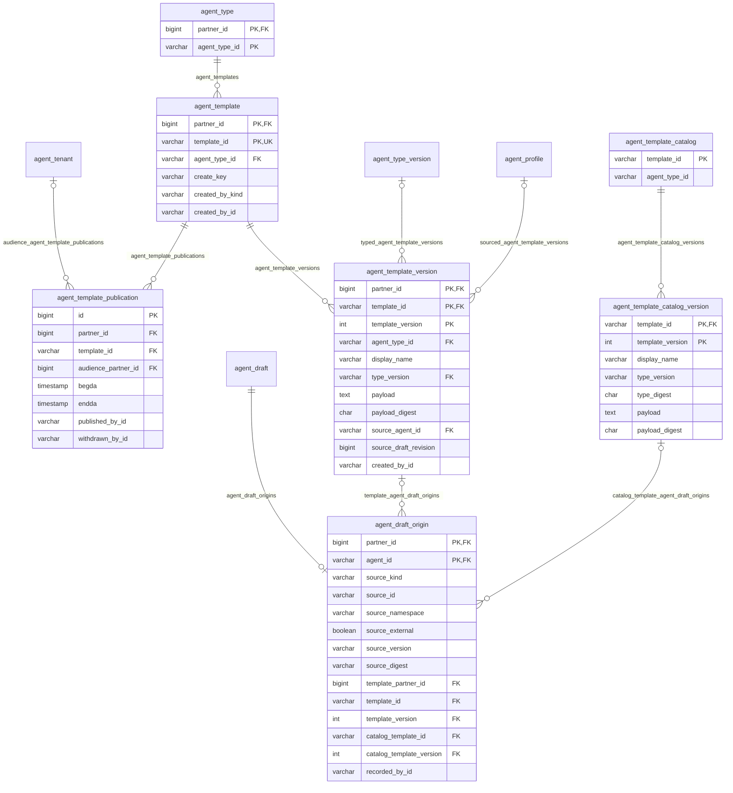

A template seeds new agents of one type. `agent_template` is a tenant's own template, private until published; its id is `tpl-` plus hex, unique across tenants, and `create_key` makes a save idempotent per actor. `agent_template_catalog` holds platform templates no tenant owns, whose ids never start with `tpl-`; because every tenant holds its own `agent_type` row, a catalog template names its type by value and each version carries the type version's digest. Versions of both are immutable and numbered from 1. `payload` is canonical JSON of agent-scope bindings and slot names: knowledge and entitlement values and approval route approvers are replaced by slots that a create maps to the new tenant's own, and a template carries no guardrails, models, or extension. `source_agent_id` and `source_draft_revision` name the agent a tenant version was saved from. `agent_template_publication` shares a tenant template, effective-dated by `begda` and `endda`, with one other tenant or, with a null `audience_partner_id`, with every tenant; partial unique indexes keep one open row per audience, and a withdrawal records who ended it.

`agent_draft_origin` records what an agent's draft derives from: an imported Charter `AgentDefinition` or a template version, named by source kind, id, namespace, version, and `sha256:` digest. A template origin also holds a real foreign key to exactly one of the tenant version or the catalog version; `template_partner_id` is the template's owner, which may be another tenant that shared it. Every freeze — publication and a draft evaluation subject — copies the origin into the release definition as `derived_from`, so provenance travels with `agent_version.definition` and with an exported definition.

## Principals, scopes, and effective configuration

### Permission

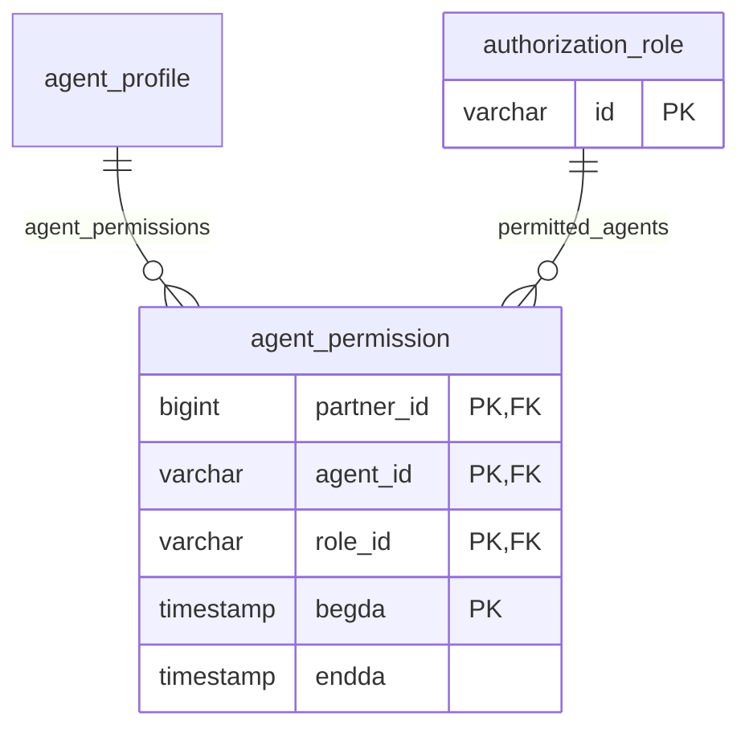

### Scope

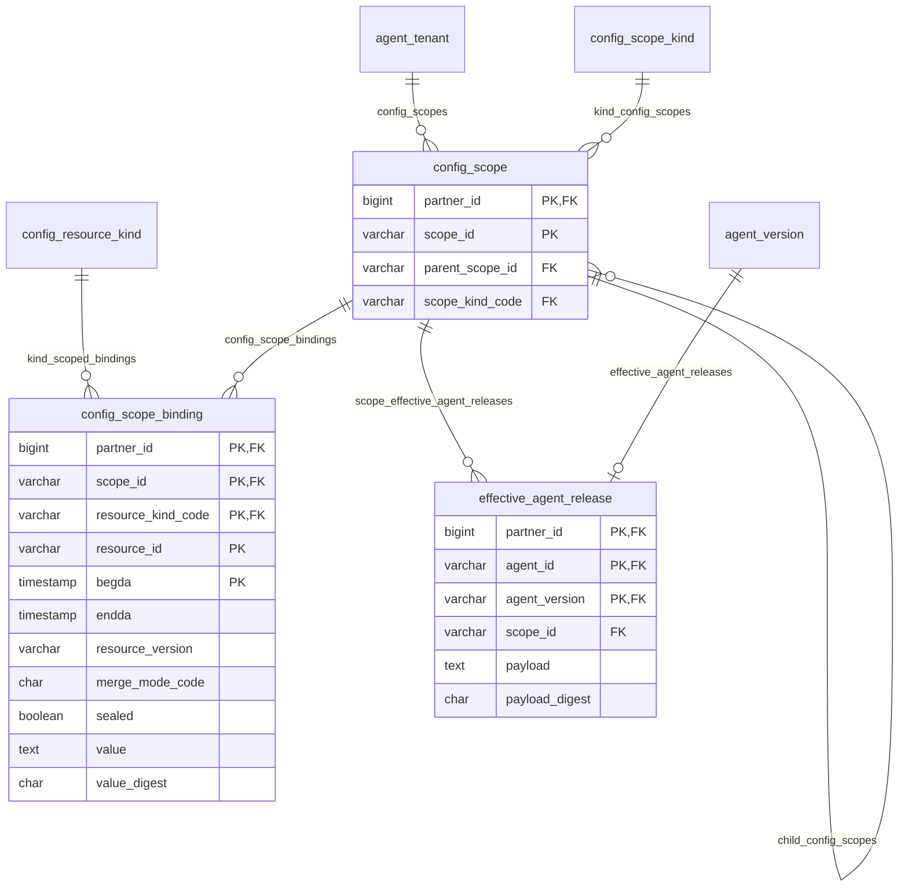

`configuration` is a per-tenant tree whose `scope_kind_code` Scout never interprets — the product names its
own levels and Scout seeds only the `tenant` root kind. One `config_scope_binding` table serves every
resource kind, so adding a level or a kind adds rows, not tables. `sealed` is set by the binding's
own scope, which is what makes a company clause genuinely non-overridable; a narrower scope that
tries fails with `domain.ErrSealed`.

`effective_agent_release` is the frozen result: `payload` carries every effective value with the
provenance of the binding that won and of each binding it superseded, so the runtime pins one row
instead of walking the chain per request, and an explain view never recompiles.

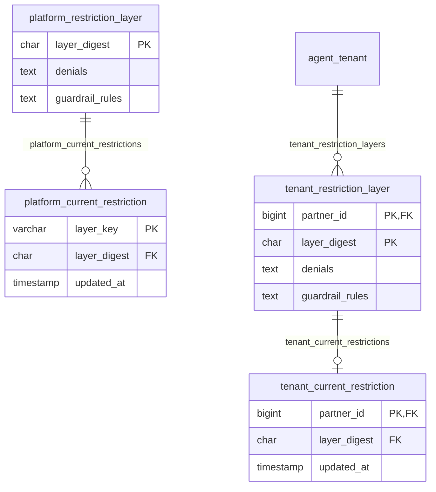

Restriction layers are the deliberate exception to freezing: standing denials and block or redact
guardrail rules that the platform or a tenant applies to every release at decision time. Versions
are immutable and keyed by digest; the current pointer moves by compare-and-swap, and
`platform_current_restriction` has exactly one row. See
[restriction layers](governance.md#restriction-layers).

`agent_permission` mirrors keel's `user_permission`, including `begda`/`endda`, so agents and humans
resolve through the same `authorization_role_permission` grants and the same `low_limit`/`high_limit`
bounds. Agents are deliberately not rows in `user_account`: that table carries interactive
credentials — password, lockout, 2FA, device session — that no machine identity should inherit.
[doc/authority.md](authority.md) records the full rationale and the compilation rules.

## Governed decisions, approvals, and credentials

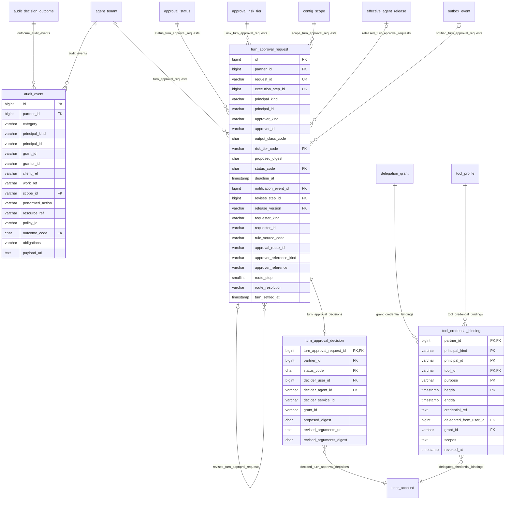

`turn_approval_request` is unique on `(partner_id, request_id, execution_step_id)`, so opening a request is
idempotent and a replayed turn re-attaches instead of asking a person the same question twice.
`proposed_digest` binds a verdict to the exact action: resolving matches on it, so approving a
changed action updates nothing. An `E` (edited) verdict stores only the archive reference and digest
of the revised tool-call arguments (`revised_arguments_uri`, `revised_arguments_digest`), never the
arguments; the turn resumes with the revised call, which is governed as a new proposal of the same
turn whose `revises_step_id` names the edited one. `turn_approval_decision` records the decider through three nullable
identity columns with an exactly-one check; human and agent identities keep real declared foreign
keys, while platform service decisions retain their stable service id.

A request records how it was routed. `rule_source_code` says why the call needs a person (`autonomy`,
`policy`, or `guardrail`), and `requester_kind`/`requester_id` name the person the turn acts for, who may
never approve it. An agent's request names in `release_version` the release whose frozen
`approval_routing` setting routed it, a real key to `effective_agent_release`. A routed request also
carries the route (`approval_route_id`), the role or position deciding at the current step
(`approver_reference_kind`, `approver_reference`), the escalation `route_step` (0 to 3) that verdicts and
reassignments are fenced on, and `route_resolution`, the product resolver's evidence reference; a check
keeps the route columns all null at step 0 or all set with a release version. Rule sources, approver
kinds, and output classes are keel constants seeded by the `approval` module and enforced by checks. `turn_settled_at` is set
on an expired request once its parked turn has been failed or found no longer parked, so a sweep retries
until it is.

`tool_credential_binding` maps one principal to a scoped identity for one tool and purpose. It holds a
`credential_ref` into keel's secret or OAuth-connection store — never secret material — so two agents
sharing a tool version never share an identity, and `revoked_at` stops work whose delegation ended.
Delegated bindings name the `delegation_grant` they exercise, so revoking or expiring that grant also
invalidates the credential binding.

`audit_event` is the governed decision itself: who acted, under whose authority, on what, under which
policy, with what outcome and obligations. The payload columns hold only a reference to redacted
evidence in object storage. `audit_decision_outcome` classifies every row, and the query side is
`contract.AuditQuery`, always bound to one tenant. [doc/governance.md](governance.md) has the rules.

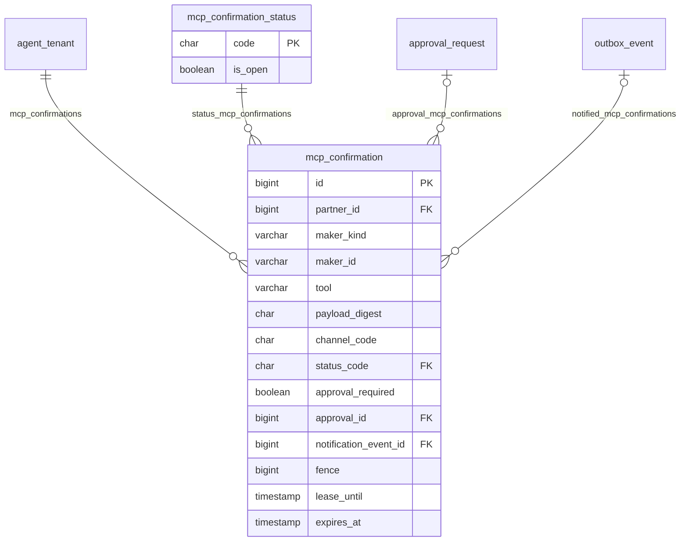

`mcp_confirmation` holds one MCP tool call until a person confirms it. A partial unique index on
`(partner_id, tool, payload_digest)` over the open statuses (`mcp_confirmation_status.is_open`) keeps
one open confirmation per action. Every transition is a conditional update on `status_code`, and a
run also on `fence`, so a stale executor changes nothing; `lease_until` is set exactly while
`R` (executing), from the store clock. `approval_id` names the keel `approval_request` that alone may
decide it; `approval_required` closes the setup window before that link exists. `notification_event_id`
names the keel outbox notice of an inbox confirmation. `client_ref`
has no foreign key because the authorization server that issued it may be external. Purging after
retention clears `payload`, `preview`, and `result` and keeps the digest and decision columns.

## Agent types, delegation, and work items

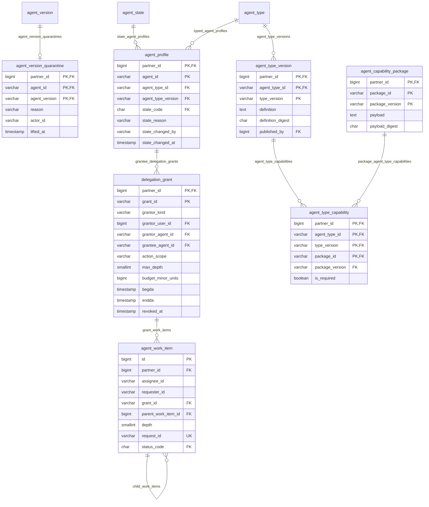

`agent_profile.agent_type_id` is a foreign key to `agent_type`; Go and the Studio wire format use
the matching `agent_type` name.

`state_code` carries the reason, actor, and time of the last change. `agent_version_quarantine`
withdraws one version from all traffic without editing the
deployment pointers that would otherwise select it.

`delegation_grant` records who may assign or approve what, for how deep, under what budget, and until
when. `agent_work_item` is unique on `(partner_id, request_id)` so a redelivered delegation re-attaches
rather than fanning out, and `parent_work_item_id` gives the chain that cycle detection walks.
[doc/organization.md](organization.md) has the rules.

## Knowledge

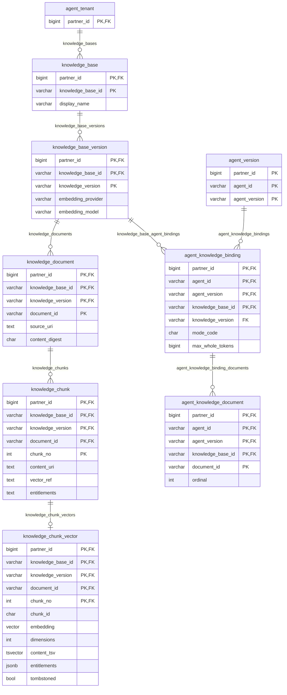

Relational rows prove tenant and version ownership. Document and chunk content remain external by URI and digest, while `vector_ref` points to the tenant-partitioned vector index. `agent_knowledge_binding.mode_code` selects how a bound version reaches a run: `R` (retrieval) searches it by similarity, `W` (whole) reads the documents `agent_knowledge_document` names — every document of the version when it names none — in full on every run, bounded by `max_whole_tokens`. The `knowledge` seed registers the code lists `knowledge_binding_mode` and `knowledge_source_op` as keel constants.

`knowledge_chunk` carries each chunk's source version, offsets, and entitlement labels, which is all a whole read needs. `knowledge_chunk_vector` is the optional PostgreSQL-resident index behind `knowledge.PgVectorIndex`: one row per chunk carrying its embedding, `tsvector`, and a copy of the chunk's entitlement labels — a deliberate denormalization, so entitlement predicates and nearest-neighbor ranking run inside one index scan instead of post-filtering a candidate set. Search joins `knowledge_document_manifest` and keeps only chunks whose knowledge version is still that document's active, untombstoned version, so a superseded generation stops being retrievable the moment the manifest pointer moves — before its rows are collected. It is the only Scout table using `VECTOR` and `TSVECTOR`; deployments on MySQL leave it out and inject a different `contract.KnowledgeVectorIndex`.

### Knowledge versioning and ingestion state

The `knowledge` group holds the state that keeps retrieval consistent while ingestion runs.

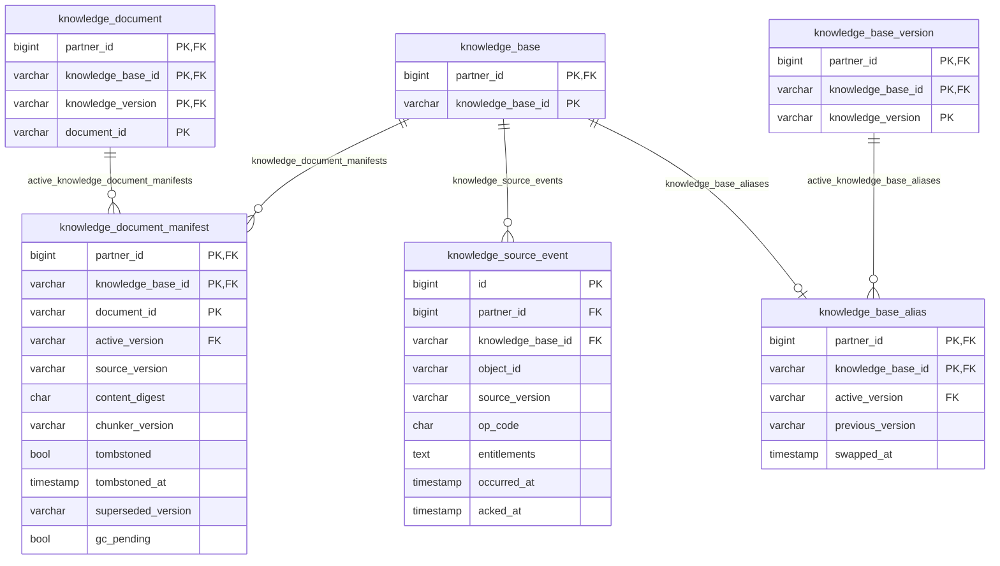

`knowledge_document_manifest` names the active version of each document plus its tombstone and garbage-collection flags. Retrieval reads it on every query, so a deleted document disappears at the tombstone and a rebuilt one stops serving its old generation at the pointer swap, both long before any chunk is reclaimed. `knowledge_base_alias` is the compare-and-set pointer that makes a rebuilt knowledge version visible atomically. `knowledge_source_event` is the CDC/outbox row a producer writes inside its own transaction, carrying tenant, object, source version, operation (`op_code` `U` upsert or `D` delete), and authorization attributes so ingestion can poll upstream changes and reconciliation can measure freshness lag from the oldest unacknowledged row.

## Conversation runtime and metering

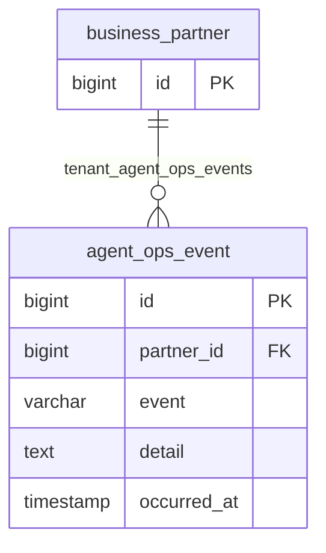

### Agent Ops Events per partner

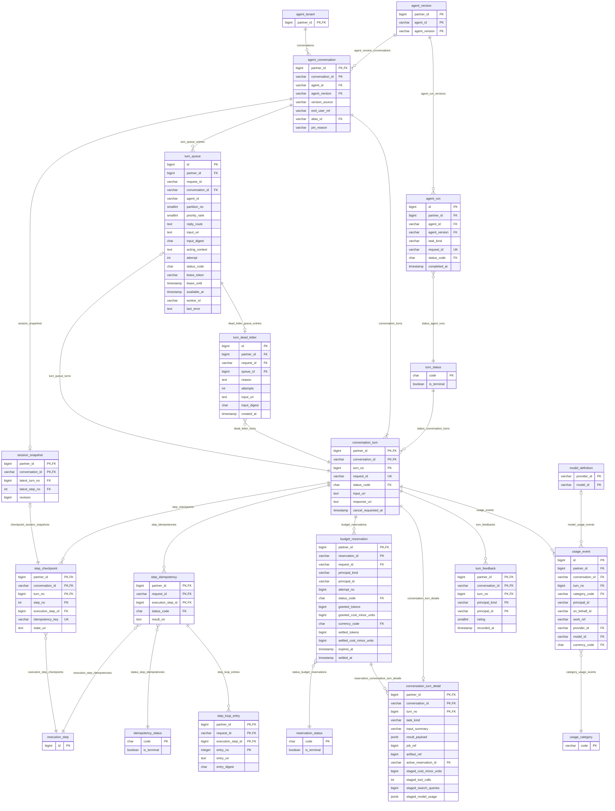

`agent_conversation` pins the release a conversation runs on and records why: `version_source` names the rule (`stable`, `canary`, `experiment_cohort`, `pilot`, a pin, or `request_pin` with its `pin_reason`), null when the product supplied the version, and `alias_id` is the agent type it was requested through. `usage_event` attributes settled usage to the spending principal, the person it acted for (`on_behalf_kind`, `on_behalf_id`), and the product's opaque `work_ref`; `audit_event.work_ref` carries the same reference.

Settlement writes one `usage_event` per model that performed part of the turn, plus one unattributed row for usage no model performed. Partial unique indexes keep those rows distinct. Until settlement, `conversation_turn_detail` stages the total tool calls and search queries and keeps the per-model breakdown as transient JSON. The `(partner_id, queued_at)` index on `conversation_turn` serves the trailing-minute turn count of the `limits` setting.

`turn_feedback` holds one person's rating, 1 to 5, of one completed turn; the person is kept for audit, and reports count ratings per release, never per person.

`step_checkpoint`, `budget_reservation`, and `usage_event` reference `currency`; those edges are omitted from the diagram to keep the layout readable. `agent_ops_event` deliberately references the Keel business partner directly because provisioning failures can occur before `agent_tenant` exists. The durable checkpoint precedes cache refresh and queue acknowledgement, and `step_idempotency` makes at-least-once delivery replay-safe. `step_loop_entry` is the append-only journal of an `L` (tool loop) step: each model decision and tool observation is one numbered entry whose body lives in object storage, so a redelivered or resumed loop replays it instead of repeating a decision or an effect.

Create `conversation_turn` before calling `BudgetLedger.Reserve`; the ledger enforces this order and the foreign key preserves it. `budget_reservation` is an attempt lease. A nonterminal turn may replace an expired attempt after fencing it; live attempts replay idempotently. Settlement records actual usage even above the grant, so overruns remain in the tenant window. `BudgetLedger` owns reserve, settle, release, and bounded expiry. Each hold is charged to the turn's agent in `principal_kind` and `principal_id`; a release budget — per turn, rolling window, or calendar day or month, with a frozen currency exponent — is enforced against the agent's settled and live holds in the current period, measured by the database clock, which the `budget_reservation_principal_ix` index on principal, status, and `settled_at` serves.

`turn_queue` is the durable, shuffle-sharded turn queue: the partition is derived from tenant and conversation so a conversation's turns stay ordered, `request_id` is unique per tenant so redelivery deduplicates, and `lease_token` with `lease_until` fences a worker's claim against a reclaimer. `acting_context` carries who the turn acts as — principal, authority chain, delegation bounds, work item — as references and bounds, never a credential. An acknowledged delivery is requeued only while its turn is live again, which is how a resumed turn returns to a worker. `conversation_turn.cancel_requested_at` is the durable cancellation request a worker polls. `turn_dead_letter` retains terminally failed turns with their reason and attempt count for investigation or replay.

## Platform release safety and audit

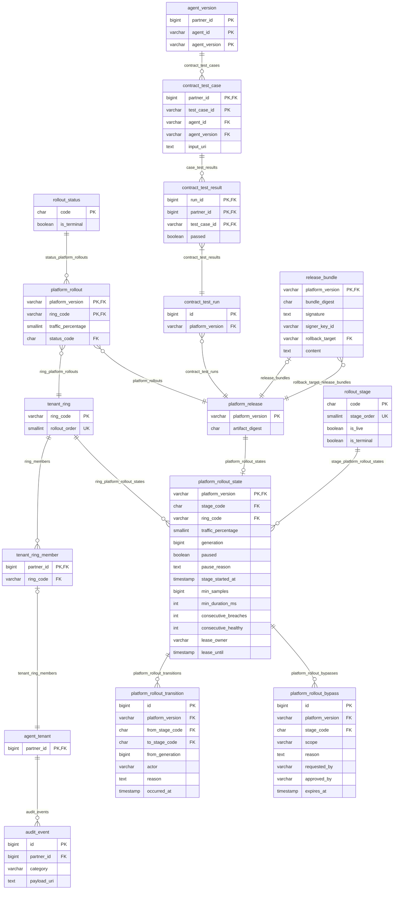

Agent canaries in `agent_deployment` remain independent from platform rings in `platform_rollout`. Compatibility results, rollout health, and redacted audit events provide the evidence required to advance or restore a release.

### Version pins and per-conversation release identity

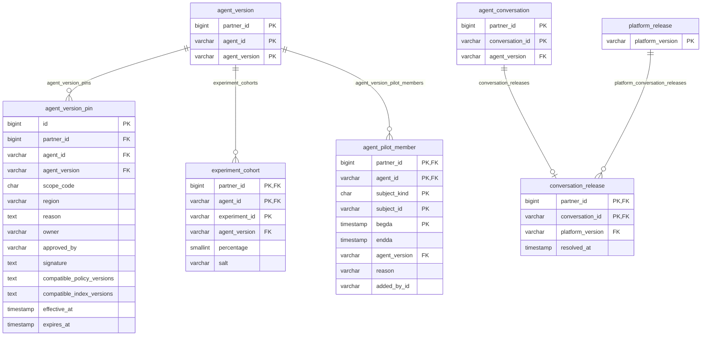

A conversation carries two independent identities: `agent_conversation.agent_version` for the tenant's agent and `conversation_release.platform_version` for the platform release it was created on. Both are resolved once at session creation and read, never re-resolved, on later turns, so a rollback of either control changes new assignments only.

### Rollout state, pins, and release identity

`platform_release` remains the deployable artifact identity and `platform_rollout` the per-ring traffic row. `platform_rollout_state` adds the controller's own state: current stage, traffic share, stage minimums, pause reason, a monotonic `generation` every transition compare-and-swaps against, and the row lease (`lease_owner`, `lease_until`) that stops two controllers from advancing the same release. `platform_rollout_transition` is the audited history of those moves and `platform_rollout_bypass` records scoped, approved, expiring exceptions.

`release_bundle` records what a platform release certifies — model and provider version, tokenizer, runtime, decoding defaults, prompt, embedding and reranker with index generation, tools, safety policy, migration set, residency policy, provenance, compatibility constraints, and rollback target — under a digest and signature. Nothing routes on the bundle; it exists so "roll back to the previous release" names exactly what it restores.

Agent-version and platform-release identity stay separate. `agent_version_pin` holds compliance (`C`) and tenant (`T`) pins with effective and expiry dates, owner, approval, and the policy and index versions each pin is compatible with; `experiment_cohort` holds the stable-hash cohort assignment. `agent_pilot_member` serves one release to a listed person (`subject_kind` `P`, a `user_account` id) or a product position (`O`, an opaque reference), apart from hash cohorts; it is effective-dated with who added it and why, and a partial unique index keeps one open membership per subject and agent. Resolution precedence is compliance pin, tenant pin, pilot, experiment cohort, then the canary/stable split; a person's own membership wins over a position's, and a release still named by a membership in force is retained by garbage collection. A conversation persists both identities: `agent_conversation.agent_version` for the agent and `conversation_release.platform_version` for the release it was created on, so a rollback changes new assignments only and live conversations drain on what they started with.

### Quality evaluation

The `evaluation` group holds the evidence a rollout gate consumes.

```mermaid
erDiagram
    knowledge_base ||--o{ golden_query : knowledge_base_golden_queries
    agent_profile ||--o| agent_golden_set : agent_golden_sets
    agent_profile |o--o{ golden_set : agent_owned_golden_sets
    agent_tenant ||--o{ golden_set : golden_sets
    golden_set ||--o{ golden_set_version : golden_set_versions
    golden_set ||--o{ golden_case : golden_cases
    approval_risk_tier ||--o{ golden_case : risk_tier_golden_cases
    golden_set ||--o{ agent_golden_set : golden_set_agents
    golden_set_version ||--o{ golden_example : golden_examples
    golden_set_version |o--o{ evaluation_run : golden_set_version_evaluation_runs
    golden_set_version ||--o{ golden_query : golden_queries
    golden_set_version ||--o{ evaluation_manifest : evaluation_manifests
    evaluation_run ||--o{ evaluation_run_subject : evaluation_run_subjects
    golden_example ||--o{ evaluation_result : example_evaluation_results
    evaluation_run ||--o{ evaluation_result : evaluation_results
    agent_version |o--o{ evaluation_run_subject : release_evaluation_run_subjects
    agent_version ||--o{ evaluation_manifest : candidate_evaluation_manifests
    agent_version ||--o{ evaluation_manifest : baseline_evaluation_manifests
    evaluation_manifest |o--o{ evaluation_run : evaluation_runs
    evaluation_manifest ||--o{ gate_decision : gate_decisions
    gate_decision }o--|| platform_release : platform_gate_decisions
    agent_tenant ||--o{ evaluation_sample : evaluation_samples
    evaluation_sample }o--|| agent_version : agent_evaluation_samples
    agent_version ||--o{ human_review_item : agent_version_human_review_items
    conversation_turn ||--o| human_review_item : turn_human_review_items
    golden_set |o--o{ human_review_item : promoted_set_human_review_items
    human_review_item |o--o{ golden_case : review_item_golden_cases
    golden_set_version ||--o{ evaluation_baseline : golden_set_version_baselines
    evaluation_baseline ||--o{ evaluation_baseline_output : evaluation_baseline_outputs
    golden_example ||--o{ evaluation_baseline_output : example_baseline_outputs
    evaluation_baseline |o--o{ evaluation_run_subject : baseline_evaluation_run_subjects
    model_definition |o--o{ evaluation_run_subject : model_evaluation_run_subjects
    evaluation_run ||--o{ evaluation_comparison : evaluation_comparisons
    golden_example ||--o{ evaluation_comparison : example_evaluation_comparisons
    agent_profile ||--o{ agent_gate_decision : agent_gate_decisions
    agent_version |o--o{ agent_gate_decision : base_version_gate_decisions
    golden_set_version |o--o{ agent_gate_decision : golden_set_version_gate_decisions
    agent_gate_decision ||--o{ agent_gate_decision_run : agent_gate_decision_runs
    evaluation_run ||--o{ agent_gate_decision_run : evaluation_run_gate_decisions

    agent_tenant {
        bigint partner_id PK,FK
    }
    agent_profile {
        bigint partner_id PK
        varchar agent_id PK
    }
    agent_version {
        bigint partner_id PK
        varchar agent_id PK
        varchar agent_version PK
    }
    knowledge_base {
        bigint partner_id PK,FK
        varchar knowledge_base_id PK
    }
    platform_release {
        varchar platform_version PK
    }
    conversation_turn {
        bigint partner_id PK
        varchar conversation_id PK
        bigint turn_no PK
    }
    model_definition {
        varchar provider_id PK
        varchar model_id PK
    }
    golden_set {
        bigint partner_id PK,FK
        varchar golden_set_id PK
        varchar name
        bigint working_revision
        varchar owner_agent_id FK
    }
    golden_case {
        bigint partner_id PK,FK
        varchar golden_set_id PK,FK
        varchar case_id PK
        varchar scope_code
        text input_text
        text expected_behavior
        varchar rubric_ref
        varchar risk_tier_code FK
        bigint review_item_id FK
    }
    agent_golden_set {
        bigint partner_id PK,FK
        varchar agent_id PK,FK
        varchar golden_set_id FK
    }
    golden_set_version {
        bigint partner_id PK,FK
        varchar golden_set_id PK,FK
        bigint set_version PK
        char dataset_revision
        int example_count
        timestamp frozen_at
    }
    golden_example {
        bigint partner_id PK,FK
        varchar golden_set_id PK,FK
        bigint set_version PK,FK
        varchar example_id PK
        varchar scope_code
        varchar provenance
        varchar consent_class
        varchar retention_class
        varchar approval_risk_tier
        varchar domain_code
        varchar language_code
        text payload_uri
        char payload_digest
    }
    golden_query {
        bigint partner_id PK,FK
        varchar golden_set_id PK,FK
        bigint set_version PK,FK
        varchar query_id PK
        varchar scope_code
        varchar knowledge_base_id FK
        text query_text
        varchar principal
        text entitlements
        text expected_document_ids
        boolean expect_abstention
    }
    evaluation_manifest {
        char manifest_id PK
        bigint partner_id FK
        varchar agent_id FK
        varchar candidate_agent_version FK
        varchar baseline_agent_version FK
        varchar golden_set_id FK
        bigint golden_set_version FK
        char dataset_revision
        varchar safety_policy_version
        text manifest_json
    }
    evaluation_run {
        bigint id PK
        bigint partner_id FK
        char manifest_id FK
        varchar agent_id FK
        varchar golden_set_id FK
        bigint set_version FK
        varchar scope_code
        char status_code
        bigint lease_token
        timestamp lease_until
        int attempt
        bigint sample_count
        bigint cost_minor_units
        char currency_code FK
    }
    evaluation_run_subject {
        bigint run_id PK,FK
        char role_code PK
        bigint partner_id FK
        char subject_code
        varchar agent_id FK
        varchar agent_version FK
        char definition_digest
        text definition_json
        text settings_json
        bigint baseline_id FK
        varchar provider_id FK
        varchar model_id FK
    }
    evaluation_result {
        bigint run_id PK,FK
        varchar example_id PK,FK
        char role_code PK
        text scores
        int latency_ms
        bigint cost_minor_units
        bigint evaluator_input_tokens
        bigint evaluator_output_tokens
        bigint evaluator_cost_minor_units
        char currency_code FK
        boolean needs_human_review
        varchar output_uri
        char output_digest
    }
    gate_decision {
        char decision_id PK
        bigint partner_id FK
        char manifest_id FK
        varchar platform_version FK
        char verdict_code
        int confidence_bp
        text decision_json
        text signature_hex
        varchar signer_key_id
        timestamp expires_at
        timestamp telemetry_fresh_at
    }
    human_review_item {
        bigint id PK
        bigint partner_id FK
        varchar agent_id FK
        varchar agent_version FK
        char source_code
        varchar risk_tier
        varchar conversation_id FK
        bigint turn_no FK
        char status_code
        smallint score
        char verdict_code
        text expected_behavior
        varchar reviewer_kind
        varchar reviewer_id
        varchar promoted_set_id FK
        varchar promoted_case_id
    }
    evaluation_baseline {
        bigint id PK
        bigint partner_id FK
        varchar golden_set_id FK
        bigint set_version FK
        varchar name
        varchar scope_code
        int example_count
        char content_digest
        varchar recorded_by_kind
        varchar recorded_by_id
    }
    evaluation_baseline_output {
        bigint baseline_id PK,FK
        varchar example_id PK,FK
        bigint partner_id FK
        varchar golden_set_id FK
        bigint set_version FK
        varchar output_uri
        char output_digest
    }
    evaluation_comparison {
        bigint run_id PK,FK
        varchar example_id PK,FK
        bigint partner_id FK
        varchar golden_set_id FK
        bigint set_version FK
        char verdict_code
        numeric confidence
        varchar evaluator_kind
        varchar evaluator_version
        char input_digest
        bigint evaluator_cost_minor_units
        char currency_code FK
        varchar reason
    }
    agent_gate_decision {
        bigint partner_id PK,FK
        varchar agent_id PK,FK
        char definition_digest PK
        char verdict_code
        varchar reason
        char policy_digest
        text policy_json
        char inputs_digest
        varchar base_version FK
        varchar golden_set_id FK
        bigint set_version FK
        varchar decided_by_kind
        varchar decided_by_id
    }
    agent_gate_decision_run {
        bigint partner_id PK,FK
        varchar agent_id PK,FK
        char definition_digest PK,FK
        bigint run_id PK,FK
        char role_code PK
        int score_bp
        int sample_count
        int critical_count
    }
    evaluation_sample {
        bigint partner_id PK,FK
        varchar sample_id PK
        varchar request_id
        varchar agent_id FK
        varchar agent_version FK
        int risk_bp
        int uncertainty_bp
        boolean redacted
        text payload_uri
        char payload_digest
        varchar retention_class
        timestamp expires_at
    }
```
 `evaluation_manifest` is content-addressed over the candidate and baseline component versions, dataset revision, evaluator versions, and safety policy. `golden_set`, `golden_set_version`, `golden_example`, and `golden_query` carry versioned truth with provenance, consent and retention class, risk tier, and slices, and a scope column that keeps hidden gate examples out of the dev scope. `evaluation_run` and `evaluation_result` store per-example outcomes with minor-unit cost, `gate_decision` stores the signed, expiring platform verdict, and `evaluation_sample` the policy-bounded production samples whose payloads are sealed in object storage.

Studio authors an agent's cases in `golden_case`, the editable working copy of a golden set; `golden_set.working_revision` guards every edit and freeze, and a freeze snapshots the cases into the next immutable `golden_set_version` and its `golden_example` rows. `agent_golden_set` names the one set an agent uses, and `golden_set.owner_agent_id` the agent whose editors may share a Studio-made set; a null owner marks a set the product owns. An `evaluation_run` either executes an `evaluation_manifest` or is a queued agent evaluation of one golden set version (`agent_id`, `golden_set_id`, `set_version`), claimed and leased by the evaluation worker through `lease_token`, `lease_until`, and `attempt`. `evaluation_run_subject` pins what each arm of an agent evaluation executes: a draft frozen as publication would freeze it (`definition_json`, with its frozen settings in `settings_json`, so the draft runs under its own `limits`) or a release (`agent_version`, whose settings its `effective_agent_release` row holds), both by `definition_digest`. `evaluation_result` keeps a model judge's spend (`evaluator_input_tokens`, `evaluator_output_tokens`, `evaluator_cost_minor_units`, in the row's `currency_code`) apart from the subject's own; the run's totals and cost ceiling include both.

A comparison is an `evaluation_run` with two `evaluation_run_subject` rows: role `B` (baseline) is arm a and `C` (candidate) arm b. Either arm may be a draft (`subject_code` `D`), which `provider_id` and `model_id` may pin to another text model, or a release (`R`); arm a may instead be an `evaluation_baseline` (`B`), which then carries no `definition_digest`. Each arm's answer to an example is an `evaluation_result` whose stored output `output_uri` and `output_digest` name, and `evaluation_comparison` holds the pairwise verdict per example (`verdict_code` `A` for arm a, `B` for arm b, or `T` for a tie, or a `reason` when judging failed) with the judge's spend. `evaluation_baseline` is an immutable, named set of human reference outputs for every example of one golden set version visible in its scope, each an `evaluation_baseline_output` in object storage; `content_digest` covers the example ids and output digests.

`agent_gate_decision` is the Studio evaluation gate's verdict on one definition digest of an agent: `P` (pass), `F` (fail), or `O` (override), the canonical gate applied (`policy_json`, `policy_digest`), the active release regression is measured against (`base_version`), and the golden set version decided on. `inputs_digest` lets an evaluation of unchanged inputs replay the decision, and a later decision for the digest replaces it. `agent_gate_decision_run` lists the completed runs it read, role `C` (candidate) for the decided digest and `B` (baseline) for the active release, with each run's score in basis points, sample count, and critical failures.

`human_review_item` is the production review queue: one row per completed turn (`conversation_id`, `turn_no`), sampled (`S`) or rated low (`F`, feedback), keyed to the release that answered. Rows hold references only; turn content stays in object storage, and who rated a turn stays in `turn_feedback`. A reviewer grades (`score` 1 to 5, `verdict_code` `P` (pass) or `F` (fail), `notes`, `expected_behavior`) or dismisses a pending item; `status_code` moves from `P` (pending) to `G` (graded) or `D` (dismissed), and a graded item may be promoted (`M`) into a dev `golden_case`, which names it through `review_item_id`. The `evaluation` seed registers the code lists `gate_decision_verdict`, `gate_decision_run_role`, `review_source`, `review_status`, `review_verdict`, `evaluation_comparison_verdict`, `evaluation_run_status`, `evaluation_role`, `evaluation_subject`, `golden_scope`, and `rollout_health_verdict` as keel constants.

## Scout table inventory

Tables are grouped by the schema module that owns them. A downstream generates only the modules its product uses; see the profile table in the [engineering reference](engineering-reference.md#generate-dialect-specific-ddl).

| Module | Tables |
|---|---|
| `catalog` | `currency`, `priority_class`, `turn_status`, `idempotency_status`, `reservation_status`, `rollout_status`, `usage_category`, `config_scope_kind`, `config_resource_kind`, `audit_decision_outcome`, `approval_status`, `approval_risk_tier`, `agent_state`, `mcp_confirmation_status`, `release_activation_state` |
| `tenancy` | `agent_tenant`, `tenant_runtime_policy`, `tenant_current_policy`, `tenant_quota` |
| `prompt` | `prompt_section`, `prompt_baseline` |
| `model` | `model_provider`, `model_definition`, `model_capability`, `model_route`, `model_price`, `tenant_model_access` |
| `agent` | `agent_type`, `agent_type_version`, `agent_capability_package`, `agent_type_capability`, `agent_profile`, `guardrail_config`, `safety_event`, `agent_draft`, `agent_governance`, `agent_draft_guardrail`, `agent_alias`, `agent_studio_event`, `agent_create_request`, `agent_template_catalog`, `agent_template_catalog_version`, `agent_template`, `agent_template_version`, `agent_template_publication`, `agent_draft_origin`, `agent_version`, `agent_deployment`, `agent_release_activation`, `agent_version_quarantine`, `agent_publish_review`, `agent_draft_comment` |
| `tool` | `tool_profile`, `tool_version`, `tool_egress_rule`, `agent_tool_binding`, `tool_credential_binding` |
| `execution_graph` | `execution_graph`, `execution_step`, `execution_graph_entry`, `execution_transition` |
| `knowledge` | `knowledge_base`, `knowledge_base_version`, `knowledge_document`, `knowledge_chunk`, `agent_knowledge_binding`, `agent_knowledge_document`, `knowledge_document_manifest`, `knowledge_base_alias`, `knowledge_source_event` |
| `knowledge_vector` | `knowledge_chunk_vector` |
| `runtime` | `agent_conversation`, `conversation_turn`, `conversation_turn_detail`, `step_checkpoint`, `session_snapshot`, `step_idempotency`, `step_loop_entry`, `turn_queue`, `turn_dead_letter`, `budget_reservation`, `usage_event`, `turn_feedback`, `agent_run`, `agent_ops_event`, `agent_work_item` |
| `release` | `rollout_stage`, `platform_release`, `release_bundle`, `tenant_ring`, `tenant_ring_member`, `contract_test_case`, `contract_test_run`, `contract_test_result`, `platform_rollout`, `platform_rollout_state`, `platform_rollout_transition`, `platform_rollout_bypass`, `agent_version_pin`, `experiment_cohort`, `agent_pilot_member`, `conversation_release` |
| `evaluation` | `golden_set`, `human_review_item`, `golden_set_version`, `golden_case`, `agent_golden_set`, `golden_example`, `golden_query`, `evaluation_baseline`, `evaluation_baseline_output`, `evaluation_manifest`, `evaluation_run`, `evaluation_run_subject`, `evaluation_result`, `gate_decision`, `evaluation_sample`, `agent_gate_decision`, `agent_gate_decision_run`, `evaluation_comparison` |
| `agent_authorization` | `agent_permission`, `delegation_grant` |
| `configuration` | `config_scope`, `config_scope_binding`, `effective_agent_release`, `audit_event`, `platform_restriction_layer`, `platform_current_restriction`, `tenant_restriction_layer`, `tenant_current_restriction` |
| `approval` | `turn_approval_request`, `turn_approval_decision` |
| `mcp_confirmation` | `mcp_confirmation` |
| `skill` | `skill_catalog_profile`, `skill_catalog_version`, `skill_catalog_tool`, `skill_catalog_example`, `skill_profile`, `skill_version`, `skill_tool`, `skill_example`, `skill_requirement`, `agent_skill_binding` |

Every catalog table above is a foreign-key target, so the tables referencing them
cannot accept a row until they hold values — Scout seeds them all. `prompt_section`
is seeded the same way: ids 1-9 are the platform sections (`task`, `tone_of_voice`,
`brand_guidelines`, `target_audience`, `language_style`, `location`,
`sensitive_topics`, `prohibited_content`, `escalation_policy`) and ids up to 100
are reserved, so `prompt_section_seq` starts at 101. Those ids are referenced by
`prompt_baseline` data and by the resource ids of `prompt_section` bindings
(`<section id>/<language>`) — never renumber them.
