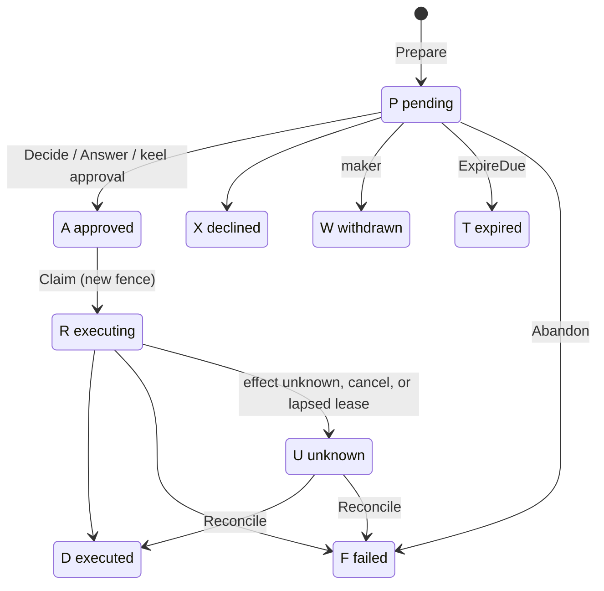

# Policy, approvals, credentials, and evidence

Where [doc/authority.md](authority.md) establishes *who* is acting and *what* their
configuration is, this covers what happens at the boundary: whether the action is allowed, what
conditions ride along, who has to say yes, which identity the call uses, and what is written down.

## Decision point

`policy.SetEvaluator` implements `contract.PolicyDecisionPoint` over the policy statements frozen
into the principal's effective release, read by `policy.ReleaseResolver`. Using the release rather
than the scope's current bindings means a decision uses the policy the work was published with.

Three rules make the default safe:

- **Deny wins**, regardless of statement order.
- **No match is a deny.** An unbound resource is refused, never allowed by omission.
- **An evaluator failure is a deny**, and it returns an auditable reason rather than an error alone.

Patterns match exactly or with a single trailing `*`. Nothing richer, so a pattern cannot widen in a
way its author did not intend.

Statements bind at any scope through `config_scope_binding` with `config_resource_kind = policy`, and the
`policy` narrowing rule enforces the asymmetry that matters: **a child may drop an allow or add a
deny, never add an allow.**

## Restriction layers

A prohibition that must reach every running agent cannot wait for each release to be republished.
The platform layer and each tenant's layer hold standing denials and guardrail rules, read at
decision time on top of the pinned release:

- **They only restrict.** A layer holds deny statements, each naming actions and resources and no
  obligations, and guardrail rules that block or redact. Anything else is `ErrValidation`.
- **They are immutable and digest-addressed.** `policy.TableRestrictionLayers` stores each version
  under its canonical digest and moves the current pointer by compare-and-swap; the expected digest
  is empty before the first write. Writing the value already in force succeeds unchanged; a stale
  expectation is `ErrConflict` with the current digest. The store clock stamps every change.
- **A service principal writes the platform layer.** A tenant's layer also takes a person of that
  tenant, whom the calling service has authorized; no agent writes either. Every change is an audit
  record (`restriction` category) naming the writer, written in the swap's transaction: a change that
  cannot be audited does not commit.
- **An unreadable layer denies.** A layer that cannot be read, or whose content no longer matches
  its digest, fails the guardrail inspection and the policy decision. A layer never written is empty.

`policy.RestrictedResolver` wraps the release resolver: it appends both layers' denials, and the
decision's policy version digests the release and both layers. `guardrail.EnforcerConfig.Restrictions`
runs the layers' rules between the baseline and the release, attributed to layer `P` (platform) or
`T` (tenant) in safety events. Reads are cached in each process for `DefaultRestrictionTTL`, which bounds how
long a new prohibition takes to arrive.

`policy.StudioRestrictions` is Studio's view. `AGENT_RESTRICTION` `VIEW` shows both layers;
`REPLACE_TENANT` replaces the tenant's layer whole behind its digest, bounded to `MaxEntries` denials
and guardrail rules; nothing in Studio writes the platform layer. For one agent it also lists which
effective `tool` and `policy` settings each restriction overrides: a denial matching `tool:invoke` and
a tool, a denial that can meet a policy allow, or a blocking `tool_allowlist` that leaves a tool out.
Overrides are computed from the settings the next publish would freeze, and a denial with conditions
is marked `conditional`.

## Obligations

An allow may carry obligations — `require_approval`, `redact`, `cap_spend`, `record_evidence`,
`notify`. `GovernedGateway` applies them before egress, and an obligation with no registered
enforcer is a hard failure (`domain.ErrDegraded`). Silently skipping one would turn a conditional
allow into an unconditional one, which is the whole point of the mechanism.

With `GovernedGateway.Approvals` composed, `require_approval` is an approval ask rather than an
enforcer: its params are absent, `{}`, or exactly `{"risk_tier":"low|medium|high|critical"}`
(default `high`, the highest of several winning), and composing an enforcer for it as well is
refused as ambiguous.

## Operating modes

The `autonomy` setting frozen into a release decides what the agent may act on, and
`GovernedGateway` enforces it on every tool call after policy, never as prompt text:
`human_only` calls nothing; `advise` and `draft` call only tools whose version is declared
`read_only`; `execute_with_approval` calls read-only tools and asks a person, through the
`ToolApprovalGate` under rule `autonomy`, for every other call; `bounded_autonomous` acts within
policy. A release with no mode is `human_only`. For Charter work, `charter.Participation` maps the
modes to `observes`, `recommends`, `prepares`, `performs`, and `executes`, and `Admission` refuses a
task needing more than the agent's mode reaches.

## Durable approvals

An irreversible action does not fail for lack of a human — it waits.

`approval.Gate` implements `contract.ToolApprovalGate` over durable requests; an optional
`contract.ApproverRouter` names each request's approver, and a request it cannot route is refused.
Each ask is a `domain.ApprovalAsk{Source, RuleID, RiskTier}` from one of three sources: the
operating mode (`autonomy`, high), a policy `require_approval` obligation (`policy`, its tier), or an
`irreversible_tool_approval` guardrail rule (`guardrail`, high, asked by the enforcer after the
other two). `GovernedGateway` puts the policy and mode asks to the gate riskiest first and stops at
the first not approved: pending suspends the turn, a refusal is `ErrForbidden`. The first call opens
a `turn_approval_request` and returns pending; later calls return whatever verdict was recorded.
Open is idempotent on `(tenant, request, execution_step)`, so a replayed turn re-attaches instead of
asking the same person twice.

One tool call owes at most eight requests, chained from its step key; a ninth is `ErrConflict`. An ask reuses the request
opened for the same ask (same rule and source, no higher tier), and a request not approved holds
every later ask. An approval decides a different ask only at an equal or higher tier and under the
same route (for asks no route names, the same approver; without a router, the tier alone), so an
approval is never reused for a stricter ask or another route's authority: the next request opens,
routed and notified on its own.

With `TableStore.NotifyThroughOutbox`, opening a request also queues the approver's notice as a keel
`outbox_event` (`turn_approval_request` / `approval.requested`) in the same transaction and records it in
`turn_approval_request.notification_event_id`, so a request never exists without its notice and the
event's `dispatched_at` proves delivery. Only the call that creates the request queues one; a request
routed by scope has no recipient and none. A keel outbox worker's `Dispatcher` delivers the notice;
leave `Gate.Notifier` unset, or the approver is told twice. A reassignment by escalation queues the
new approver's notice the same way; without the outbox, `Sweeper.Notifier` tells them, and a sweep
refuses to run with both.

`ProposalDigest` binds a verdict to the exact call — tenant, request, tool, version, and arguments.
The digest is also a `WHERE` predicate in the resolve statement, so approving a changed action
updates nothing rather than resolving the wrong proposal.

The turn lifecycle includes `U` (suspended):

| Step | What happens |
| --- | --- |
| Pending approval | `guardrail.ErrApprovalPending` wraps `domain.ErrApprovalPending`, not `ErrForbidden` |
| `TurnRuntime.suspend` | Records the suspension, publishes a final frame, acks the delivery |
| Budget | The reservation stays **held** — settling would resume with no budget, releasing would let a tenant park work to dodge its ceiling |
| Verdict | `approval.Resumer` records it; `A` (approved) and `E` (edited) return the turn to `Q` (queued) and requeue its delivery, `X` (rejected) fails it |
| Replay | The worker resumes from the last checkpoint through `StepIdempotencyStore`; committed steps do not re-execute |

Resolving without requeueing would leave the turn parked forever, so `Resumer` owns all three
steps rather than leaving the last one to a caller. It is the decider's whole desk: `Pending` lists
only what the decider may decide now, `Resolve` takes `A` (approved), `X` (rejected), or `E` (edited), and a
single-use decision link from keel's `actiontoken` lets a person approve or reject from email or
chat. A link is bound to one person, request, verdict, and proposal digest, is refused above
`LinkMaxRisk`, and authorizes its person again when redeemed.

An edit substitutes the tool call. It carries revised arguments — one JSON object within
`MaxRevisedArgumentBytes` (64 KiB by default) — and is accepted only for a pending or escalated tool
proposal at its current digest. `Resumer.Archive` keeps the arguments in the evidence archive; the
verdict row holds only their reference and digest, and the decision record holds neither. The original
never runs: `Gate` denies it with `domain.ErrProposalRevised`. On resume the tool loop journals the
substitution before running it, so replay is deterministic, and the revised call opens its own request
linked by `revises_step_id` and passes the whole governed gateway again — schema, policy and
obligations, autonomy, guardrails, egress, and credentials. The editor's verdict also approves the
revision only when `Gate.Authorizer` lets the editor decide it; otherwise it waits for its own
approver. One call may be revised at most eight times.

## Approval routing

Who decides is authored, frozen, and checked like any other setting. `approval_routing` (narrowing
rule `routing`, at agent or type scope) is an ordered list of routes:

```json
{"routes":[{"id":"pay","match":{"tools":["pay.*"],"sources":["policy","autonomy"],"min_risk_tier":"high"},
  "approver":{"kind":"position","ref":"controller"},"deadline_seconds":3600,
  "escalation":[{"approver":{"kind":"role","ref":"cfo-office"},"extension_seconds":600},{"extension_seconds":1800}],
  "on_exhausted":"expire"}]}
```

- **Match.** The first route whose match covers the ask serves it; an empty field matches anything.
  `tools` holds up to 16 exact ids or prefixes with one trailing `*`, `sources` any of the three
  sources, and `min_risk_tier` a floor. A route an earlier route fully covers is refused as unreachable.
- **Approver.** A `role` or `position` reference, opaque to Scout; the product resolves it.
- **Deadline and escalation.** `deadline_seconds` and each step's `extension_seconds` run from 60
  seconds to 30 days, a whole route at most 90 days, over at most three steps. A step naming an
  approver hands the request on; one without extends the current approver's deadline.
  `on_exhausted` is `expire` (the default) or `hold`.
- **Bounds.** At most 32 routes per binding and 64 per agent.

A child scope overlays its parent: parent routes keep their places, replaced in place by a child
route of the same id, and the child's own routes follow; merge mode `I` (intersect) is refused. The child may only
tighten: each parent route keeps its id, order, match, approvers, and step count, deadlines and
extensions may only shrink, and `hold` may become `expire`, never the reverse.

`approval.ReleaseRouter`, composed as `Gate.Router` and `Sweeper.Policy`, reads the routing frozen
into the asking agent's release, picks the first matching route, and asks the product's
`contract.ApproverResolver` for the reference's holders, at most 20, most preferred first. The first
eligible holder decides: a person with a user account id, neither the asking agent nor the
requester, holding their own `DECIDE` grant for the request. With nobody eligible it tries the later
steps, and with nobody at any step opens the request **vacant**, which nobody can decide until a
sweep fills it. A resolver or authorizer failure fails the call; it is never read as absence. A
release that binds no routing goes to the optional `Fallback` router or is refused, and a request
opened without a route escalates through the optional `Unrouted` policy, such as `BackupEscalation`,
or expires.

The request records the authority it was routed under: release version, requester, rule source,
route id, role or position, step, and the resolver's evidence (sanitized, at most 256 bytes, never
shown in the inbox). A verdict is fenced on the step and approver it was authorized against, so a
reassignment in between refuses a stale one with `ErrConflict`, and a vacant request refuses every
verdict, decision links included.

`approval.Sweeper` moves requests on, and `ReleaseRouter.Escalate` follows the route each was
opened under:

- a vacancy not yet overdue is filled under its current deadline once someone is eligible;
- an overdue request goes to the next step with an eligible holder, with that step's extension,
  excluding the current approver where the step names a new role or position and preferring them
  where it only extends;
- with nobody eligible it moves vacant to the next step; once every step is spent it holds (open,
  no deadline, still fillable) or expires;
- a route missing from the release expires the request.

No outcome approves, and a backup needs its own grant — escalation moves *who decides*, never *what
may be decided*. Expiry commits the verdict, then fails the parked turn and marks the request
settled (`turn_settled_at`); a later sweep retries any expired request whose turn is not settled.
Each move is audited as `S` (escalated), `held`, or `T` (expired), naming the route, reference, and step.
`TableStore.Reassign` refuses a plain backup step on a routed request, so a product with unrouted
requests composes its `BackupEscalation` as `ReleaseRouter.Unrouted`.

`controlplane.StudioApprovalRouting` is the publish guard. On publish, restore, and scheduled
activation it counts every ask the frozen release can make — the mode's ask for each tool not
declared read-only, each policy tier per tool, and the `irreversible_tool_approval` rules of the
baseline, the restriction layers, and the release that reach the agent's tools — and refuses with a
field error on `approval_routing` an ask no route serves, an unreachable route, or a role or
position the resolver's `Check` does not know. A release that can ask with no resolver composed is
`ErrNotReady`, and an unreadable restriction layer fails closed; a release that asks nothing needs
no routing. With `Fallback` set, mirroring a runtime `ReleaseRouter.Fallback`, a release that binds
no routing passes, as the fallback routes its asks. Compose it with the runtime router's resolver and the enforcer's `Baseline` and
`Restrictions`. Its Studio view, `approval-routing`, lists the effective routes with the scope
declaring each, every ask with the route serving it, and what publication would refuse.

## Two-person publish and restore

`contract.PublishSeparation` decides, per tenant, agent, and kind (`publish` or `restore`), whether
the act is separated from authoring: `service/charter.PublishSeparation` while a Charter
`SodConstraint` in force in the tenant's namespace constrains both the author capability and the
`Publish` or `Restore` capability at `agent:<id>`, or `controlplane.BasePublishSeparation` for every
or the listed tenants without Charter, extended to restores by `Restores`. While the Charter
`Restore` capability is unset no restore is separated and the corpus is not read for one. A
constraint or `SodException` of one kind never separates or excuses the other.

`controlplane.StudioPublishReviews` is the maker-checker. A person holding `EDIT` requests a review of
the exact release the draft would freeze: its definition digest, a diff against the active release,
and optional results from a `contract.PublishReviewEvaluator`. A newer request supersedes an open
publish review.
The review's authors are the requester, the last editor (`bound_by`) of every resource the release
adds or changes, and every person who changed the agent's draft since its last publish; a person holding `APPROVE_PUBLISH` who is none of them approves or rejects it, and
only while the draft still has the reviewed digest.

Composed as a publish guard and a release writer, it admits a publish under separation only when the
agent's latest review is approved, unconsumed, and of the candidate's digest, its approver and
publisher are not authors, and no draft comment is open. The one relief is the requester publishing
under the `sod_exception_id` named on the request — a Charter `SodException`, checked through
`Excuse` at request and again at publish, so revoking it takes effect; `BasePublishSeparation` admits
none. The writer re-reads the review under a row lock in the publish transaction and consumes it, so
a review publishes one version, and a newer request or a rejection withdraws an earlier approval.
Each step is an `agent_studio_event`; `PUBLISH_REVIEWED` names the exception only when the publish
relied on it.

A restore review is a separate track in the same table, marked by `restore_version`. A person
holding `RESTORE` requests one for a published version (`restore_version` on the request): it
records that version's definition digest and a diff from the active release, which becomes its
`base_version`, and supersedes only open restore reviews. Its only author is the requester. A
non-author holding `APPROVE_PUBLISH` approves it while the version keeps the reviewed digest and no
other release has become active. Where restores are separated, `Restore` admits only the agent's
latest restore review when it is approved, unconsumed, of exactly that version and digest, and
based on the release active now; the restorer is not the requester unless the requester named a
`sod_exception_id` that `Excuse` still accepts. Open draft comments do not block a restore. The
restore transaction claims the review under a row lock, checks it again, and consumes it with the
new version (`RESTORE_REVIEWED`). Scheduled activations were admitted at publish and are not
reviewed again. Where restores are separated, `release.StudioTraffic` keeps traffic moves to the
stable release and the current canary, as [rollout](rollout.md#version-pin-precedence) describes.

`controlplane.StudioDraftComments` holds the discussion: a comment sits on a draft revision, anchored
to the draft, a prompt section (optionally one language), or a setting. Commenting and resolving need
`EDIT` or `APPROVE_PUBLISH`.

## Evaluation gate

The `evaluation_gate` setting holds an agent's publication to what its stored evaluations show
([decisions and scoring](evaluation.md#evaluation-gate)). It narrows like any scoped setting — a child
scope may only tighten it ([scope hierarchy](authority.md#scope-hierarchy)) — and it governs whether a
release may publish, not how it runs, so no release freezes it and it is no part of a settings digest.

`controlplane.StudioEvaluationGate` is the guard. Composed in `StudioService.Guards`, it checks a
publish or restore before the release transaction (`CheckPublish`) and again inside it after the
draft lock (`CheckRelease`, the `EvaluationGateGuard` extension), reading the digest's decision and the
locked deployment through the transaction, so a decision or release that changes in between cannot
slip through. A publish is refused with `domain.EvaluationGateRefusal` (`ErrConflict`, HTTP 409) coded
`missing` when the candidate digest has no decision, `failed` when it failed, and `stale` when it was
made under another policy, active release, or — for a pass — golden set version. A scheduled
activation was admitted when it was scheduled and is not checked again. Publish and restore refuse an
agent bound to a gate when no `EvaluationGateGuard` is composed (`ErrNotReady`, 503), so a bound gate
is never silently ignored.

A restore admits a version whose digest the gate once passed or a person overrode, however stale that
decision is now. Any other restore, including a version published before its gate existed, needs
`OVERRIDE_GATE`; the restore transaction then records a `GATE_RESTORE_OVERRIDE` Studio event and a
`restore_over_evaluation_gate` decision through the gate's `Audit` sink.

Weakening the gate is itself gated. A settings save, or an import over an existing draft, that
removes the gate in force at the changed scope or admits anything it refused — another metric, a
lower score or sample count, a higher or unset regression bound, fewer required scopes — needs
`OVERRIDE_GATE` and `StudioService.Audit`, and records a `GATE_LOOSEN` Studio event and a
`loosen_evaluation_gate` decision carrying the value before and after. Tightening needs neither.

An override is evidence, not a shortcut. A person holding `OVERRIDE_GATE` names the current draft's
digest and a reason of 1 to 400 characters; the gate refuses it when a current pass already admits
the digest, and refuses every override without an `Audit` sink. It is stored as the digest's
`O` (override) decision with a `GATE_OVERRIDE` Studio event and an `override_evaluation_gate` publication
decision naming the policy digest, active release, and golden set version. Every gate decision record
is written before its transaction commits under a key derived from its inputs, so a retried commit
replays rather than duplicates it.

## Confirmed MCP tool calls

An MCP client can call a tool that must not act until a person confirms it. That call is not a turn,
so `service/confirmation` holds it instead of the turn approval module:



- **The stored action is what runs.** `Prepare` keeps the exact payload under an action digest; the
  executor never runs re-sent arguments. One action has one open confirmation, and it belongs to its
  maker and client: anyone else preparing it gets `ErrConflict`, and an elicitation answer must name
  the maker's own confirmation for the same tool and digest.
- **The product decides who may act.** `contract.MCPConfirmationChecker` checks a direct decider,
  then re-checks both maker and recorded decider before the run. Its error refuses.
- **Maker-checker is keel's.** Set `ApprovalRequired` at preparation so direct decisions fail closed
  while the keel request is opened. `AttachApproval` links it, and `DecideApprovalTx`, called from
  `approval.Service.OnDecided`, decides both records in keel's transaction.
- **Exactly once, or unknown.** A run holds a store-clock lease under a fence that only it may
  complete. A runner error wrapping `domain.ErrEffectUnknown`, a success whose result cannot be
  stored, a cancellation, or a lost claim is `U` (unknown), never success and never retried; a person records the verified outcome with `Reconcile`.
- **Client-safe reasons.** The stored and returned reason is generic or the product's `Reason`; the
  cause goes to `Executor.OnFailure`.
- **The store is a seam.** The executor drives `contract.MCPConfirmationStore`. `TableStore` and the
  in-memory `confirmationtest.Store` pass the same `confirmationtest.RunStoreSuite`.

## Credentials

`ToolCredentialProvider` is keyed on the principal, not the tenant:

```go
Credential(ctx, principal, toolID, action, purpose) ([]byte, domain.AuthorityRef, error)
```

`tool_credential_binding` maps `(tenant, principal, tool, purpose)` to a reference into keel's secret or
OAuth-connection store — never secret material, so a binding is safe in logs, definitions, and audit
payloads. `BoundCredentialProvider` resolves it just in time, after policy, guardrails, egress, and
admission have all passed.

Two agents on the same tool version therefore resolve **different** identities. The returned
`AuthorityRef` names whose authority was exercised, including the human behind a delegated OAuth
connection; the gateway records it and never the secret. `TableCredentialBindings.Revoked` reports
bindings whose delegation ended so bound work can be stopped rather than continuing orphaned.

## Evidence

`domain.DecisionRecord` carries principal, authority chain,
the client application the principal acted through (such as an OAuth client), scope, action,
resource, release, policy id and version, outcome, obligations, reason, and a reference to redacted
evidence in object storage.

`observability.TableAuditSink` is both sides: `Record` writes, `RecordTx` writes inside a caller's
transaction so a state change commits only with its record, `Decisions` reads. Evidence with no
way to read it answers nothing, which is why `AuditQuery` ships with the sink rather than later.
A query reads exactly one tenant, or — with `TenantID` zero — only the platform-wide records that
name no tenant, such as a rollout transition. Reading across tenants is not expressible in
`domain.DecisionQuery`, and a platform-wide record may not name a tenant scope.

Evidence is deliberately not telemetry. Metrics are sampled and lossy; a decision record is not, and
never derives from one.

Records are emitted at turn admission, model routing, every governed tool invocation, guardrail
hits, credential resolution, approval verdicts, rollout transitions, version resolution, and turn
terminal states.

A decision is recorded once. `domain.WithDecisionScope` marks the replay-stable position a decision
is made at — the turn, the step, the loop iteration, the tool call by its idempotency key — and
`domain.DecisionKeyFor` derives `audit_event.decision_key` from that scope and the record's
category, action, and resource; the nth identical decision in one scope gets the nth key. The sink
keeps the first record of a key, so a redelivered turn re-makes a decision without writing it twice.
A decision made outside any scope has no key and stays append-only.

A turn's chain is gap-free: it opens with `turn_admitted`, written before dispatch, and closes with
exactly one of `turn_completed`, `turn_failed`, or `turn_cancelled`. An audit write that fails fails
the delivery rather than passing silently, and the terminal replay offers the terminal record again,
which the key makes a no-op unless the first write was lost. `observability.VerifyTurnChain` asserts
all of this over one request's records.

Studio's `runs/trace` shows one run's audit decisions in order with its model steps, tool calls,
guardrail hits, and approvals, and, when `charter.RunActions` is composed, the disposition Charter
recorded for each governed action of the run's execution context, without reasons, inputs, or
subjects; see [run traces](observability.md#run-traces).

## Attribution

`usage_event` records `principal_kind`, `principal_id`, and `scope_id`, and `RecordUsage` takes a
`domain.UsageAttribution`. Cost is reportable per agent and organizational scope.

`isolation.ReleaseLimits` reads the budget, autonomy, and execution limits frozen into the release.
Compilation already narrowed all three against every parent scope, so nothing here re-derives
inheritance: it reads one row. Outside its operating window a `bounded_autonomous` agent degrades to
`execute_with_approval` rather than stopping, so out-of-hours work is queued for a human instead of
lost.

## Release budgets

The `budget` binding names the period its ceilings reset over:

```json
{"tokens":0,"cost_minor_units":50000,"currency":"EUR","exponent":2,"period":"day","timezone":"Europe/Berlin"}
```

- `period` is `turn`, `rolling` with `window_seconds` (60 seconds to 366 days), or `day` or `month`
  with an IANA `timezone` (`Local` is refused). A field the period does not take is refused.
- `tokens` and `cost_minor_units` run from 0 to 10^18, 0 leaving that axis unlimited, and a value
  caps at least one. A cost ceiling carries its `currency` and that currency's `exponent`, frozen
  with it and matched against the `currency` catalog when saved and again at publish, restore, and
  activation, which also refuse a cost budget over a selected model that is unpriced or priced in
  another currency.
- A child narrows a bounded parent only over the same period, window, and timezone and, when both
  cap cost, the same currency and exponent; it may only lower ceilings.

`isolation.BudgetLedger` (with `Releases` set to the data plane's `PrincipalLimits`) charges every
hold to the turn's conversation agent at the release its conversation pinned, inside the tenant's
rolling envelope:

- **Per turn.** The turn's token and cost caps narrow to the budget, each step receives what is left
  (`StepInput.Spend`), and the tool loop narrows its ceilings by it and requires a pricer. A
  governed turn's hold is clamped to the ceiling; any other hold above it is `ErrBudgetExceeded`.
- **Rolling, day, and month.** The current period `[start, end)` comes from the database clock; a
  day starts at local midnight and a month on its first day, correct across DST and other offset
  changes. Under the tenant advisory lock, the agent's usage settled in the period plus its live
  holds, counting cost only in the budget currency, must leave room for the hold on every bounded
  axis; a spent axis admits nothing. A hold larger than the whole ceiling is `ErrBudgetExceeded`;
  one that does not fit beside earlier use is a keel `LimitError` (scope `agent_budget`) whose
  `Retry-After` is the end of a `day` or `month` period, and absent for `rolling`. A hold quoting
  no cost against a period cost ceiling is refused, so the turn estimator must quote cost.
- **Unenforceable fails closed.** A budget the ledger cannot count — no window, no or an unknown
  currency, a changed exponent, a ceiling in another currency than the turn's, no cost quote — is a
  `domain.BudgetUnenforceableError` naming the problem, which is `ErrDegraded`.
- **Admission is for new holds.** A live hold for the same request is returned as it stands, so
  cancellation and `TurnRuntime.Abandon` can always release it.

## What is not here yet

Tracked in [TODO.md](../TODO.md): the OPA/cedar-go adapter behind the decision point (A3),
SPIFFE and RFC 8693 credential adapters (K4), and the OpenTelemetry GenAI mapping (V4).
