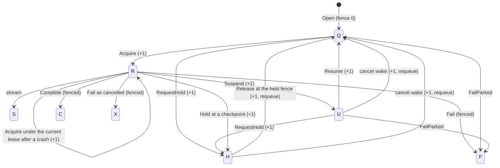

# Persistence design: durable turns, checkpoints, and step idempotency

Reference implementations live in `service/dataplane/`: `ObjectStateStore` (`state_codec.go`),
`DurableSessionStore` (`durable_session_store.go`), `StepIdempotencyStore`
(`step_idempotency_store.go`), the turn fence (`turn_fence.go`, `turn_runtime_records.go`, `table_turn_control.go`),
and the cache discipline in `SessionCoordinator` (`session_coordinator.go`).

## DTO ↔ table identity

| DTO | Table | Notes |
|---|---|---|
| `domain.ExecutionStep.ExecutionStepID` | `execution_step.id` | Compiled surrogate id; the only step identity persistence keys on. `StepID` is the logical name and is derived on load via `execution_step.step_id`. |
| `domain.StepCheckpoint` | `step_checkpoint` | `(partner_id, conversation_id, turn_no, step_no)`; `IdempotencyKey`, `Fingerprint` (64-hex), `Usage` (currency required) map 1:1. `State` is dehydrated to `state_uri`/`state_digest` (`StateRef`). No checkpoint id or request id column exists; neither is stored. |
| `domain.SessionSnapshot` | `session_snapshot` + `agent_conversation.agent_version` + latest checkpoint's `execution_step.step_id` | `Revision` = `session_snapshot.revision`; `State` is hydrated from `state_uri`/`state_digest`, digest verified before return. A conversation with no checkpoint loads at revision 0 with empty state. |
| `domain.TurnResult.Response` | `conversation_turn.response_uri`/`response_digest` | Written by `Complete` on the owner's turn, which must be the conversation's oldest non-terminal turn and `R` (running) or `S` (streaming) at the owner's fence. |
| `domain.StepResult` (JSON) | `step_idempotency.result_uri`/`result_digest` | Keyed by `(partner_id, request_id, execution_step_id)`. |
| `domain.ObjectRef{URI, Digest}` | any `*_uri`/`*_digest` pair | URI `<scheme>://<bucket>/<key>`, digest lowercase SHA-256 hex. |

The repository never invents a fingerprint, currency, or digest: `Checkpoint` rejects a checkpoint that lacks them
(`domain.ErrValidation`).

## Object keys and orphan cleanup

`ObjectStateStore` writes `<KeyPrefix>/<name>/<sha256>` where `<name>` is deterministic:
`checkpoint/<tenant>/<conversation>/<turn>/<step>`, `turn/<tenant>/<conversation>/<turn>/response`,
`step/<tenant>/<request>/<execution_step_id>`, `loop/<tenant>/<request>/<execution_step_id>/<entry_no>`. Identical retries overwrite the same object; different content
from a concurrent writer never collides, so a loser can never corrupt the winner's referenced bytes.

Object upload always precedes the row write. On row failure the store deletes its upload only after confirming
the durable row does not reference that digest (`scout_session_checkpoint_digest`, `scout_session_response_digest`,
`scout_step_find`); a concurrent identical replay may legitimately share the object. Delete failures are joined
onto the original error, never swallowed. What remains unreferenced (delete failed, crash between upload and row
write) is reclaimed by a reconciliation sweeper that lists the prefix and drops objects no row references —
the same worker that expires reservations. Reads always fail closed: a missing or tampered object
is `ErrDigestMismatch`/download error, never empty state.

## Transaction boundaries

- `Checkpoint`: upload → **one tx** { guarded touch of the owner's turn, which must be the checkpoint's turn;
  insert `step_checkpoint`; `revision = expected → expected+1` CAS on `session_snapshot` (expected 0 inserts
  revision 1 with `ON CONFLICT DO NOTHING`) } → commit. Zero touch rows is `domain.ErrFenceLost`; zero CAS rows is
  `domain.ErrRevisionConflict` and rolls the checkpoint insert back.
- `Complete`: read the executing turn and current revision (autocommit) → the executing turn must be the owner's,
  else `ErrFenceLost` → conflict early if the revision moved → upload response → single guarded
  `UPDATE conversation_turn` (request and fence = the owner's AND status `R`/`S` AND snapshot revision = expected).
  Zero rows is `ErrFenceLost` when the fence or status moved, else `ErrRevisionConflict`. Revision is not bumped by
  `Complete`. Budget settlement and the `usage_event` insert are `TurnLedger`'s terminal transaction; a runtime
  that composes both runs `Complete` inside that same terminal transaction or immediately before it, never after
  the final frame. `TurnRuntime` instead runs `CommitTurn`, `RecordUsage`, and `Complete` as three fenced
  transactions before the final frame; a fence move between settlement and completion is an open window
  ([turn takeover](turn_takeover.md) §1.5, G3).
- `StepIdempotencyStore`: every transition is one fenced statement, the owner's guarded touch plus a single-row
  CAS on `status_code` (autocommit); `updated_at` is written from the injected clock so lease arithmetic never
  mixes worker and database time.

## Order of durability for one step / turn

0. `TurnRecordStore.Acquire` takes the turn with the delivery's queue claim and moves its fence; every write
   below presents that owner.
1. `StepIdempotencyStore.Begin` claims the step (or replays the committed result — no side effect re-runs).
2. Execute; `Commit` uploads the JSON result, then CAS `C` (claimed) → `M` (committed).
3. `SessionCoordinator.Checkpoint` (durable checkpoint + snapshot CAS, then cache invalidation).
4. Guardrail-approved *intermediate* frames publish (sequence-deduplicated by the reply hub, so replay republishes the same sequences).
5. Terminal result + settlement persist (`CommitTurn`, `RecordUsage`, `Complete`, or the `TurnLedger` terminal tx; one `usage_event`).
6. Final frame publishes. It is never client-visible before step 5 exists; a crash between 5 and 6 replays the frame from the durable result.
7. Queue ack. Nothing is acked from cache state. A delivery refused with `ErrFenceLost` or `ErrTurnHeld` is acked,
   or dropped when its lease is already gone; it is never retried or dead-lettered.

## Turn fence

`conversation_turn.fence` is the epoch of the turn's owner. Every transition that changes who may write the turn
increments it in SQL, and every runtime write presents the `domain.TurnOwner{TenantID, RequestID, Fence}` its
acquisition or last transition returned. Once the fence moved on, the write is refused with `domain.ErrFenceLost`.
A missing or forged owner fails closed the same way in table, memory, and fake stores; the memory stores check
owners against `MemoryTurnFences`, and `dataplanetest.RunFenceSuite` is the conformance suite.



`S` (streaming) takes every transition `R` does.

- **Acquire.** `TurnRecordStore.Acquire(claim)` moves a `Q` turn, or an `R`/`S` turn redelivered after a crash, to
  `R` with the fence incremented, in one statement whose `EXISTS` checks that the claim's queue id, lease token, and
  worker id are the current lease of the turn's `turn_queue` row (`status_code = 'L'`,
  `lease_until > CURRENT_TIMESTAMP`). A refused claim reads as: not the current lease `ErrFenceLost`, an `H` or `U`
  turn `ErrTurnHeld`, an ended one `ErrConflict`.
- **Guarded touch.** A write that is not itself a transition of `conversation_turn` opens with
  `UPDATE conversation_turn SET fence = fence WHERE partner_id = ? AND request_id = ? AND fence = ? AND status_code IN ('R','S') RETURNING turn_no`,
  as the first CTE of one statement or the first statement of its transaction. The implicit row lock of that
  conditional write serializes the owner's write against a hold or reacquisition of the same row, and PostgreSQL
  re-evaluates `fence = ?` against the committed row, so each write lands entirely before or after the transition.
  A single-statement write reports two counts: zero owner rows is `ErrFenceLost`, an owned write that changed
  nothing is a key conflict.
- **Fenced writes.** The loop journal append and every step idempotency transition use the single-statement form;
  `Checkpoint`, `RecordUsage`, and the budget ledger's `CommitTurn` and `ReleaseTurn` open their transaction with
  the touch (the ledger before its tenant advisory lock); `Complete`, `Suspend`, `Fail`, and `Hold` carry
  `AND fence = ?` in their own update. A refused write leaves its uploaded object to the reconciliation sweep,
  since the current owner may reference the same content-addressed object.
- **On `ErrFenceLost`** the runtime stops the delivery with no terminal record, settlement, terminal audit, or final
  frame: the turn belongs to whoever moved the fence.
- **Conversation order.** Both queue claim paths and `qSessionActiveTurn` block a turn behind every earlier turn of
  its conversation, by `turn_no`, that is `Q`, `R`, `S`, `U`, or `H`, so a later turn never runs while an earlier
  one is parked or held, and `Complete` refuses a turn that is not the oldest live one. Queue timestamps do not
  order a conversation.
- **Hold.** `TableTurnControl.RequestHold` holds a `Q` or `U` turn at once (`H`, fence +1, `hold_code`, `held_at`)
  and asks an `R`/`S` turn to hold by setting `hold_requested_at` and `hold_reason`, the first request winning; a
  cancelled turn is not held. The running worker honors the request at its next durable boundary — after a step's
  checkpoint and frame when another step follows, before each loop iteration after the first, and before each
  non-read-only tool call once its decision is journaled — abandoning the open step claim under its fence, then
  `TurnRecordStore.Hold` moves the turn to `H` with `hold_code` `C`, clears the request, and keeps the budget
  reservation. A hold or suspension yields to a cancellation requested before it: the transition is refused with
  `ErrTurnCanceled` and the worker ends the turn `X` instead of parking it out of the canceller's reach. A delivery
  that finds its turn `H` or `U` is acknowledged without running.
- **Suspend and resume.** `Suspend` moves the owner's turn to `U` (fence +1) and keeps the reservation;
  `Resume` moves `U` to `Q` (fence +1), is a no-op on `Q`, and returns `ErrTurnHeld` for a held turn. `FailParked`
  fails a `Q` or `U` turn no worker runs; owner `Fail` applies to `R`/`S` only.
- **Release.** `TableTurnControl.Release` moves `H` to `Q` only at the expected held fence (fence +1), clears every
  hold column, and requeues the queue row in the same transaction; any other state or fence is `ErrConflict`.
  Cancelling a `U` or `H` turn wakes it to `Q` the same way, and the worker that picks it up ends it `X`.
  `qQueueRequeue` requeues only a `Q` turn's row, including one still leased by a worker that found the turn
  parked.
- **Watcher.** `TableTurnControl.Watch(owner)` derives the running turn's context. One poll every
  `agent_cancel_poll_ms`, woken early by the cache, reads `cancel_requested_at`, `hold_requested_at`, `fence`, and
  `status_code`: a cancellation fails the context with `ErrTurnCanceled`, a fence other than the owner's or a status
  other than `R`/`S` with `ErrFenceLost`, and a hold request only sets the flag `TurnWatch.HoldRequested` reports.
  `agent_cancel_max_read_failures` consecutive failed reads stop the turn. `MemoryTurnControl` has no fence
  authority and never cancels on a fence move; the memory stores refuse the stale owner's writes instead.

The CHECKs on `conversation_turn` keep the hold columns consistent: `fence >= 0`, the request columns both set or
both null, `hold_code` in `C` or `A`, and `hold_code` and `held_at` set exactly while the status is `H`.
[Turn takeover](turn_takeover.md) is the accepted design for what remains — unknown tool outcomes, preemption,
takeover, and handback — and lists the open findings in its §1.5.

## Idempotency state machine

```
(none) --Begin--> C claimed --Commit--> M committed   (terminal; Begin replays the stored result)
C claimed --Abandon--> A abandoned --Begin--> C claimed   (the replay transition; A is reclaimable)
C claimed --lease expired (updated_at + ClaimLease <= now)--Begin--> C claimed (CAS re-lease)
C claimed (live) --Begin--> ErrConflict
```
`Commit` on a lost claim is `ErrConflict` unless the row is already `M` (committed) with the same digest (duplicate
delivery → no-op). `Abandon` twice is a no-op; `Abandon` after `M` is `ErrConflict`. Every transition is behind the
owner's guarded touch, so a worker whose turn fence moved claims, commits, and abandons nothing. The row itself has
no fence column and its claim lease runs on the injected clock: a new owner that reaches a claim younger than
`ClaimLease` gets `ErrConflict` until the claim expires.

## Tool-loop journal

An `L` (tool loop) step is one row of `step_idempotency`, but it makes several decisions and effects before it
commits. `step_loop_entry` records them one entry at a time, keyed `(tenant, request, execution_step_id, entry_no)`
and numbered from 1 without gaps; the body is an object, the row keeps URI and digest.

```
model decision  --Append--> entry n        (the proposed calls are now fixed)
tool call k     --Invoke--> --Append--> entry n+k   (the observation is now fixed)
pending approval            --Append--> approval_pending entry, step returns ErrApprovalPending
```
`Append` is first-writer-wins on the primary key, behind the owner's guarded touch, so a fenced-out worker
journals nothing: a concurrent worker gets the stored entry back and deletes its own upload; if the stored content differs from what it offered, the step fails with `ErrConflict` rather than
continuing on a decision it did not make. On redelivery or approval resume the executor reads the journal and consumes it in order — a
journaled decision is never re-asked, a journaled observation is never re-invoked — and appends only past its
end. A crash between a tool effect and its entry is the one window where the call repeats; it carries the same
`ToolCall.IdempotencyKey` (`loop:` + SHA-256 of tenant, request, execution step, and call id), which is what a transport dedupes on.
The step result, not the journal, remains what `step_idempotency` replays once the step commits.

## Cache discipline (`SessionCoordinator`, `MemorySessionCache`)

- Durable write completes before any cache write; the cache is only ever *invalidated* by writers.
- Every cache entry carries `Revision`. `MemorySessionCache.Put` never replaces a newer cached revision with an older one.
- The coordinator remembers the highest revision it wrote per conversation (bounded LRU, `RevisionMemory`).
  A cache hit below that floor is invalidated and reloaded; a durable read below it fails with `ErrStaleEvidence`
  instead of regressing.
- An in-flight durable load overlapping a successful write is marked superseded: after its `Put` it invalidates
  again rather than leaving a superseded revision cached.
- Failed `Checkpoint`/`Complete` still invalidate (the cached entry is stale by definition or of unknown standing).
- Local TTL never exceeds the remote/shared TTL: `MemoryCacheConfig.RemoteTTL` is validated by the factories.
- Misses coalesce through singleflight; a lost cache costs latency only.
