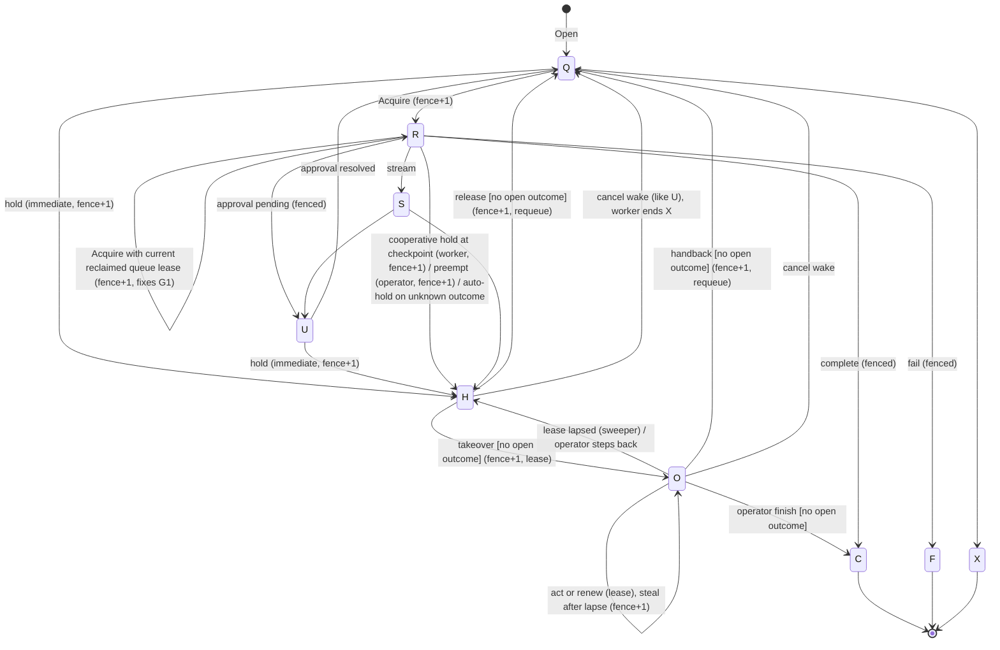
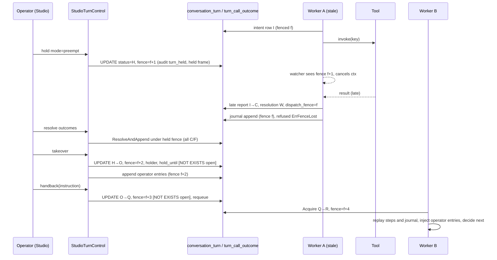

# Turn takeover, handback, and outcome reconciliation

Status: accepted design for SCOUT-2 and SCOUT-3, not yet implemented. Section 1 describes the runtime it changes; the decisions in section 11 are settled.

## 1. Current state

### 1.1 What "fence" means today: separate guards, none of them per turn owner

| Guard | Where | What it fences | What it does not fence |
|---|---|---|---|
| `turn_queue.lease_token` + `worker_id` | fair_turn_scheduler.go:74-94 (claim), :96-112 (extend, ack, lock), :374-384 (`fenced`) | Only queue `Extend`, `Ack` and `Nack` | None of the runtime's writes. `HandleJob` passes `lease.Message.Dispatch` to `HandleTurn`, and the token never reaches the runtime (runtime_worker.go:59-68) |
| `session_snapshot.revision` CAS | durable_session_store.go:63-68 (advance), :83-97 (complete: `revision = expected`) | `Checkpoint` and `Complete` per conversation | Ownership. A stale worker that still holds the current revision can checkpoint if the new owner has not written yet |
| `step_idempotency.status_code` CAS + `ClaimLease` | step_idempotency_store.go:30-70; persistence.md:46-47, 59-70 | Claim, commit and abandon of one step | Ownership: "The schema has no owner column, so a worker whose lease expired can still commit" (persistence.md:68-70). `updated_at` comes from the worker clock |
| `step_loop_entry` primary key, first writer wins | loop_journal.go:30-37, :99; tool_loop_executor.go:514-530 | Divergent content at the same `entry_no` (`ErrConflict`) | Identical writes, and the next entry number |
| `conversation_turn.status_code` CAS | turn_runtime_records.go:107-134 (Start Q→R, Suspend Q/R/S→U, Resume U/Q→Q, Fail live→F/X) | Lifecycle transitions | Which worker makes them |
| `budget_reservation.attempt_no` | isolation/budget_ledger.go:44-100, 224-256 | Replacing an expired hold | Settlement by a stale worker |
| `mcp_confirmation.fence` + store-clock lease | confirmation/store.go:132-161; executor.go:185-215 | The only real per-owner fence: claim does `fence = fence + 1`, lease is `CURRENT_TIMESTAMP + n`, `Complete`/`Renew` use `WHERE fence = ?`, an expired lease lapses to `U`, and a person runs `Reconcile` (store.go:565, executor.go:127) | (this is the model to copy) |
| Reply hub | cache_reply_hub.go:121-123: "One leased worker publishes a request's frames, so the head needs no compare-and-set" | Sequence gaps and divergent content | A second publisher |

Conclusion: no write the runtime makes is fenced by who owns the turn. SCOUT-2 needs a per-turn owner epoch that every runtime write checks.

### 1.2 How a turn resumes today

- Approval resume works. `Resumer.Resolve` records the verdict, then runs `Records.Resume` (U→Q) and `Queue.Requeue` (approval/resumer.go:73-125). The worker replays committed steps through `StepIdempotencyStore.Begin` (turn_runtime.go:323). The loop executor reads the journal and consumes it by cursor: a journaled decision is never re-asked and a journaled observation is never re-invoked (tool_loop_executor.go:278-284, :388-394, :505-512).
- `TurnRuntime.suspend` keeps the reservation held, records `turn_suspended` under scope `frame/<seq>`, publishes a final `approval_pending` frame, and the delivery is acked (turn_runtime.go:155-170). The resumed turn reuses that frame sequence (engineering-reference.md:939-941).
- **Finding G1.** Crash redelivery does not resume. `TableTurnRecordStore.Start` moves only Q→R. A redelivered turn whose worker died after `Start` is still `R`, so `Start` returns `ErrConflict`; `HandleTurn` then calls `fail()` and ends it `F`. Resume-from-journal is reachable only through U→Q. Existing journal redelivery tests drive the executor directly, not `TurnRuntime` over table records.

### 1.3 Where an unknown tool outcome can arise

1. **Effect landed, observation lost.** A crash or lease expiry falls between the tool effect and its journal append. Redelivery re-invokes with the same `ToolCall.IdempotencyKey` (`loop:` + SHA-256, tool_loop_executor.go:648) and relies on the transport to dedupe (persistence.md:85-88).
2. **`ErrEffectUnknown` from effect verification** (toolgateway/effect_verification.go:50-70; domain/errors.go:74-76). In the loop this error is not in `endsLoop` (tool_loop_executor.go:433-447). So it is journaled as an ordinary error observation, `{"error":"effect_unknown"}` with `IsError` (tool_loop_executor.go:411-417). The model sees it and the turn carries on. The model may re-propose the call under a new call id, which means a new idempotency key. **The unknown outcome is effectively recorded as a failure.**
3. **Transport error after the request was sent** (timeout, reset) on a mutating tool without `VerifyEffect`. Same path: an error observation, retried only if `result.Retryable` (governed_gateway.go:133-193).
4. **Context cancelled mid-call** (cancel or loop deadline). `endsLoop` ends the loop, the step is abandoned (turn_runtime.go:343-352), and the turn fails or a redelivery re-invokes.
5. **A claimed but uncommitted non-loop step** (`step_idempotency` = `C`). Replay re-runs the whole step (turn_runtime.go:323-357); there is no journal below step level.
6. **Charter capability gateway** reports `StatusUnknown` and reconciles it through its `Reconciler` (charter/capability_gateway.go:70-74; engineering-reference.md:1076).
7. **MCP confirmation** goes to `U` on runner `ErrEffectUnknown`, cancellation, an unstorable result, or a lost claim. It stays `U` until `Executor.Reconcile` (executor.go:185-215; store.go:149-167).

### 1.4 Reconciliation that already exists

- The gateway observes before acting on `VerifyEffect` tools: a satisfied effect means the transport is not invoked (effect_verification.go:14-28; governed_gateway.go:133-141).
- Charter's `Reconciler`.
- Confirmation `Reconcile`, by a person who is an authorized decider.
- The actiontoken `UnknownOutcome` for decision links (approval/resumer.go `RedeemLink`).

None of these is surfaced at turn level, and none blocks the turn.

### 1.5 Other findings this design must fix or account for

- **G2.** `fail()` records the terminal audit and publishes the final frame even when `Records.Fail` was refused (turn_runtime.go:504-514). A fenced-out worker would therefore write `turn_failed` or `turn_cancelled` in the middle of the chain, which breaks `VerifyTurnChain` (observability/turn_chain.go:67-91), and would publish a stale final frame.
- **G3.** If a stale worker settles the reservation, the resumed run's `reserve()` sees `ErrBudgetSettled`, sets `settled = true` and runs with no budget hold (turn_runtime.go:266-282, 444-449).
- **G4.** Lease clocks are mixed. `QueueTurnScheduler.Claim` writes `lease_until = ?` from the worker clock (fair_turn_scheduler.go:76). keel's claim SQL uses `CURRENT_TIMESTAMP` (fair_turn_scheduler.go:539). Step idempotency uses the worker clock (persistence.md:46-47). Everything new here uses the store clock.
- **G5.** A parked turn's queue row is acked, while both scheduler claim paths order only live `turn_queue` rows. `Open` admits a later turn, and `qSessionActiveTurn` excludes `U`. A later turn can therefore run while an earlier one is suspended; its snapshot can make the earlier turn's steps appear checkpointed when that turn resumes. Claims and active-turn selection must use `conversation_turn.turn_no` and treat every earlier non-terminal status, including `U`, `H`, and `O`, as blocking.
- **G6.** A fence acquisition must authenticate the current queue lease. `RuntimeWorker` currently discards the `QueueLease` and passes only `TurnDispatch`; an `Acquire(tenant, request)` API would let a delayed delivery increment the fence and evict the healthy owner. The runtime must receive an explicit claim containing queue id, lease token, and worker id, and `Acquire` must validate it against the leased `turn_queue` row while incrementing the turn fence.
- **G7.** Outcome settlement and observation append cannot be atomic through separate `CallOutcomeStore.Settle` and `LoopJournal.Append` calls. The table implementation needs one transactional operation that settles the outcome and appends the observation under the same owner fence.
- **Pause today.** `StudioPause` accepts only `finish` or `cancel` (studio_pause.go:60-62; domain/studio.go:367-374). The cancel path is the durable flag plus a watcher poll (table_turn_canceller.go:31-49, 154-215). There is no hold or suspend signal; that is SCOUT-3's blocker.

## 2. Actors, authorization, state machine

**Actors**

- **Operator (a person in Studio).** Takes over a live turn, acts in it, hands it back, finishes it, or releases it.
- **Reassigner (operator, or a sweeper acting on an operator's request).** Takes a stuck or runaway turn away from its worker (preemptive hold), reconciles, then releases it to any worker.
- **Agent worker.** Acquires the turn (fence +1), holds itself cooperatively at a checkpoint when asked, or auto-holds on an unknown outcome.
- **Pause (SCOUT-3).** Asks every live turn of an agent to hold at its next checkpoint.

**Authorization.** A new authorization object, `AGENT_OPERATION`, checked at `agent:<id>` like `AGENT_STUDIO`, with these actions:

| Action | Allows |
|---|---|
| `VIEW` | Live turns, outcomes, operator entries |
| `OPERATE` | Checkpoint hold, takeover, act, hand back, release, finish |
| `PREEMPT` | Hold now (fences out a running worker) |
| `RECONCILE` | Attest an unknown outcome |

Default grants: `AGENT_OPER` gets VIEW and OPERATE; `AGENT_ADMIN` gets all four. None of these is implied by authoring actions (EDIT, PUBLISH), which keeps operation separate from authoring. `contract.OperationSeparation`, in the same style as `PublishSeparation`, is required for high-risk attestations and may also forbid authors of the running release from attesting.

**Turn status codes.** Add two non-terminal codes to the `turn_status` catalog (schema/seed/catalog/catalog.yml:23-32, domain/turn_status.go:7-13):

- `H` (Held): fenced; no worker runs it; awaiting reconciliation or a person.
- `O` (Operated): a person holds it under a store-clock lease.



Holding is always allowed, because stopping is always safe. Takeover, release, handback and finish are refused while any outcome of the turn is open (`I`, `A` or `U`, see §4). Cancel stays allowed: it moves `I` and `A` outcomes to `U`; existing `U` outcomes remain listed for reconciliation, as with an `mcp_confirmation` in `U`.

## 3. The new fence

**Column.** `conversation_turn.fence BIGINT NOT NULL DEFAULT 0`. Every acquisition or ownership transition sets `fence = fence + 1` in a guarded transaction:

- Acquire: Q→R; also R/S→R on redelivery, only for the current queue lease.
- Hold.
- Takeover and steal.
- Handback and release.
- Approval suspend and resume, cancel wake, and operator-lease lapse.

The transition transaction also writes its audit record and queue change when applicable. It publishes the reply frame after commit under the returned fence; if cache publication fails, subscribers reconstruct the control frame from the durable turn record.

**Fenced write pattern (no explicit locks).** Each runtime write that is not itself an update of `conversation_turn` becomes a single statement with a data-modifying CTE:

```sql
WITH owner AS (
  UPDATE conversation_turn SET fence = fence
   WHERE partner_id = ? AND request_id = ? AND fence = ? AND status_code IN (<allowed>)
  RETURNING turn_no)
INSERT INTO step_loop_entry (...) SELECT ... FROM owner
ON CONFLICT DO NOTHING RETURNING entry_no
```

Zero `owner` rows means `domain.ErrFenceLost`; a follow-up read tells that apart from a primary-key conflict. The hold's own `UPDATE` and the guarded touch serialize on the same row. PostgreSQL re-evaluates `fence = ?` against the committed version, so every write is linearized before or after the hold, with no `FOR UPDATE` and no advisory lock. The row lock is the implicit one of a conditional write and lasts one autocommit statement. `<allowed>` is `R,S` for a worker and `O` for an operator, which also requires `holder_id = ?`. Writes while `H` exist only in `TurnControl`; they require an authorized actor and the expected held fence.

**Writes this applies to:**

| Write | Change |
|---|---|
| `TableLoopJournal.Append` | CTE as above |
| `StepIdempotencyStore` claim, reclaim, replay, commit, abandon | CTE |
| `DurableSessionStore.Checkpoint` | First statement of its existing transaction |
| `DurableSessionStore.Complete` | `AND fence = ?` added to its existing `UPDATE` |
| `TableTurnRecordStore` Suspend, Fail, `RecordUsage` | `AND fence = ?` |
| Budget settle (`Commit`/`Release`) | Guarded touch as the first statement of the ledger transaction, fixing G3 |
| Call-outcome writes | See §4 |

**Acquisition and fence carriage.** `RuntimeWorker` passes an explicit claim containing queue id, lease token, and worker id to the runtime. `TurnRecordStore.Acquire` validates that claim against the current leased `turn_queue` row and returns a `domain.TurnOwner{TenantID, RequestID, Fence}`. Runtime-facing write commands and keys carry that owner explicitly; safety-critical ownership is not hidden in `context.Context`. Table stores fail closed without it. Memory and fake stores honor the same contract, and `dataplanetest.RunFenceSuite` covers missing, stale, and forged owners.

**Runtime reactions:**

- `TableTurnCanceller.Watch` becomes `TableTurnControl.Watch` (contract `TurnControlWatcher`). One poll reads `cancel_requested_at, hold_requested_at, fence, status_code`.
  - A fence different from the worker's own cancels the turn context with cause `ErrFenceLost`, which aborts in-flight transports.
  - A hold request sets a flag; it does not cancel.
  - Reuses `agent_cancel_poll_ms`, the max-read-failures setting, and the cache wake-up.
- On `ErrFenceLost`, `HandleTurn` does not call `fail()`. It makes no terminal audit, settlement, or final frame. The worker treats a lost queue lease while acknowledging or rejecting that stale delivery as benign; it must not retry or dead-letter it. A current delivery that finds `H`/`O` is acknowledged as a no-op.
- `fail()` publishes and audits only when `Records.Fail` succeeded (fixes G2).
- **Reply frames.** `TurnReply` and `replyHead` gain `Fence`. Publish compares and advances `(fence, sequence)` atomically: under the hub lock in memory and through a new atomic compare-and-set capability in `CacheReplyHub`. `CacheReplyHub` uses keel's `cache.CacheService.CompareAndSet`, a single atomic round trip. A lower fence returns `ErrFenceLost`; a higher fence requires the `TurnOwner` or transition receipt returned by the guarded store operation, and sequence must still advance by one. This is required, not best effort: a stale token delta after takeover is still an unauthorized response.
- **Store clock.** `hold_until`, `held_at`, `dispatched_at` and `deadline_at` are all `CURRENT_TIMESTAMP`-based. Leases lapse through a sweeper using `CURRENT_TIMESTAMP` with `SKIP LOCKED` batches, the same pattern as `qConfirmLapse` (confirmation/store.go:149-155).

## 4. Unknown tool outcomes, reconciled first

**Intent before effect.** For every non-`ReadOnly` call, the loop inserts a fenced `turn_call_outcome` row in status `I` (in flight), with `dispatch_fence`, `dispatched_at = CURRENT_TIMESTAMP`, and a `deadline_at` derived from the tool timeout plus `agent_outcome_attest_grace`, before `Tools.Invoke`. `SettleAndAppend` records a definite `C` or `F` result and its observation in one transaction; `MarkUnknown` moves `I` or `A` to `U` without inventing an observation. Because an invoke happens only after a successful fenced intent, "no row" proves the call never left. Read-only calls write no row; they are re-runnable.

**Classification** (`CallOutcomes.Classify`, enumerated from the journal plus outcome rows):

| Class | Condition | Disposition |
|---|---|---|
| received | Proposed in a journaled model decision; no row (or an `approval_pending` entry only) | Never sent. Runs on resume unless the operator withdraws it |
| in flight | Row `I`, `dispatch_fence` = current fence, `deadline_at` > now | Wait |
| accepted | Row `A`: the tool returned a validated async handle, no terminal result | Lookup |
| completed | Row `C`, or an observation without error (plus a satisfied effect when `VerifyEffect`) | Resolved |
| failed | Row `F`: definite failure (refused before send, validation, or effect proven absent) | Resolved |
| unknown | Row `U`, or `I` with a stale `dispatch_fence` or a passed `deadline_at` | Must be resolved |

**Rules.**

- Never re-invoke and never mark failed an `I`/`A`/`U` call, with one exception: a tool declaring the new `ToolDefinition.DedupesByKey` may be re-sent with the same `IdempotencyKey`. Scout cannot verify deduplication, so only the product's trusted adapter composition may declare it, never a registered tool document or a tenant.
- `A` requires a provider-neutral `ToolAcceptance` on `ToolResult` containing an opaque handle and lookup deadline. A tool that can return one must declare lookup support; otherwise an apparent async acceptance is invalid output.
- `ErrEffectUnknown`, and transport errors after send on mutating tools, no longer become error observations. They set the row to `U` and return `ErrOutcomeUnknown`, which `HandleTurn` turns into an **auto-hold**: R→H with hold code `U`, a `held` frame, and the reservation kept.
- On resume, an unobserved call at the journal cursor is decided from its row:
  - `C`/`F` with a result: the observation is journaled from the row.
  - `I`/`A`/`U`: try the gateway's pre-observe (`VerifyEffect`) or the lookup port. If still unknown, auto-hold.
- **Late report.** A fenced-out worker that gets a validated, guarded result after the hold may still settle its own row: `UPDATE turn_call_outcome SET status_code = ?, resolution_code = 'W', result_uri = ?, ... WHERE ... AND status_code IN ('I','A','U') AND dispatch_fence = ?`. This records evidence, not turn progress. The journal entry is written later under the current fence.

Outcome results, evidence, and operator entry bodies use private state storage, digest verification, and the existing `agent_state_max_bytes` bound; operator entries also obey their tighter per-entry limit. An accepted result stores its `ToolAcceptance` in the outcome result object.

**Resolution sources** (`resolution_code`):

| Code | Source |
|---|---|
| `G` | Gateway, normal path |
| `W` | Late worker report |
| `E` | `ToolEffectVerifier` observation (existing port) |
| `L` | New optional port, `contract.ToolOutcomeLookup.Lookup(ctx, call, definition) (domain.CallOutcome, error)`, keyed by `IdempotencyKey`. Charter's `Reconciler` is adapted to it |
| `M` | A linked `mcp_confirmation` reconciled by `Executor.Reconcile`. A hook on confirmation reconcile settles the row by `mcp_confirmation_id` |
| `T` | Operator attestation |

**Attestation guard.** Allowed only with `RECONCILE`, only after `deadline_at <= CURRENT_TIMESTAMP`, with a mandatory note and optional evidence (uri and digest). It is a CAS from `I/A/U` to `C/F`.

**Gate.** Takeover, release, handback and finish each carry `AND NOT EXISTS (SELECT 1 FROM turn_call_outcome WHERE partner_id = ? AND request_id = ? AND status_code IN ('I','A','U'))` in the same `UPDATE`. After a hold, no fenced writer can add rows; rows only move toward resolution. So the predicate is race-free without locks.

**Journaling a resolution.** The reconciler uses `ResolveAndAppend` to settle the row and append the missing `observation` at the cursor under the expected held fence or the current operator owner. A new optional `LoopEntry.Outcome` records `{status, resolution, resolver, evidence}`. Replay consumes it unchanged.

## 5. Handback



- **Operator entries** go in a new `turn_operator_entry` table, append-only and fenced by `O`, fence and holder. Kinds:
  - `N` note
  - `T` tool call: through `GovernedGateway` as the human principal, `OnBehalfOf` the end user, key `op:` + SHA-256 of (tenant, request, fence, entry). It gets its own outcome row with origin `O`.
  - `Y` reply to the end user: guarded by `AfterModelChunk` and published at the next sequence.
  - `W` withdraw a received call: journaled as an observation with `F` and resolution `T`.
  - `H` handback instruction.

  Each entry records `execution_step_id` and `after_entry_no`, the journal length at the hold. Before the next `decide`, the loop executor drains entries whose position is at or before the cursor into one operator-labelled message (marked untrusted like other human text). Entries are immutable, so replay is deterministic. The loop journal's cursor semantics stay unchanged. A hold between steps is handed to the next step through `StepInput.Operator`.
- **Audit.** Operator records use the decision scope `turn/<req>/fence/<f>/op/<n>`, so keys are distinct per epoch. Agent decisions keep their replay-stable scopes, and the "recorded once across redelivery" test (turn_chain_test.go:72) still holds. New intermediate categories:
  - `turn_hold_requested`, `turn_held`, `turn_taken_over`
  - `turn_operator_action`, `call_outcome_resolved`
  - `turn_handed_back`, `turn_released`, `turn_hold_lapsed`

  `VerifyTurnChain` already accepts intermediate categories. Add `observability.VerifyTurnControl`: held precedes takeover precedes handback or release, fences increase monotonically (fence goes into the turn audit payload), and no takeover happens while an outcome is open.
- **Usage and budget.** The agent's usage is rebuilt by replay as today. Each operator tool action settles tenant admission immediately and stores its usage on the immutable operator entry. At terminal settlement those entries are aggregated into the single operator `usage_event` allowed by the existing `(turn, category[, model])` uniqueness, attributed to the human with `OnBehalfOf` set to the end user. The operator category is distinct from the agent category. The held agent reservation behaves like `U`; release and handback first acquire or renew a reservation, then atomically change the turn and queue row. A failed transition releases only the newly acquired hold and leaves the turn `H`.

## 6. SCOUT-3: `suspend` at the next durable checkpoint

`domain.PauseSuspend = "suspend"`. `StudioPause` first disables admission (unchanged), then for each live turn:

- `Q`/`U`: hold immediately (fence +1, hold code `A`).
- `R`/`S`: set `hold_requested_at` and `hold_reason`, using the same "first request wins" `COALESCE` as the cancel flag (table_turn_canceller.go:31-36).

The worker checks `HoldRequested()` at three durable boundaries:

1. After a step's checkpoint and frame (turn_runtime.go:391-399).
2. Between loop iterations.
3. Before each non-read-only invoke, after the decision append.

At a boundary it does a cooperative R→H (fence +1 by the worker itself) and publishes a final `held` frame (resumed turns continue that sequence, like `approval_pending`). There are no open outcomes by construction, so release is immediate. Unpausing does not auto-release: an operator releases held turns per turn or in a batch. `AgentPauseResult` gains `Held`. The live-turn list in studio_pause.go:24-31 and the canceller's lists (table_turn_canceller.go:35, 39-43) gain `H` and `O`.

Both scheduler claim paths and `qSessionActiveTurn` must order by the durable turn number and block behind every earlier non-terminal turn. Queue timestamps are not the conversation-order source of truth.

## 7. Schema, contracts, routes, flags

**Schema**

- `conversation_turn`, new columns:
  - `fence BIGINT NOT NULL DEFAULT 0` (CHECK `>= 0`)
  - `hold_requested_at`, `hold_reason VARCHAR(200)` (both null or both set)
  - `hold_code CHAR(1)`, CHECK `IN ('C','P','A','U')`: C = checkpoint request, P = preempt, A = agent paused, U = unknown outcome. CHECK `(status_code IN ('H','O')) = (hold_code IS NOT NULL)`
  - `holder_kind VARCHAR(20)`, `holder_id VARCHAR(120)` (pair CHECK; both are non-null exactly in `O`)
  - `held_at`, CHECK `(status_code IN ('H','O')) = (held_at IS NOT NULL)`
  - `hold_until`, CHECK `(status_code = 'O') = (hold_until IS NOT NULL)`
  - Index `conversation_turn_hold_ix (status_code, hold_until)`
  - An honored hold request is cleared in the same transition.
- `turn_status` seed rows: `[H, false, Held under a new fence]`, `[O, false, Operated by a person under a lease]`.
- New `schema/runtime/turn_call_outcome.yml`:
  - Primary key `(partner_id, request_id, execution_step_id, call_id)`; foreign key `(partner_id, request_id)` → `conversation_turn`.
  - Columns: `idempotency_key VARCHAR(200)`, `tool_id`, `tool_version`, `origin_code CHAR(1) IN ('A','O')`, `status_code CHAR(1) DEFAULT 'I' IN ('I','A','C','F','U')`, `dispatch_fence`, `dispatched_at`, `deadline_at`, `result_uri`/`result_digest`, `resolution_code CHAR(1) IN ('G','W','E','L','T','M')`, `resolved_fence`, `resolver_kind`/`resolver_id`, `resolved_at`, `note VARCHAR(500)`, `evidence_uri`/`evidence_digest`, `mcp_confirmation_id`.
  - A unique `(partner_id, id)` key on `mcp_confirmation` supports the composite foreign key `(partner_id, mcp_confirmation_id)`, preventing a cross-tenant link.
  - CHECKs: `C`/`F` ⇔ resolution set; `T` ⇒ resolver and note; `deadline_at >= dispatched_at`; the uri/digest pairs.
  - A unique index on `(partner_id, idempotency_key)` prevents one key naming two effects; indexes on `(partner_id, request_id, status_code)` and `(status_code, deadline_at)` serve reconciliation.
- New `turn_operator_entry`:
  - Primary key `(partner_id, request_id, fence, entry_no)`.
  - `kind_code IN ('N','T','Y','W','H')`, actor kind and id, `execution_step_id`, `after_entry_no`, `entry_uri`/`entry_digest`, non-negative usage counts and minor-unit cost with currency and exponent, and `created_at`.
- Add `constant_value` rows in `schema/seed/catalog/catalog.yml` and `constant_lookup` rows in `schema/seed/runtime/runtime.yml` for each new code column (`turn_hold_code`, `turn_call_outcome_status`, `turn_call_resolution`, `turn_call_origin`, `turn_operator_entry_kind`). `TestConstantLookupColumnsCheckTheirCodes` enforces agreement with the CHECKs.
- `ToolDefinition.DedupesByKey` and provider-neutral `ToolAcceptance` metadata for tools that support async lookup.
- `agent_alert_kind` gains `U` (unresolved outcome), with the `agent_alert` kind CHECK widened to match; `health_alerts` gains `max_unresolved_minutes`, tightened like the other thresholds.

**Domain.** `TurnHeld`, `TurnOperated`; `ErrFenceLost`, `ErrTurnHeld`, `ErrOutcomeUnknown`; `TurnClaim`, `TurnOwner`; `CallOutcome` with status and resolution codes; `ToolAcceptance`; `HoldMode`; `OperatorEntry`; `PauseSuspend`; `LoopEntry.Outcome`.

**Contracts**

- `ConversationRuntime` receives the current queue claim, and `TurnRecordStore.Start` is replaced by `Acquire(ctx, claim) (TurnOwner, error)`. `Acquire` validates the current leased queue row.
- `TurnControlWatcher` supersedes `TurnCancelWatcher`.
- Runtime-facing session, step, journal, turn-record, and budget writes take `TurnOwner` explicitly.
- New:
  - `CallOutcomeStore` (`Intend`, `SettleAndAppend`, `MarkUnknown`, `Report`, `Open`, `ResolveAndAppend`)
  - `ToolOutcomeLookup` (optional)
  - `TurnControl`, `StudioTurnControlBackend`
  - `OperationSeparation` (required for high-risk attestation; lower-risk policy is optional)

**Studio feature `turn_control`.** `handler.StudioTurnControlHandler` over `dataplane.StudioTurnControl`; paths are relative to `/api/agent-studio/` and permissions are on `AGENT_OPERATION`:

| Route | Permission |
|---|---|
| `GET turns/live?agent_name=&before=&limit=` | VIEW |
| `GET turn?agent_name=&request_id=` (status, fence, holder, outcomes, entries) | VIEW |
| `POST turn/hold {agent_name, request_id, mode: checkpoint\|preempt, reason}` | OPERATE; preempt also needs PREEMPT |
| `POST turn/outcome/lookup {agent_name, request_id, fence, execution_step_id, call_id}` | OPERATE |
| `POST turn/outcome/attest {…, outcome: completed\|failed, note, evidence?}` | RECONCILE |
| `POST turn/takeover {agent_name, request_id, fence}` | OPERATE |
| `POST turn/act {…, fence, kind: note\|tool\|reply\|withdraw, …}` | OPERATE; renews the lease |
| `POST turn/handback {…, fence, instruction?}` | OPERATE |
| `POST turn/release {…, fence}` | OPERATE |
| `POST turn/finish {…, fence, reply}` | OPERATE |

Pause's `policy` also accepts `suspend`. A stale `fence` returns 409.

**Flags**

| Flag | Default | Meaning |
|---|---|---|
| `agent_takeover_lease` | 900 s, > 0 | Operator lease |
| `agent_outcome_attest_grace` | 60 s, ≥ 0 | Added to the tool timeout for `deadline_at` |
| `agent_operator_entry_max_bytes` | 16384 | Size cap per operator entry |
| `agent_operator_max_entries` | 64 | Entries per turn |
| `agent_hold_lapse_batch` | 100 | Sweeper batch size |

Cooperative-hold polling reuses `agent_cancel_poll_ms`.

## 8. Failure modes and their tests

1. **Stale worker after a preempt.** Checkpoint, append, commit, complete, fail, usage and budget settle all return `ErrFenceLost`. No terminal audit or final frame is written, and the turn stays `H`. A current held delivery is acknowledged; an expired stale delivery is discarded without retry or dead-letter.
2. **Hold racing an append and an intent.** Run against real PostgreSQL with forced interleaving: either the write is visible to enumeration or it was refused, never neither.
3. **G1.** Crash redelivery of an `R` turn resumes from the journal with fence +1; the zombie's writes are refused.
4. Intent committed, crash before the transport: classified unknown, auto-hold; resolved by lookup, by attestation after `deadline_at`, or by a late report.
5. `ErrEffectUnknown`: no error observation reaches the model, the row is `U`, the turn is `H`.
6. Takeover, release, handback and finish refused while an `I`/`A`/`U` row exists; allowed after resolution. Attestation before the deadline or without RECONCILE is refused; an identical replay is a no-op and a conflicting replay is refused.
7. Operator lease lapse O→H by the store-clock sweeper; a stale operator action returns 409.
8. Pause `suspend`: `Q`/`U` held immediately, `R` held at the next boundary, counts correct, unpause does not release.
9. Cancelling `H`/`O` ends `X` and releases the hold; open outcomes stay listed.
10. `VerifyTurnChain` and `VerifyTurnControl` over hold → takeover → act → handback → complete; operator decision keys are distinct per fence.
11. G3: a stale settle is refused, and the resumed run holds a live reservation.
12. Reply hub: a frame below the head fence is refused after a `held` frame.
13. Schema-constants test; `RunFenceSuite` passes for the memory and table stores.
14. A delayed or forged queue claim cannot acquire or increment the turn fence; the current claim can.
15. Outcome settlement and observation append roll back together under injected failure.
16. Concurrent old- and new-fence frame publication proves the reply-head compare-and-set.
17. Several operator tool actions settle tenant spend individually and produce one complete operator usage line at terminal settlement.

## 9. Visibility and cost

**Visibility.** Holding turns on unknown outcomes and blocking later turns behind them is deliberate, so operators must see it. The agent health report (`health`) counts held and operated turns in `turns_by_status` and adds `open_outcomes`, the turns' `I`, `A`, and `U` calls; the `health_alerts` policy gains `max_unresolved_minutes`, which opens an alert of kind `U` (unresolved outcome) while any turn of the agent has held that long with an open outcome, and resolves it when none has.

**Cost.** Model and tool latency dominate a turn; the design adds no extra round trip to a write the runtime already makes.

| Change | Cost | Mitigation |
|---|---|---|
| Fenced write (guarded touch of the turn row) | Same statement; a new row version and WAL per write on `conversation_turn` | `fence` is unindexed, so updates stay heap-only; set a lower fillfactor on `conversation_turn` |
| Intent row per non-read-only call | One small insert; settlement shares the observation's transaction | Read-only calls write none |
| Reply-head compare-and-set per frame | Free in memory; one `CompareAndSet` round trip in the cache, the same count as today's write | — |
| Conversation-order check on claim | One primary-key lookup per claim | — |
| Control watcher | A few more columns in the existing poll | — |

The guarded touch is the design's only lock: the implicit row lock of a conditional update of the turn's own row for one statement. It is what linearizes a hold against a write; the turn row is written only by its current owner, so contention is limited to a hold racing that owner. Measure `conversation_turn` dead tuples, WAL rate, and reply-frame latency in the test environment before closing slice 1.

## 10. Implementation slices

1. **Fence foundation and SCOUT-3.**
   - `fence` and hold columns, status `H`.
   - Queue-lease-authenticated `Acquire` (fixes G1); explicit `TurnOwner`; CTE-fenced writes; G2 and G3 fixes.
   - `TurnControlWatcher`; cooperative hold at step and iteration boundaries; `H` as a no-op delivery.
   - Canceller and pause lists; `PauseSuspend`; `turn/hold` (checkpoint mode only), `turn/release`, `turns/live`, `turn`.
   - Reply-hub fence; `turn_held`/`turn_released` audit; `RunFenceSuite`.

   Ships SCOUT-3.
2. **Outcomes and preemption.**
   - `turn_call_outcome`, intent before effect, late report, auto-hold on unknown.
   - Atomic settlement plus journal append; outcome-aware resume; `DedupesByKey`; `ToolAcceptance`; `ToolOutcomeLookup` (plus a Charter adapter); confirmation hook.
   - Attestation route; preempt mode with `PREEMPT`/`RECONCILE`.
   - `open_outcomes` in the health report and the `U` alert kind.
3. **Takeover and handback.**
   - Status `O`, operator lease and sweeper, `turn_operator_entry`, act/handback/finish routes.
   - Operator-message injection; per-action tenant settlement and terminal usage aggregation; `VerifyTurnControl`.
   - Docs: persistence.md, governance.md, api_surface.md, configuration.md.

   Closes SCOUT-2.

## 11. Decisions

1. **Ownership is explicit.** Runtime-facing commands and keys carry `TurnClaim` and `TurnOwner`; ownership never travels in `context.Context`, where it could be forged or omitted without compiler help.
2. **Unknown outcomes hold the turn.** Every non-read-only call whose effect is unknown auto-holds; the model never reinterprets uncertainty as failure.
3. **Resend only on declared deduplication.** A dispatched, unobserved call is re-sent only when the trusted adapter composition declares that the provider deduplicates by the same idempotency key; otherwise it holds and is reconciled.
4. **An operator may finish a turn** after every outcome is resolved, with a reply that passes the same output guardrails and evidence rules. It is persisted as operator-authored and attributed to the person; no agent `RunCompleted` is recorded.
5. **Operator tool authority** is the intersection of the release's bound tools, the operator's grants, the original turn's tenant and delegated authority, and current policy obligations. Credentials are resolved for the person just in time, and `OnBehalfOf` is preserved.
6. **Operator spend** is admitted and settled against the tenant envelope per action, stored on the immutable operator entry, and aggregated into one operator usage line at terminal settlement. It never charges the agent's release budget. Operators make no model calls in v1; a bounded operator budget comes first.
7. **High-risk attestation needs a second authorized person** and fails closed when the separation policy cannot be evaluated; lower-risk separation is product-configurable. A team with one authorized person keeps such a turn held until a second is granted.
8. **Live operation has its own object,** `AGENT_OPERATION`, apart from authoring.
9. **Conversation order is strict.** Both claim paths and `qSessionActiveTurn` block behind every earlier non-terminal turn, ordered by `turn_no` (G5 is a defect).
10. **Release and handback re-admit first.** They acquire or renew the reservation, then commit the transition and queue write atomically; on failure only the new reservation is released and the turn stays held.
11. **A verdict on a held turn** is persisted without queueing: `Resumer.Resolve` resumes `U` and leaves `H` and `O` for the later owner.
12. **G2 ships alone;** G1 and G3 ship with the fence foundation, since ownership fixes without an authenticated fence open another race.
13. **Only the current leased queue claim** (queue id, lease token, worker id) acquires the turn, validated in the transaction that increments the fence.
14. **Settlement and journal append are one transactional store operation;** a failure leaves both unchanged.
15. **Async acceptance** is a validated provider-neutral `ToolAcceptance`, allowed only for tools that declare lookup support.
16. **Reply fencing is mandatory:** every reply hub advances `(fence, sequence)` atomically, and output after a takeover is unauthorized even when it is not terminal.
17. **Held work is visible:** the health report counts held turns and open outcomes, and the `U` alert reports outcomes left unresolved past the policy's limit.

### Primary implementation files

- `service/dataplane/turn_runtime.go`
- `service/dataplane/runtime_worker.go`
- `service/dataplane/fair_turn_scheduler.go`
- `service/dataplane/turn_runtime_records.go`
- `service/dataplane/tool_loop_executor.go`
- `service/dataplane/cache_reply_hub.go`
- `service/dataplane/table_turn_canceller.go`
- `service/isolation/budget_ledger.go`
- `schema/runtime/conversation_turn.yml`
