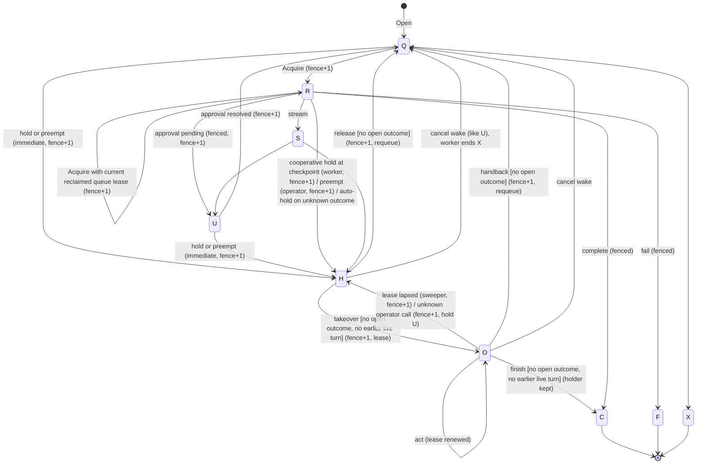
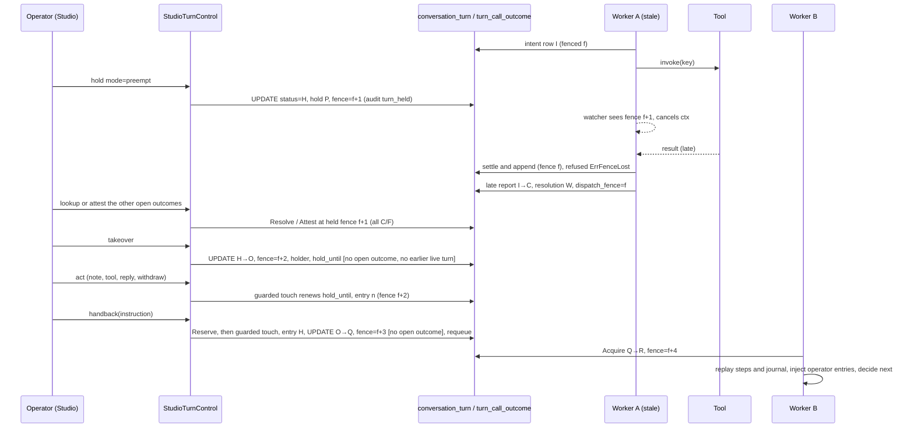

# Turn takeover, handback, and outcome reconciliation

Status: SCOUT-2 and SCOUT-3 are implemented in all three slices. Slice 1: the per-turn fence with queue-lease-checked acquisition, fenced runtime writes, strict conversation order, reply fencing, held turns with cooperative holds, pause `suspend` (SCOUT-3), and the Studio `turn_control` feature (`turns/live`, `turn`, `turn/hold` in checkpoint mode, `turn/release`) under `AGENT_OPERATION` `VIEW` and `OPERATE`. Slice 2: call outcome records written before the call leaves (intent before effect); settlement and completion as one fenced unit; outcome-aware resume; late worker reports; resend only on declared deduplication; validated asynchronous acceptance; reconciliation through the effect verifier, a composed `ToolOutcomeLookup` with a Charter adapter, and the MCP confirmation hook; preemption (`PREEMPT`); attestation (`RECONCILE`) with two-person separation; the release gate on open outcomes; and the health report's `open_outcomes` and `U` alert. Slice 3: status `O` under a store-clock operator lease and its lapse sweeper (`TurnHoldLapseWorker`); the append-only `turn_operator_entry` (note, tool call as the person, reply, withdrawal, handback instruction); the Studio routes `turn/takeover`, `turn/act`, `turn/handback`, and `turn/finish`; operator entries replayed into the resumed loop; per-action tenant settlement of operator calls and one operator usage line at the turn's end; and `observability.VerifyTurnControl`. Section 1 describes the runtime's guards and its open findings; sections 2 to 9 describe the design as built; the decisions in section 11 are settled. [Persistence](persistence.md#turn-fence) documents the fence, the operator lease, and [call outcomes](persistence.md#call-outcomes).

## 1. Current state

### 1.1 Fences and guards

| Guard | Where | What it fences | What it does not fence |
|---|---|---|---|
| `conversation_turn.fence` | turn_fence.go, turn_runtime_records.go | The turn's owner. `Acquire` increments it, and every runtime write presents the acquired `TurnOwner` and is refused with `ErrFenceLost` once the fence moved (§3) | Writes outside the owner guard (§1.5) |
| `turn_queue.lease_token` + `worker_id` | fair_turn_scheduler.go (claim, extend, ack, nack); turn_runtime_records.go (`qRecordAcquire`) | Queue `Extend`, `Ack`, and `Nack`, and acquisition: `RuntimeWorker` hands the runtime the leased row as a `TurnClaim`, and only the current lease of the turn's queue row moves the fence | `QueueTurnScheduler.Claim` writes `lease_until` from the worker clock (G4) |
| `session_snapshot.revision` CAS | durable_session_store.go | `Checkpoint` and `Complete` per conversation, behind the owner guard | — |
| `step_idempotency.status_code` CAS + `ClaimLease` | step_idempotency_store.go | Claim, reclaim, replay, commit, and abandon of one step, each behind the owner guard | The claim lease: `updated_at` comes from the worker clock and the row has no fence column (§1.5) |
| `step_loop_entry` primary key, first writer wins | loop_journal.go | Divergent content at the same `entry_no` (`ErrConflict`); the append is behind the owner guard | — |
| `conversation_turn.status_code` CAS | turn_runtime_records.go, table_turn_control.go | Lifecycle transitions; every ownership transition also moves the fence | — |
| `budget_reservation.attempt_no` | isolation/budget_ledger.go | Replacing an expired hold; a turn's settlement runs inside the transaction that ends it, after the owner's guarded touch (G3) | — |
| `turn_call_outcome` status + `dispatch_fence` | call_outcome_store.go | The owner's intent, acceptance, settlement, and unknown marking behind the guarded touch; a late report or retraction only by the fence the call was dispatched under; a status moves only toward resolution | An accepted row nobody looks up (§10) |
| `conversation_turn` holder + `hold_until` | table_turn_operation.go | A person's writes in an operated turn: each transaction opens with the holder's guarded touch, which matches `O`, the fence, the holder, and `hold_until > CURRENT_TIMESTAMP` and renews the lease (§5) | — |
| `mcp_confirmation.fence` + store-clock lease | confirmation/store.go:132-161; executor.go:185-215 | Claim does `fence = fence + 1`, lease is `CURRENT_TIMESTAMP + n`, `Complete`/`Renew` use `WHERE fence = ?`, an expired lease lapses to `U`, and a person runs `Reconcile` (store.go:565, executor.go:127) | (the model the operator lease follows) |
| Reply hub `(fence, sequence)` head | reply_hub.go, cache_reply_hub.go | A second publisher: a frame below the stream's fence is `ErrFenceLost`, and only a higher fence replaces the frame at the head | A stream absent from the cache restarts at any fence (§1.5) |

### 1.2 How a turn resumes

- Approval resume: `Resumer.Resolve` records the verdict, then runs `Records.Resume` (U→Q, fence +1) and `Queue.Requeue` (approval/resumer.go:73-128); a held turn keeps the verdict unqueued (§6). The worker replays committed steps through `StepIdempotencyStore.Begin` (turn_runtime.go:365). The loop executor reads the journal and consumes it by cursor: a journaled decision is never re-asked and a journaled observation is never re-invoked (tool_loop_executor.go:202, :517-541).
- `TurnRuntime.suspend` moves the owner's turn to `U` (fence +1), keeps the reservation held, records `turn_suspended` under scope `frame/<seq>`, publishes a final `approval_pending` frame under the suspended fence, and the delivery is acked (turn_runtime.go:180-193). The resumed turn reuses that frame sequence under its higher fence.
- **G1.** Crash redelivery resumes. `Acquire` takes a `Q` turn, or an `R`/`S` turn redelivered under the current lease of its queue row, to `R` with fence +1, so the new delivery replays from the journal and the dead worker's writes are refused.

### 1.3 Where an unknown tool outcome arises and what the runtime does

Every non-read-only call of the tool loop has a `turn_call_outcome` row written before it leaves (§4), and `GovernedGateway.Invoke` says what became of a failed call: `ErrNotSent` (refused before it left), `ErrNoEffect` or `ErrEffectViolated` (sent, effect proven absent), `ErrOutputWithheld` (took effect, output cannot be shown), and `ErrEffectUnknown` for any other failure of a sent mutating call.

1. **Effect landed, observation lost.** A crash, lease expiry, or preemption falls between the tool effect and its settlement. The row stays `I` under the old `dispatch_fence`, and the next owner meets the call unobserved at the journal cursor and decides it from the row (§4): it is never re-sent blindly, and a fenced-out worker's late answer settles the row as evidence (resolution `W`).
2. **`ErrEffectUnknown`** from effect verification, a transport error or timeout after send, invalid output, or an asynchronous acceptance from a tool whose composition declares no lookup. The loop moves the row to `U` and returns `ErrOutcomeUnknown`, and the runtime auto-holds the turn (hold code `U`, reservation kept). No error observation reaches the model.
3. **Context cancelled mid-call.** A cancellation marks the turn's `I` and `A` rows `U` in the cancelling transaction and the worker ends the turn `X`; the rows stay listed for reconciliation. After a fence move the next owner resumes from the row as in 1.
4. **A claimed but uncommitted non-loop step** (`step_idempotency` = `C`). Replay re-runs the whole step (turn_runtime.go); there is no journal or outcome record below step level.
5. **Charter capability gateway.** A denied call is `ErrNotSent`, a call Charter settles failed is `ErrNoEffect`, and `StatusUnknown` or any other non-executed status is `ErrEffectUnknown`. Its `Lookup` adapter answers a held call's key from Charter's action records (§4).
6. **MCP confirmation.** A call accepted with a `ToolAcceptance.MCPConfirmationID` is linked to that confirmation; reconciling the confirmation settles the call (resolution `M`).
7. **Operator call.** A person's tool call in a turn they operate has an origin-`O` row. An `ErrEffectUnknown`, any other unclassified failure after send, or an asynchronous acceptance marks it `U` and holds the turn again (§5); nothing looks an operator call up on its own.

### 1.4 Reconciliation

- **Pre-observation.** The gateway observes before acting on `VerifyEffect` tools: a satisfied effect means the transport is not invoked.
- **`ToolOutcomeReconciler`.** `GovernedGateway.Reconcile` settles an unobserved call without sending it: the effect verifier first (resolution `E`), then the composed `ToolOutcomeLookup` when the composition declares the tool's lookup support (resolution `L`). A completed answer passes the same output validation and `AfterTool` guardrails as a sent call's.
- **Studio.** `turn/outcome/lookup` runs the reconciler for one call of a held or ended turn; `turn/outcome/attest` lets authorized people attest the outcome after the call's deadline (resolution `T`).
- **Confirmation `Reconcile`,** by a person who is an authorized decider, settles linked calls in its own transaction.
- The actiontoken `UnknownOutcome` for decision links (approval/resumer.go `RedeemLink`) covers approval links, not tool calls.

### 1.5 Findings

- **G2.** `fail()` writes the terminal audit, the run record, and the final frame only after `Records.Fail` succeeded, and stops at a fence loss from its settlement unit, so a fenced-out worker writes nothing terminal and `VerifyTurnChain` holds.
- **G3.** Settlement and the turn's end are one fenced unit (decision 18). `DurableSessionStore.Complete` and `TableTurnRecordStore.Fail` each run one transaction: the owner's guarded touch, `BudgetLedger.SettleTurnTx` (tenant advisory lock, then commit or release), the usage events, and the terminal update. A fence that moved before the touch refuses the whole unit, and once the touch is taken the fence cannot move until commit. A live run that finds its reservation settled fails closed with `ErrBudgetSettled` and runs no step; Studio release refuses it the same way.
- **G4 (open).** Lease clocks are mixed. `QueueTurnScheduler.Claim` writes `lease_until = ?` from the worker clock, while keel's claim SQL and `Acquire`'s lease check use `CURRENT_TIMESTAMP`. Step idempotency uses the worker clock (persistence.md). Everything new here uses the store clock.
- **G5.** Both scheduler claim paths and `qSessionActiveTurn` block a turn behind every earlier turn of its conversation, by `turn_no`, whose status is `Q`, `R`, `S`, `U`, `H`, or `O`, and `Complete` refuses a turn that is not the conversation's oldest live one; takeover and finish carry the same earlier-live-turn gate.
- **G6.** `RuntimeWorker` passes the leased row as a `TurnClaim` (queue id, lease token, worker id), and `Acquire` validates it against the current leased `turn_queue` row in the statement that increments the fence, so a delayed delivery can neither acquire the turn nor evict its owner.
- **G7.** `CallOutcomeStore.SettleAndAppend` settles the row and appends the observation in one transaction opened by the owner's guarded touch; a failure leaves both unchanged.
- **Step claim lease (open).** `step_idempotency` has no fence column and its claim lease runs on the worker clock. A new owner that replays a step whose claim is younger than `agent_step_claim_lease` gets `ErrConflict` until the claim expires. The defaults keep the queue lease (900 s) above the step claim lease (360 s), but nothing validates that order.
- **Writes outside the owner guard (open).** Agent run records run only after a fenced success. The `OnSettled` hook runs before the settlement unit, once per delivery, so a unit refused after it ran offers it again on the turn's next owner; a usage mirror keys on the turn. Approval requests opened by a fenced-out worker's tool gateway are not fenced, and neither is the synchronous `TurnLedger` path.
- **Reply cache loss (open).** A stream the cache no longer holds restarts at any fence and sequence, so a fenced-out worker's frame can open a stream the cache lost.
- **Pause.** `StudioPause` accepts `finish`, `cancel`, and `suspend`. Cancel is the durable flag plus a watcher poll in `TableTurnControl`; `suspend` holds parked turns at once and asks running ones to hold at their next durable checkpoint (§6).

## 2. Actors, authorization, state machine

**Actors**

- **Operator (a person in Studio).** Holds a live turn, takes over a held one, acts in it under a lease, hands it back, finishes it, or releases it. Only a principal of kind human operates a turn.
- **Reassigner (operator).** Takes a stuck or runaway turn away from its worker (preemptive hold), reconciles, then releases it to any worker.
- **Agent worker.** Acquires the turn (fence +1), holds itself cooperatively at a checkpoint when asked, or auto-holds on an unknown outcome.
- **Pause (SCOUT-3).** Asks every live turn of an agent to hold at its next checkpoint.
- **Lapse sweeper (`TurnHoldLapseWorker`).** Holds an operated turn again once its lease lapsed by the store clock.

**Authorization.** A new authorization object, `AGENT_OPERATION`, checked at `agent:<id>` like `AGENT_STUDIO`, with these actions:

| Action | Allows |
|---|---|
| `VIEW` | Live turns, outcomes, operator entries |
| `OPERATE` | Checkpoint hold, takeover, act, hand back, release, finish |
| `PREEMPT` | Hold now (fences out a running worker) |
| `RECONCILE` | Attest an unknown outcome |

Default grants: `AGENT_OPER` gets VIEW and OPERATE; `AGENT_ADMIN` gets all four. None of these is implied by authoring actions (EDIT, PUBLISH), which keeps operation separate from authoring. Every `turn_control` call also needs `AGENT_STUDIO` `VIEW` on the agent, and an agent the actor cannot view reads as not found. OPERATE also covers an outcome lookup. A preempting hold needs OPERATE and PREEMPT.

**Separation.** `contract.OperationSeparation`, in the same style as `PublishSeparation`, decides who may attest. `Required` reports whether the call needs a second authorized person, as a high-risk tool's always does; `Permit` refuses a person the tenant separates from attesting, such as an author of the running release. Attestation fails closed: without a composed policy, or when either method errors, nothing is attested.

**Turn status codes.** Two non-terminal codes in the `turn_status` catalog (schema/seed/catalog/catalog.yml, domain/turn_status.go):

- `H` (Held): fenced; no worker runs it; awaiting reconciliation or a person.
- `O` (Operated): a person holds it under a store-clock lease; no worker runs it, and a hold or preempt is `ErrTurnHeld`. The hold code and `held_at` stay from the hold it was taken over from.



Holding is always allowed, because stopping is always safe, but a cancellation requested before a hold or suspension is taken wins: the transition is refused and the worker ends the turn `X`. A verdict on a held or operated turn is persisted and leaves it as it is (§6). Takeover, release, handback and finish are refused while any outcome of the turn is open (`I`, `A` or `U`, see §4), and takeover and finish also while an earlier turn of the conversation is live. A lapsed lease is not taken over in place: the turn waits at most one sweeper period to be held again, then anyone with `OPERATE` may take it over. There is no route by which an operator steps back to `H`; they hand back, finish, or let the lease lapse. Cancel stays allowed: it moves `I` and `A` outcomes to `U`; existing `U` outcomes remain listed for reconciliation, as with an `mcp_confirmation` in `U`.

## 3. The new fence

**Column.** `conversation_turn.fence BIGINT NOT NULL DEFAULT 0`. Every acquisition or ownership transition sets `fence = fence + 1` in a guarded statement or transaction:

- Acquire: Q→R; also R/S→R on redelivery, only for the current queue lease.
- Hold: cooperative R/S→H by the worker, at a checkpoint or on an unknown outcome; immediate Q/U→H by an operator or pause; preempt Q/U/R/S→H at once by an operator.
- Takeover H→O.
- Handback O→Q and release H→Q.
- Approval suspend and resume, cancel wake, operator-lease lapse O→H, and the O→H hold on an operator call's unknown outcome.

The transition and its queue change, when it has one, commit together. Its audit record is written after the commit, since `AuditSink` has no transactional form: a hold, release, takeover, handback, or lapse under the decision scope `turn/<req>/fence/<f>`, the fence the transition left, so a retried transition records once, and a suspension under `frame/<seq>`. A worker's own transition (suspend, cooperative hold) publishes its final frame after commit under the returned fence. An immediate hold publishes no frame, because no delivery is running at a frame sequence: a subscriber whose stream the cache does not hold gets the `held` frame rebuilt from the durable turn record, and a stream that already ended on a final frame, such as `approval_pending`, keeps it.

**Fenced write pattern (no explicit locks).** Each runtime write that is not itself an update of `conversation_turn` becomes a single statement with a data-modifying CTE:

```sql
WITH owner AS (
  UPDATE conversation_turn SET fence = fence
   WHERE partner_id = ? AND request_id = ? AND fence = ? AND status_code IN (<allowed>)
  RETURNING turn_no),
written AS (
  INSERT INTO step_loop_entry (...) SELECT ... FROM owner
  ON CONFLICT DO NOTHING RETURNING entry_no)
SELECT (SELECT COUNT(*) FROM owner), (SELECT COUNT(*) FROM written)
```

An `UPDATE` in `written` carries `AND EXISTS (SELECT 1 FROM owner)`. Zero `owner` rows is `domain.ErrFenceLost`; an owned statement that wrote nothing is a key conflict. The hold's own `UPDATE` and the guarded touch serialize on the same row. PostgreSQL re-evaluates `fence = ?` against the committed version, so every write is linearized before or after the hold, with no `FOR UPDATE` and no advisory lock. The row lock is the implicit one of a conditional write and lasts one autocommit statement, or the transaction whose first statement it is. `<allowed>` is `R,S` for a worker. An operator's write is a transaction opened by the holder's guarded touch, `UPDATE conversation_turn SET hold_until = CURRENT_TIMESTAMP + <lease> WHERE ... AND fence = ? AND status_code = 'O' AND holder_kind = ? AND holder_id = ? AND hold_until > CURRENT_TIMESTAMP`, which renews the lease (§5). Writes while `H` exist only in `TurnControl`; they require an authorized actor and the expected held fence.

**Writes this applies to:**

| Write | Change |
|---|---|
| `TableLoopJournal.Append` | CTE as above |
| `StepIdempotencyStore` claim, reclaim, replay, commit, abandon | CTE |
| `DurableSessionStore.Checkpoint` | Guarded touch as the first statement of its existing transaction; the touched turn must be the checkpoint's turn |
| `DurableSessionStore.Complete` | One transaction: guarded touch (the touched turn must be the conversation's oldest live turn), settlement, then the completing `UPDATE` with `AND request_id = ? AND fence = ?` |
| `TableTurnRecordStore.Fail` | One transaction: guarded touch, settlement, then the failing `UPDATE` with `AND fence = ?` |
| `TableTurnRecordStore` Suspend, Hold | `AND fence = ?` |
| Turn settlement (`TurnSettlementWriter` in `Complete` and `Fail`) | `BudgetLedger.SettleTurnTx` after the guarded touch, taking the tenant advisory lock; the usage events skip their own lock because the touch already serializes the turn |
| Call-outcome writes | CTE or guarded touch; see §4 |

A turn no worker runs is failed by `FailParked` (Q/U only, used by ingress and the approval resumer); owner `Fail` is R/S only. An upload a fenced write refused is left to the reconciliation sweep, since the current owner may reference the same content-addressed object.

**Acquisition and fence carriage.** `RuntimeWorker` passes an explicit `TurnClaim` containing queue id, lease token, and worker id to the runtime. `TurnRecordStore.Acquire` moves the turn and increments the fence in one statement whose `EXISTS` checks the leased `turn_queue` row (id, lease token, worker id, status `L`, `lease_until > CURRENT_TIMESTAMP`), and returns a `domain.TurnOwner{TenantID, RequestID, Fence}`. A refused acquisition is classified by a probe: a claim that is not the current lease is `ErrFenceLost`, an `H` or `U` turn `ErrTurnHeld`, and a terminal one `ErrConflict`. Runtime-facing write commands and keys carry that owner explicitly; safety-critical ownership is not hidden in `context.Context`. Table, memory, and fake stores fail closed with `ErrFenceLost` without it; the memory stores check owners against `MemoryTurnFences`. `dataplanetest.RunFenceSuite` covers missing, superseded, held, and forged owners.

**Runtime reactions:**

- `TableTurnControl.Watch` (contract `TurnControlWatcher`) runs one poll that reads `cancel_requested_at, hold_requested_at, fence, status_code`.
  - A fence different from the worker's own, or a status other than `R`/`S`, cancels the turn context with cause `ErrFenceLost`, which aborts in-flight transports.
  - A hold request sets a flag; it does not cancel.
  - `Preempt` sends the cache wake-up a cancel sends, so the fenced-out worker's context fails promptly and its next fenced write is refused.
  - Reuses `agent_cancel_poll_ms`, the max-read-failures setting, and the cache wake-up.
  - `MemoryTurnControl` has no fence authority, so its watch never cancels on a fence move; the memory stores still refuse the stale owner's writes.
- On `ErrFenceLost`, `HandleTurn` does not call `fail()`. It makes no terminal audit, settlement, or final frame. The worker acknowledges a delivery that ended in `ErrFenceLost` or `ErrTurnHeld`, and drops it when the acknowledgement finds the lease gone; it never retries or dead-letters it. A current delivery that finds `H`, `U`, or `O` is acknowledged as a no-op.
- `qQueueRequeue` requeues only a turn in `Q`, and also takes back a row still leased by the worker that found its turn parked; otherwise a release or approval resume racing that worker's acknowledgement would strand the turn.
- `fail()` publishes and audits only when `Records.Fail` succeeded.
- **Reply frames.** `TurnReply` and `replyHead` carry `Fence`, the fence the publisher's acquisition or transition returned. Publish compares and advances `(fence, sequence)` atomically: under the hub lock in memory, and in `CacheReplyHub` through keel's `cache.CacheService.CompareAndSet` on the head, with one re-decision after a lost compare-and-set, followed by a compare-and-set of the frame, so a publisher overtaken by a higher fence stores nothing. A lower fence returns `ErrFenceLost`; a higher fence may replace the frame at the head sequence, final or not, which covers resuming after a held or approval frame and a new owner overwriting a frame a fenced-out worker raced in; otherwise the sequence must advance by one. Subscribers wait while the head's own frame is still being stored. This is required, not best effort: a stale token delta after takeover is still an unauthorized response.
- **Store clock.** `held_at`, `dispatched_at`, `deadline_at`, `resolved_at`, and attestation times are `CURRENT_TIMESTAMP`, and so is `hold_until`. Operator leases lapse through `TurnHoldLapseWorker` using `CURRENT_TIMESTAMP` with `SKIP LOCKED` batches, the same pattern as `qConfirmLapse` (confirmation/store.go:149-155). The queue claim of `QueueTurnScheduler` (G4) and the step claim lease remain on the worker clock (§1.5).

## 4. Unknown tool outcomes, reconciled first

**Intent before effect.** Before every non-`ReadOnly` call, once its decision is journaled and a pending hold request has been honored, `CallOutcomeStore.Intend` inserts a `turn_call_outcome` row in status `I` (in flight) with `dispatch_fence` = the owner's fence, `dispatched_at = CURRENT_TIMESTAMP`, and `deadline_at` = the store clock plus the call's dispatch window. The window (`domain.ToolDispatchWindow`) is the tool's timeout times its attempt ceiling, each defaulting to the gateway's when the tool registers none, plus `agent_outcome_attest_grace`, so retries inside the gateway cannot outlive the deadline. The insert is a fenced CTE with `ON CONFLICT DO NOTHING`: a row the call already has is returned unchanged, and an idempotency key that already names another call is `ErrConflict`. A call is invoked only after a successful intent, so "no row" proves the call never left. Read-only calls write no row; they are re-runnable. The loop refuses a decision that leaves a call id empty or reuses one of the step as invalid output, because the id binds the call's idempotency key, approval, and outcome row.

**The gateway's answer** decides the row (`ToolLoopExecutor.settleSent`):

| Answer | Row | The model sees |
|---|---|---|
| Success | `C`, resolution `G`, and the observation, in one transaction (`SettleAndAppend`) | The guarded output |
| `ErrOutputWithheld`: the effect landed, then breaker settlement, `AfterTool`, or the invocation audit failed | `C`/`G` | The failure class only |
| `ErrNotSent` | `F`/`G`; if the loop is ending, `Retract` deletes the `I` row by its dispatch fence instead | The failure class |
| `ErrNoEffect`, `ErrEffectViolated` | `F`/`G` | The failure class |
| `ErrApprovalPending` | `Retract`, then an `approval_pending` entry: the call is received, not dispatched | — |
| A `ToolAcceptance` from a tool whose composition declares lookup | `A` (below) | — |
| Anything else after send: `ErrEffectUnknown`, a transport error, invalid output, or an acceptance from a tool that declares no lookup | `MarkUnknown` (`I`/`A`→`U`) and `ErrOutcomeUnknown` | Nothing |

When a resend's own attempt is refused (`ErrNotSent` or `ErrApprovalPending`), the call stays unknown, since the dispatch it repeats may have landed. `ErrOutcomeUnknown` makes `HandleTurn` **auto-hold**: R/S→H with fence +1 and hold code `U`, a `held` frame, a `turn_held` audit whose reason is the cause class `outcome_unknown`, and the reservation kept. The step's usage is not counted, because the released turn replays it.

**Asynchronous acceptance.** A tool may answer with a provider-neutral `ToolAcceptance` (an opaque handle of 1 to 512 printable bytes, a `LookupWithin` in (0, 7 days], and an optional `MCPConfirmationID`) only when the composition declares its lookup support; anything else is invalid output of a sent call. The gateway settles its breaker and passes on only the handle and usage. `Accept` moves the row `I`→`A` under the owner's fence, stores the acceptance in the result object, and extends `deadline_at` to the greater of itself and the store clock plus `LookupWithin` plus grace; a positive `MCPConfirmationID` writes the `turn_call_confirmation` link in the same transaction. The loop then reconciles the call once: a definite answer settles it, an `A` row before its deadline holds the turn with the row left `A`, and one past its deadline becomes `U`.

**Outcome-aware resume.** A non-read-only call met unobserved at the journal cursor, on redelivery or after release, is decided by its row:

- No row: the call never left; it is sent after a new intent.
- `C` or `F`: the observation is journaled from the row's result object, or, for a person's settlement without one, `{"status":"completed"}` or the `no_effect` class. `LoopEntry.Outcome` records `{status, resolution, resolver, evidence}`, and replay consumes it unchanged.
- `I`, `A`, or `U` under another idempotency key: `ErrConflict`.
- `I`, `A`, or `U` of a tool whose composition declares `DedupesByKey`: `Redispatch` moves it back to `I` under the owner's fence with a new deadline, and the call is resent under the same key.
- Otherwise the reconciler is asked (effect verifier, resolution `E`; lookup, resolution `L`). A definite answer settles the row with its observation; anything else marks it `U` and holds the turn again.

**Rules.**

- An open call (`I`, `A`, `U`) is never re-invoked and never marked failed, except the resend under declared deduplication. `domain.ToolOutcomeTraits` (`DedupesByKey`, `Lookup`) is the trusted composition's declaration by tool id (`GovernedGateway.Outcomes`, `BaseDataPlane.ToolOutcomes`, read through `ToolOutcomeReconciler.Traits`); Scout cannot verify either, so neither is ever read from a registered tool or anything a tenant writes. A gateway declaring lookup support for a tool without a composed `ToolOutcomeLookup` fails validation.
- A reconciled completed answer passes the tool's output validation and `AfterTool` guardrails. Invalid output leaves the call unknown; output a guardrail blocks completes the call with its output withheld.
- An effect proven absent before the call's deadline is not definite, since the call may still be in flight; a lookup's failed answer is.
- **Late report.** A worker whose settlement is refused with `ErrFenceLost` reports the gateway's definite answer: `UPDATE turn_call_outcome SET status_code = ?, resolution_code = 'W', result_uri = ?, ..., resolved_fence = dispatch_fence WHERE ... AND status_code IN ('I','A','U') AND dispatch_fence = ?`. This records evidence, not turn progress; the next owner journals it under its own fence. `Retract` is likewise bound to the dispatch fence, and leaves a row that moved on or carries an attestation.
- **Cancel** marks the turn's `I` and `A` rows `U` in the cancelling transaction; the rows stay listed for reconciliation.

Outcome results and evidence use private state storage under `call-outcome/<tenant>/<request>/<execution_step_id>/<call>`, digest verification, and the existing `agent_state_max_bytes` bound; operator entry bodies have their tighter per-entry limit, `agent_operator_entry_max_bytes`. An accepted call's result object holds its `ToolAcceptance`.

**Resolution sources** (`resolution_code`):

| Code | Source |
|---|---|
| `G` | Gateway, the owner's own call |
| `W` | Late worker report, or an operator call's answer once its lease was lost (§5) |
| `E` | `ToolEffectVerifier` observation, through `ToolOutcomeReconciler.Reconcile` |
| `L` | The optional `contract.ToolOutcomeLookup.Lookup(ctx, call, definition) (domain.CallReport, error)`, keyed by `IdempotencyKey`; it reports completed with the tool's result, failed, or unknown, and never sends the call. Charter's `CapabilityGateway` implements it from its recorded actions and `Reconciler` |
| `M` | A linked `mcp_confirmation` reconciled by `Executor.Reconcile`: `confirmation.TableStore.Reconcile` calls `ReconciledCalls.ConfirmationReconciledTx` in its own transaction, which settles the linked open rows through `turn_call_confirmation` in the confirmation's tenant, `C` for executed and `F` for failed |
| `T` | Attestation by the required number of people |

**Lookup by a person.** `turn/outcome/lookup` (OPERATE) acts only on a turn held or ended at the fence the operator saw. It rebuilds the call as it was sent (the turn's acting identity at the conversation's pinned release, the arguments from the journal including a revision) and runs the reconciler; an operator call (origin `O`) takes its arguments and person from its entry, so the lookup resolves the person's credential as the call did. A definite answer is written by `Resolve` (`E` or `L`, the person as resolver, `resolved_fence` = the turn fence) with `WHERE status IN ('I','A','U') AND EXISTS (turn at the fence in H or ended)`, and audited `call_outcome_resolved`; any other answer returns the row unchanged. Without a composed reconciler the lookup is `ErrNotReady`.

**Attestation.** `turn/outcome/attest` needs `RECONCILE` and acts only on a turn held or ended at the stated fence, only once `deadline_at <= CURRENT_TIMESTAMP`, with a mandatory note of 1 to 500 characters and optional evidence (a uri and its SHA-256 digest) that the composed `EvidenceObjectVerifier` must accept; evidence without a verifier is refused. `OperationSeparation` (§2) is evaluated first and fails closed. Each person's statement is a `turn_call_attestation` row, and a conditional touch of the outcome row orders concurrent attesters. When the required number of distinct people agree (one, or two when `Required` says so), the row settles `T` with the last attester as resolver, the note, the evidence, and `resolved_fence`; until then the response carries `awaits_second`. An identical repeat is a no-op; a conflicting outcome, from the same person or another, is `ErrConflict`. Each statement is audited `call_outcome_attested`, the settlement `call_outcome_resolved`.

**Gate.** Release carries `AND NOT EXISTS (SELECT 1 FROM turn_call_outcome WHERE partner_id = ? AND request_id = ? AND status_code IN ('I','A','U'))` in the same `UPDATE`; takeover, handback, and finish carry it too. After a hold no fenced writer can add rows, and rows only move toward resolution or, for a call that never left, are retracted, so the predicate is race-free without locks.

**Journaling a resolution.** A person acts on a held or ended turn, which has no journal owner, so `Resolve`, `Attest`, a late report, and the confirmation hook settle the row only. The next owner journals the missing observation at the cursor under its own fence, with `LoopEntry.Outcome`, as in resume above.

## 5. Takeover, operator entries, handback, and finish



`StudioTurnControl` (studio_turn_operation.go) authorizes and shapes each operation; `TableTurnControl` (table_turn_operation.go) owns its transitions and SQL.

- **Takeover.** `turn/takeover` needs a person with `OPERATE` and a turn held at the stated fence. One conditional `UPDATE` moves H→O, fence +1, sets `holder_kind`, `holder_id`, and `hold_until = CURRENT_TIMESTAMP + agent_takeover_lease`, and keeps `hold_code` and `held_at`; it is gated on no open outcome and no earlier live turn of the conversation, and any refusal is `ErrConflict`. Audited `turn_taken_over`.
- **The holder's guarded touch.** Every operator write is one transaction whose first statement matches the turn only in `O`, at the lease's fence, with the same holder, and while `hold_until > CURRENT_TIMESTAMP`, and renews `hold_until`. A lapsed lease or a moved fence is `ErrFenceLost` (409). The touch serializes the act against the sweeper and every other transition.
- **Operator entries** (`turn_operator_entry`) are append-only and immutable, numbered per turn from 1 (`entry_no`), and carry the fence they were made under, the person, and the entry's position, computed when the act is built and checked again under the touch:
  - `step_no`, the step that takes the entry: committed steps plus one;
  - `execution_step_id`, the step in progress (claimed or abandoned), null between steps;
  - `after_entry_no`, that step's journal length at the hold, 0 between steps.

  An entry built against a position that moved meanwhile is `ErrConflict` (retry). A turn holds at most `agent_operator_max_entries` entries, each body at most `agent_operator_entry_max_bytes` encoded; the body is a content-addressed object under `operator-entry/<tenant>/<request>/<fence>` and the row keeps its uri and digest. An act is refused while another operator call of the turn is in flight. Each entry is audited `turn_operator_action`.
- **Kinds** (`turn/act`):
  - `N` note: text for the agent.
  - `T` tool call as the person (below).
  - `Y` reply to the end user (below).
  - `W` withdraw: only a call the step in progress proposed in its journal, never observed, with no outcome row, and not withdrawn already. On resume the loop journals its observation `{"error":"withdrawn"}` with outcome `F`, resolution `T`, and the person as resolver; the call is never invoked.
  - `H` handback instruction: written only by handback.
- **Tool call.** The tool must be bound to the conversation's pinned release (otherwise `ErrForbidden`), and the composition must supply `Tools`, `Gateway`, `OperatorBudget`, and `Dispatch` (otherwise `ErrNotReady`, 503). Then:
  1. `OperatorBudget.ReserveOperatorAction` holds the tenant's window for the person, never the agent's release budget; the person's holds number their own attempts.
  2. `IntendCall` writes the origin-`O` row `I` under the touch: call id `op:<fence>:<entry_no>`, idempotency key `op:` + SHA-256 of (tenant, request, fence, entry), filed under the step in progress or else the turn's latest step. A turn that ran no step has none to file it under and refuses the call (`ErrConflict`).
  3. `GovernedGateway.Invoke` with `ToolCall.Principal` the turn's pinned acting principal, `ToolCall.Operator` the person, and `OnBehalfOf` the end user, under the decision scope `turn/<req>/fence/<f>/op/<n>` (§2 authority, decision 5).
  4. A call that never left (`ErrNotSent`, `ErrApprovalPending`) is retracted and its hold released; no entry records it.
  5. Otherwise one fenced transaction settles the hold and outcome, inserts the `T` entry with its usage, and, for an unknown or asynchronous answer, holds the turn O→H. A failure rolls back the unit. Definite results use resolution `G`.
  6. An act refused with `ErrFenceLost` because the lease was lost mid-call reports a definite answer late (resolution `W`): evidence about the call, not an act in the turn.
- **Reply.** The text passes `AfterModelChunk` under the pinned release's guardrail config. When any tool-loop step of the release requires evidence, the reply must be an evidenced answer whose claims the turn's validated tool results support, the agent's journaled observations and the completed operator calls alike; an unsupported claim is 400 and a release without a composed evidence validator 503. The frame carries an `operator_reply` event (and `citations` when the guardrail returned some). Its sequence is the frames the turn's steps published plus the replies before it, its fence the operator's, and it is stored in the entry, then published after commit. A frame the stream refuses, such as one that would leave a gap after a step checkpointed whose frame never published, is logged and the act returns `published: false`; the resumed runtime publishes it at its sequence.
- **Replay into the resumed loop.** `TurnRuntime.Operator` (`contract.OperatorEntryReader`, the data plane's `TableTurnControl`) loads the turn's entries once per delivery, and each step receives the entries of its `step_no` through `StepInput.Operator`. Before each decision the tool loop drains every entry whose `after_entry_no` its journal cursor reached into one user message that opens with the untrusted-content notice and fences each entry as untrusted; a withdrawal appears only as its observation. Entries are immutable and their positions fixed, so a replay adds the same message at the same place and the journal's cursor semantics are unchanged. The runtime publishes each reply frame again at its sequence under its own fence before its next frame, and a terminal replay counts the replies before the final frame.
- **Handback.** `turn/handback` re-admits the turn's budget through `Reserve` first; a refusal leaves the turn `O`. Then one transaction: the guarded touch, the `H` entry when there is an instruction, O→Q (fence +1, every hold and holder column cleared) gated on no open outcome, and the requeue. A refused handback rolls back all of it and releases only a reservation it newly took (not `Replayed`). Audited `turn_handed_back`.
- **Finish** (decision 4). `turn/finish` guards the reply as above, then takes the agent's held reservation through `Reserve`, which replays the live hold; a settled one refuses the finish. The agent's usage is rebuilt as a replay would: committed step results plus the journal of the step in progress. One transaction: the guarded touch, the `Y` entry, the settlement (the agent's lines and the operator line), and O→C with the response, gated on no open outcome and no earlier live turn; it mirrors the result into the turn's history row and keeps the holder, which marks the response operator-authored. The reply frame publishes, then the final frame once the reply frame did; when the reply frame is refused, live subscribers rely on the durable record. No agent `RunCompleted` is recorded, and `turn_completed` is attributed to the person (payload `operator: true`) under the runtime's terminal decision key, so a stale delivery's terminal replay is a no-op.
- **Lapse.** `TurnHoldLapseWorker`, a keel `JobWorker` running every `agent_hold_lapse_period`, calls `TableTurnControl.LapseHolds(agent_hold_lapse_batch)` until a batch comes back short. One statement selects `O` turns with `hold_until <= CURRENT_TIMESTAMP`, oldest lease first, `FOR UPDATE SKIP LOCKED`, and moves them O→H with fence +1 and the holder cleared, keeping the hold code and `held_at`. Each is audited `turn_hold_lapsed` as the person whose lease lapsed.
- **Audit.** Operator entries use the decision scope `turn/<req>/fence/<f>/op/<n>`, so keys are distinct per epoch. Agent decisions keep their replay-stable scopes, and the "recorded once across redelivery" test (turn_chain_test.go:72) still holds. Intermediate categories:
  - `turn_hold_requested`, `turn_held`, `turn_taken_over`
  - `turn_operator_action`, `call_outcome_attested`, `call_outcome_resolved`
  - `turn_handed_back`, `turn_released`, `turn_hold_lapsed`

  `turn_hold_requested`, `turn_held`, `turn_released`, `turn_taken_over`, `turn_handed_back`, and `turn_hold_lapsed` are recorded under the scope `turn/<req>/fence/<f>`, and every turn audit payload carries `fence`; a worker's `turn_held` carries its cause class (`held` or `outcome_unknown`) as the reason. `call_outcome_attested` (each person's statement) and `call_outcome_resolved` (a person's lookup or the attestation that settles the call) use `turn/<req>/fence/<f>/call/<step>/<call>/by/<kind>:<id>`, so each person's act records once. `VerifyTurnChain` accepts intermediate categories, and treats `call_outcome_*` records as call evidence that may follow the terminal record. `observability.VerifyTurnControl(records, outcomes)` checks the control order: a takeover follows a hold; operator actions are at the takeover's fence; an operated turn then ends in handback, lapse, a hold on an unknown call, or finish; a release follows a hold; fences never decrease and every transition strictly increases them; and no takeover happens while a call dispatched before it had an open outcome.
- **Usage and budget.** The agent's usage is rebuilt by replay. Each operator tool call is admitted against the tenant envelope and settled at what it spent when it is made, and its usage is stored on its immutable entry. Every end of the turn — the agent's completion or failure, a refunded failure included, and an operator's finish — writes one operator `usage_event` in `OperatorUsageCategory`, distinct from the agent's category, summing the `T` entries, attributed to the last person who called a tool and `OnBehalfOf` the end user; spend in more than one currency refuses the turn's end. The held agent reservation behaves like `U`.

## 6. SCOUT-3: `suspend` at the next durable checkpoint

`domain.PauseSuspend = "suspend"`. `StudioPause` first disables admission (unchanged), then lists the agent's live turns that are neither cancelled nor already asked to hold, and for each:

- `Q`/`U`: hold immediately (fence +1, hold code `A`), with no frame (§3).
- `R`/`S`: set `hold_requested_at` and `hold_reason`, using the same "first request wins" `COALESCE` as the cancel flag.

`TableTurnControl.RequestHold` is that one `CASE` statement, shared with Studio's `turn/hold`, which holds under code `C`; it skips a cancelled turn, reports an already held one as held, and refuses an operated one with `ErrTurnHeld`, which pause skips. Each hold is audited `turn_held` or `turn_hold_requested`, and `AgentPauseResult` counts `Held` and `HoldRequested` apart.

The worker checks `HoldRequested()` at three durable boundaries:

1. After a step's checkpoint and frame, when another step follows.
2. Before loop iterations 2 and later, once the previous iteration's observations are journaled.
3. Before each non-read-only invoke, after the decision is journaled.

At a boundary the step returns `ErrTurnHeld`; a hold inside a step first abandons the step claim under the owner's fence, and the step's usage is not counted, because the released turn replays the journal and counts it then. The runtime then does a cooperative R/S→H (fence +1 by the worker itself, hold code `C` whoever asked, hold request cleared, `held_at` set, reservation kept), records `turn_held`, and publishes a final `held` frame (error code `held`; resumed turns continue that sequence, like `approval_pending`). A delegate that ends on a `held` frame holds its delegator at the delegating step. There are no open outcomes by construction, so release is immediate. Unpausing does not auto-release: an operator releases held turns per turn. Pause's cancel listing, `TableTurnControl.Cancel`, and the cancel wake include `H` and `O`.

**Release.** Studio's `turn/release` re-admits the turn's budget (a refusal, including `ErrBudgetSettled`, leaves it held), then `TableTurnControl.Release` moves H→Q at the expected held fence (fence +1), clears the hold columns, and requeues the queue row in the same transaction; any other state or fence, or an open outcome of the turn (§4), is `ErrConflict` (409).

**Cancel.** Cancelling a `U`, `H`, or `O` turn wakes it to `Q` (fence +1, hold and holder columns cleared) and requeues it in the cancelling transaction; the worker that picks it up runs no step, ends it `X`, and releases the kept reservation.

**Verdicts on held turns.** `Resumer.Resolve` persists the verdict on a held or operated turn and returns: an approval does not requeue it and a rejection does not fail it, and an escalation expiry behaves the same. After release or handback, the replayed call meets the recorded verdict at the gate.

Both scheduler claim paths and `qSessionActiveTurn` order by the durable turn number and block behind every earlier non-terminal turn. Queue timestamps are not the conversation-order source of truth.

## 7. Schema, contracts, routes, flags

**Schema**

- `conversation_turn` columns:
  - `fence BIGINT NOT NULL DEFAULT 0` (CHECK `>= 0`)
  - `hold_requested_at`, `hold_reason VARCHAR(200)` (both null or both set)
  - `hold_code CHAR(1)`: C = checkpoint request (an operator's hold, or any cooperative hold), A = agent paused, P = preempted by an operator, U = held on an unknown outcome, E = held on a conflicted or insufficient working set. The CHECKs are `IN ('C','A','P','U','E')` and `(status_code IN ('H','O')) = (hold_code IS NOT NULL)`. A cooperative hold always records `C`, also when pause asked for it; `A` marks a `Q` or `U` turn pause held at once.
  - `held_at`, CHECK `(status_code IN ('H','O')) = (held_at IS NOT NULL)`
  - `holder_kind VARCHAR(20)`, `holder_id VARCHAR(120)`: `conversation_turn_holder_ck` keeps the pair together, and `conversation_turn_operated_ck` requires the holder in `O` and allows it only in `O` or `C`, where it names the person who finished the turn
  - `hold_until`, CHECK `conversation_turn_hold_until_ck` `(status_code = 'O') = (hold_until IS NOT NULL)`
  - Index `conversation_turn_hold_ix (status_code, hold_until)`, which the lapse sweeper reads
  - An honored hold request is cleared in the same transition; a release, handback, or cancel wake clears every hold and holder column, a lapse or an unknown operator call clears the holder and `hold_until`, and a finish clears the hold columns and keeps the holder.
- `turn_status` seed rows: `[H, false, Held under a new fence]`, `[O, false, Operated by a person under a lease]`.
- `schema/runtime/turn_call_outcome.yml`:
  - Primary key `(partner_id, request_id, execution_step_id, call_id)`; foreign keys `turn_call_outcomes` `(partner_id, request_id)` → `conversation_turn`, `step_call_outcomes` `(partner_id, request_id, execution_step_id)` → `step_idempotency`, and `tool_call_outcomes` `(partner_id, tool_id, tool_version)` → `tool_version`, so the runtime module depends on the tool module.
  - Columns: `idempotency_key VARCHAR(200)`, `tool_id`, `tool_version`, `origin_code CHAR(1) DEFAULT 'A'`, `status_code CHAR(1) DEFAULT 'I'`, `dispatch_fence`, `dispatched_at`, `deadline_at`, `result_uri`/`result_digest`, `resolution_code CHAR(1)`, `resolved_fence`, `resolver_kind`/`resolver_id`, `resolved_at`, `note VARCHAR(500)`, `evidence_uri`/`evidence_digest`.
  - CHECKs: status `IN ('I','A','C','F','U')`, resolution `IN ('G','W','E','L','T','M')`, origin `IN ('A','O')`; `C`/`F` ⇔ resolution, `resolved_at`, and `resolved_fence` set; `T` ⇒ resolver and note; resolver pair; `deadline_at >= dispatched_at`; positive fences; the uri/digest pairs; `A` ⇒ a result object.
  - A unique index `turn_call_outcome_key_uq (partner_id, idempotency_key)` prevents one key naming two effects; `turn_call_outcome_turn_ix (partner_id, request_id, status_code)` serves the gate and turn reads, and `turn_call_outcome_due_ix (status_code, deadline_at)` serves reconciliation.
- `schema/runtime/turn_call_attestation.yml`: one row per person attesting a call, primary key `(partner_id, request_id, execution_step_id, call_id, attester_kind, attester_id)`, foreign key `call_outcome_attestations` → `turn_call_outcome`, `outcome_code CHAR(1) IN ('C','F')`, a non-empty `note VARCHAR(500)`, the evidence pair, and `attested_at`.
- `schema/mcp_confirmation/turn_call_confirmation.yml`: the confirmation an accepted call waits on, primary key the call's key, foreign keys `call_outcome_confirmations` → `turn_call_outcome` and `confirmation_call_links` `(partner_id, mcp_confirmation_id)` → `mcp_confirmation (partner_id, id)` through the unique `mcp_confirmation_partner_uq`, which prevents a cross-tenant link; index `turn_call_confirmation_link_ix (partner_id, mcp_confirmation_id)`. The link lives in the confirmation module, which therefore depends on runtime.
- `schema/runtime/turn_operator_entry.yml`:
  - Primary key `(partner_id, request_id, fence, entry_no)`, and the unique `turn_operator_entry_turn_uq (partner_id, request_id, entry_no)`, since entries are numbered per turn.
  - Columns: `kind_code CHAR(1)`, `actor_kind`/`actor_id`, `step_no`, nullable `execution_step_id`, `after_entry_no`, `entry_uri`/`entry_digest`, `input_tokens`, `output_tokens`, `tool_calls`, `search_queries`, `cost_minor_units`, nullable `currency_code`, and `created_at`. The exponent is read from `currency`.
  - Foreign keys `turn_operator_entries` `(partner_id, request_id)` → `conversation_turn`, `step_operator_entries` `(partner_id, request_id, execution_step_id)` → `step_idempotency`, and `currency_operator_entries` `(currency_code)` → `currency`.
  - CHECKs: kind `IN ('N','T','Y','W','H')`; positive fence, entry, and step numbers, `after_entry_no >= 0`, and `after_entry_no = 0` without a step; a non-empty actor; a 64-character digest; non-negative usage; and a currency exactly on `T`, the only kind that carries usage.
- Each new code column's `constant_header`, `constant_value`, and `constant_lookup` rows go in `schema/seed/runtime/runtime.yml`, beside the other runtime code lists: `turn_hold_code`, `turn_call_outcome_status`, `turn_call_resolution`, `turn_call_origin`, `turn_call_attested`, and `turn_operator_entry_kind` (`N` Note, `T` Tool Call, `Y` Reply, `W` Withdrawal, `H` Handback Instruction) are seeded, and `turn_call_origin` holds `A` (Agent) and `O` (Operator). `TestConstantLookupColumnsCheckTheirCodes` enforces agreement with the CHECKs.
- `budget_reservation_request_attempt_uq` is `(partner_id, request_id, principal_kind, attempt_no)`, so a person's operator holds number their attempts apart from the turn agent's, and the ledger's turn lookup reads only the agent's attempts.
- No tool column declares deduplication or lookup support: both are `domain.ToolOutcomeTraits` the composition declares (§4).
- `agent_alert_kind` includes `U` (unresolved outcome), and the `agent_alert` kind CHECK matches; `health_alerts` has `max_unresolved_minutes`, tightened like the other thresholds.

**Domain.** Slice 1: `TurnHeld`; `ErrFenceLost` (class `fence_lost`), `ErrTurnHeld` (class `held`); `TurnClaim`, `TurnOwner`, `TurnRecord`; `TurnHoldCode`; `HoldMode` (`checkpoint`); `PauseSuspend`; `TurnEventHeld`; `TurnReply.Fence`; `StepInput.Owner` and `HoldRequested`; `BudgetReservation.Replayed`; `OperationView`, `OperationOperate`. Slice 2: `HoldPreempted`, `HoldUnknownOutcome`, `HoldModePreempt`, `OperationPreempt`, `OperationReconcile`; `CallOutcome` with `CallOutcomeStatus`, `CallResolution`, and `CallOrigin`; `CallOutcomeKey`, `CallIntent`, `CallSettlement`, `CallRecord`, `CallReport`, `CallAttestation`, `AttestationResult`; `ToolAcceptance` (`ToolResult.Acceptance`), `ToolOutcomeTraits`, `ToolDispatchWindow`; `LoopOutcome` (`LoopEntry.Outcome`); `TurnSettlement`; `TurnOutcomeRequest`, `TurnAttestRequest`; `LiveTurn.Outcomes`; `ErrOutcomeUnknown` (`outcome_unknown`), `ErrNotSent` (`not_sent`), `ErrNoEffect` (`no_effect`), `ErrOutputWithheld` (`output_withheld`), `ErrBudgetUnsettled` (`budget_unsettled`). Slice 3: `TurnOperated`, `CallFromOperator`; in domain/operator_entry.go `OperatorEntryKind`, `OperatorLease`, `OperatorHold`, `OperatorPosition`, `OperatorToolUse`, `OperatorEntryBody`, `OperatorEntry`, `OperatorSettings`, `OperatorCallIntent`, `OperatorAct`, `OperatorActed`, `OperatorHandedBack`, `OperatorFinish`, `LapsedHold`, `TurnTakeover`, and the requests `TurnTakeoverRequest`, `TurnActRequest` (result `TurnActResult`), `TurnHandbackRequest`, `TurnFinishRequest`; `LiveTurn.Holder`, `HoldUntil`, and `Entries`; `StepInput.Operator`; `ToolCall.Operator`, the person, while `Principal` stays the turn's pinned acting principal; `TurnEventOperatorReply` (`operator_reply`).

**Contracts**

- Slice 1:
  - `ConversationRuntime.HandleTurn` receives the current queue claim, and `TurnRecordStore.Acquire(ctx, claim) (TurnOwner, error)` validates it against the leased queue row; the store adds `Hold` and the ownerless `FailParked`.
  - `TurnControlWatcher` with `TurnWatch` (`Context`, `HoldRequested`, `Release`).
  - Runtime-facing session, step, journal, and turn-record writes take `TurnOwner` explicitly.
  - `TurnControl` (`RequestHold`, `Release`), `StudioTurnControlBackend` (`LiveTurns`, `Turn`, `Hold`, `Release`).
- Slice 2:
  - `CallOutcomeStore`: `Intend`, `Redispatch`, `Accept`, `SettleAndAppend`, `MarkUnknown` (owner writes); `Retract` and `Report` (by dispatch fence); `Find`, `Record`, `List`; `Resolve` and `Attest` (a person, on a held or ended turn at the stated fence). `TableCallOutcomeStore` and `MemoryCallOutcomeStore` implement it.
  - `ToolOutcomeLookup` (optional), returning a `domain.CallReport`; `ToolOutcomeReconciler` (`Reconcile`, `Traits`), implemented by `GovernedGateway`.
  - `OperationSeparation` (`Required`, `Permit`); without it no outcome is attested.
  - `DurableSessionStore.Complete`/`SessionCoordinator.Complete` and `TurnRecordStore.Fail` take a `domain.TurnSettlement` and write it in their transaction; `TurnRecordStore.Hold(owner, code)` takes `C` or `U`. The runtime's `Budget` is a `TenantBudgetManager`, and the default stores settle through a `TurnBudgetSettler` (`BudgetLedger.SettleTurnTx`).
  - `TurnControl.Preempt`; `StudioTurnControlBackend.LookupOutcome` and `AttestOutcome`.
  - `confirmation.ReconciledCalls`, which `TableCallOutcomeStore` implements for `confirmation.TableStore.Calls`.
- Slice 3:
  - `TurnControl` adds `TakeOver`, `IntendCall`, `Act`, `HandBack`, `Finish`, and embeds `OperatorEntryReader` (`OperatorEntries`, which `TurnRuntime.Operator` reads); `TurnHoldLapser` (`LapseHolds`). `TableTurnControl` implements all three.
  - `OperatorBudget` (`ReserveOperatorAction`, `Release`), implemented by `isolation.BudgetLedger`; `TurnControl.Act` settles a used hold in its fenced transaction.
  - `StudioTurnControlBackend` adds `TakeOver`, `Act`, `HandBack`, and `Finish`.
  - `TurnSettlementWriter` and `BaseDataPlane` require an `OperatorUsageCategory` distinct from `UsageCategory`.

**Studio feature `turn_control`.** `handler.StudioTurnControlHandler` over `dataplane.StudioTurnControl`; paths are relative to `/api/agent-studio/` and permissions are on `AGENT_OPERATION`:

| Route | Permission |
|---|---|
| `GET turns/live?agent_name=&before=&limit=` | VIEW |
| `GET turn?agent_name=&request_id=` (status, fence, holder, lease, outcomes, operator entries) | VIEW |
| `GET outcomes/open?agent_name=&before=&limit=` (the tenant's `I`, `A`, and `U` calls across turns, oldest deadline first) | VIEW on the agent; without `agent_name`, VIEW on every agent (`*`) |
| `POST turn/hold {agent_name, request_id, mode: checkpoint\|preempt, reason}` | OPERATE; preempt also needs PREEMPT |
| `POST turn/outcome/lookup {agent_name, request_id, fence, execution_step_id, call_id}` | OPERATE |
| `POST turn/outcome/attest {…, outcome: completed\|failed, note, evidence?}` | RECONCILE |
| `POST turn/takeover {agent_name, request_id, fence}` | OPERATE |
| `POST turn/act {…, fence, kind: note\|tool\|reply\|withdraw, text?, tool_id?, tool_version?, arguments?, call_id?}` | OPERATE; renews the lease |
| `POST turn/handback {…, fence, instruction?}` | OPERATE |
| `POST turn/release {…, fence}` | OPERATE |
| `POST turn/finish {…, fence, reply}` | OPERATE |

`turns/live` pages newest first (`before` is the previous page's `next_before`, `<queued_at unix nanos>:<request_id>`); `outcomes/open` pages oldest deadline first through `turn_call_outcome_open_ix` (`before` is the previous page's last call, `<deadline_at unix nanos>:<execution_step_id>:<base64url request_id>:<call_id>`, and the next page starts strictly after it), each call with its agent, turn, tool, status, and `deadline_passed` by the store clock; `turn` returns status, fence, hold code, hold request and reason, cancel request, times, holder and `hold_until`, the call outcomes, and the operator entries; `turn/outcome/attest` returns the call's outcome and `awaits_second`; `turn/act` returns the entry, a tool call's outcome, the turn, and `published`; takeover, handback, and finish return the turn. Pause's `policy` also accepts `suspend`. A stale `fence` or a lapsed lease returns 409, and so do `ErrFenceLost`, `ErrTurnHeld`, an open outcome or an earlier live turn, an attestation before the deadline, and a conflicting attestation. On the operator routes a call awaiting approval is 409, a reply claim the turn's evidence does not support 400, and an evidence rule that cannot be evaluated 503; an operation the composition cannot serve (tool calls or replies without their services) is 503.

**Flags**

| Flag | Default | Meaning |
|---|---|---|
| `agent_live_turn_page_size` | 50 | Live turns one `turns/live` page returns without a limit |
| `agent_live_turn_max_page_size` | 200 | Largest `turns/live` page, at most 1000 |
| `agent_outcome_attest_grace` | 60 s, 1..86400 | Added to a call's timeout over its attempts for `deadline_at` |
| `agent_takeover_lease` | 900 s, 1..86400 | Operator lease from the takeover or the holder's latest act |
| `agent_operator_entry_max_bytes` | 16384, 1..1048576 | Encoded bytes of one operator entry |
| `agent_operator_max_entries` | 64, 1..4096 | Operator entries per turn |
| `agent_hold_lapse_batch` | 100, 1..10000 | Lapsed leases one sweeper statement holds again |
| `agent_hold_lapse_period` | 30 s, 1..3600 | Seconds between sweeper passes |

Zero takes each default. `ScoutConfig.OperatorSettings()` carries the operator flags into `BaseDataPlane.Operation` and `TurnHoldLapseWorker.Settings`. Cooperative-hold polling reuses `agent_cancel_poll_ms`.

## 8. Failure modes and their tests

1. **Stale worker after a preempt.** Checkpoint, append, commit, complete, fail, usage and budget settle all return `ErrFenceLost`. No terminal audit or final frame is written, and the turn stays `H`. A current held delivery is acknowledged; an expired stale delivery is discarded without retry or dead-letter.
2. **Hold racing an append and an intent.** Run against real PostgreSQL with forced interleaving: either the write is visible to enumeration or it was refused, never neither.
3. **G1.** Crash redelivery of an `R` turn resumes from the journal with fence +1; the zombie's writes are refused.
4. Intent committed, crash before the transport: classified unknown, auto-hold; resolved by lookup, by attestation after `deadline_at`, or by a late report.
5. `ErrEffectUnknown`: no error observation reaches the model, the row is `U`, the turn is `H`.
6. Takeover, release, handback and finish refused while an `I`/`A`/`U` row exists; allowed after resolution. Attestation before the deadline or without RECONCILE is refused; an identical replay is a no-op and a conflicting replay is refused.
7. Operator lease lapse O→H by the store-clock sweeper; an operator action after the lapse or with a stale fence returns 409.
8. Pause `suspend`: `Q`/`U` held immediately, `R` held at the next boundary, counts correct, unpause does not release.
9. Cancelling `H`/`O` ends `X` and releases the hold; open outcomes stay listed.
10. `VerifyTurnChain` and `VerifyTurnControl` over hold → takeover → act → handback → complete; operator decision keys are distinct per fence.
11. G3: a refused completion settles nothing, and a run that finds its reservation settled runs no step.
12. Reply hub: a frame below the head fence is refused after a `held` frame.
13. Schema-constants test; `RunFenceSuite` passes for the memory and table stores.
14. A delayed or forged queue claim cannot acquire or increment the turn fence; the current claim can.
15. Outcome settlement and observation append roll back together under injected failure.
16. Concurrent old- and new-fence frame publication proves the reply-head compare-and-set.
17. Several operator tool actions settle tenant spend individually and produce one complete operator usage line at terminal settlement.

Unit tests cover 1 (fence loss, held deliveries, and a preempted worker), 3, 4, 5, 6 (the release, takeover, handback, and finish gates, attestation deadline, replay, and separation), 7, 8, 9, 10, 11, 12, 13, 14, 15, 16, and 17, besides operator tool authority as the intersection, the withdrawal rules, the reply's guardrails, evidence rule, and frame sequence, operator entries taken at their position on resume, and the unknown operator call holding the turn. Test 2, the guarded-touch, call-outcome, and operator SQL, the CHECKs on every transition and the FK creation order (the nullable composite `step_operator_entries` included), the holder's guarded touch racing the `SKIP LOCKED` lapse, the takeover, handback, and finish gates under concurrent late reports, per-turn entry numbering under concurrent acts, the lock order (guarded touch, then tenant lock) under concurrent settlements, the changed `budget_reservation` unique index with the existing ledger flows, concurrent two-person attestation, and the release gate under a concurrent late report still need a run against real PostgreSQL in the test environment.

## 9. Visibility and cost

**Visibility.** Holding turns on unknown outcomes and blocking later turns behind them is deliberate, so operators must see it. The agent health report (`health`) counts held and operated turns in `turns_by_status` and reports `open_outcomes`, the `I`, `A`, and `U` calls of the agent's turns whenever queued. The `health_alerts` policy's `max_unresolved_minutes` opens an alert of kind `U` (unresolved outcome) while any turn of the agent has been held or operated at least that many minutes by the store clock with an open outcome, and resolves it when none has; the alert follows the other kinds' open, resolve, and disable rules, observed is the number of such turns, and the threshold the span.

**Cost.** Model and tool latency dominate a turn; the design adds no extra round trip to a write the runtime already makes.

| Change | Cost | Mitigation |
|---|---|---|
| Fenced write (guarded touch of the turn row) | Same statement; a new row version and WAL per write on `conversation_turn` | `fence` is unindexed, so updates stay heap-only; set a lower fillfactor on `conversation_turn` |
| Intent row per non-read-only call | One small insert; settlement shares the observation's transaction | Read-only calls write none |
| Turn end | One transaction for the guarded touch, budget settlement, usage events, and terminal update, in place of three | — |
| Reply-head compare-and-set per frame | Free in memory; in the cache, a read and a `CompareAndSet` for the head and again for the frame, in place of two writes | — |
| Conversation-order check on claim | One primary-key lookup per claim | — |
| Control watcher | A few more columns in the existing poll | — |

Besides the tenant advisory lock the budget ledger already takes, which a turn's end acquires after the turn row, the guarded touch is the design's only lock: the implicit row lock of a conditional update of the turn's own row for one statement or transaction. A conditional touch of the outcome row orders concurrent attesters the same way. It is what linearizes a hold against a write; the turn row is written only by its current owner, so contention is limited to a hold racing that owner. Measuring `conversation_turn` dead tuples, WAL rate, and reply-frame latency in the test environment is open work.

## 10. Implementation slices

1. **Fence foundation and SCOUT-3 (implemented).**
   - `fence` and hold columns, status `H`.
   - Queue-lease-authenticated `Acquire` (fixes G1); explicit `TurnOwner`; CTE-fenced writes; the G2 fix and the G3 settlement guard.
   - `TurnControlWatcher`; cooperative hold at step and iteration boundaries; `H` as a no-op delivery.
   - Cancel and pause lists; `PauseSuspend`; `turn/hold` (checkpoint mode only), `turn/release`, `turns/live`, `turn`.
   - Reply-hub fence; `turn_held`/`turn_released` audit; `RunFenceSuite`.

   Ships SCOUT-3.
2. **Outcomes and preemption (implemented).**
   - `turn_call_outcome`, `turn_call_attestation`, and `turn_call_confirmation`; intent before effect, late report, auto-hold on unknown.
   - Atomic settlement plus journal append; outcome-aware resume; composition-declared `ToolOutcomeTraits` (`DedupesByKey`, `Lookup`); `ToolAcceptance`; `ToolOutcomeLookup` with the Charter adapter; the confirmation hook.
   - Lookup and attestation routes with `OperationSeparation`; preempt mode; `PREEMPT` and `RECONCILE`; the release gate.
   - `open_outcomes` in the health report and the `U` alert kind.
   - Settlement and completion as one fenced unit (decision 18).
3. **Takeover and handback (implemented).**
   - Status `O`, the operator lease and its sweeper, `turn_operator_entry`, and the takeover, act, handback, and finish routes.
   - Operator-message injection; per-action tenant settlement and terminal usage aggregation; `VerifyTurnControl`.

   Closes SCOUT-2.

Open work no slice owns yet (§1.5): a fence column or store-clock lease for `step_idempotency` claims, the worker-clock queue claim (G4), the writes outside the owner guard (approval requests opened by a fenced-out worker's gateway, the synchronous `TurnLedger` path), a stream absent from the cache restarting at any fence, and a background reconciliation worker over `turn_call_outcome_due_ix`: nothing re-checks accepted `A` rows on its own yet, so a lookup runs only on resume and through `turn/outcome/lookup`.

## 11. Decisions

1. **Ownership is explicit.** Runtime-facing commands and keys carry `TurnClaim` and `TurnOwner`; ownership never travels in `context.Context`, where it could be forged or omitted without compiler help.
2. **Unknown outcomes hold the turn.** Every non-read-only call whose effect is unknown auto-holds; the model never reinterprets uncertainty as failure.
3. **Resend only on declared deduplication.** A dispatched, unobserved call is re-sent only when the trusted adapter composition declares that the provider deduplicates by the same idempotency key; otherwise it holds and is reconciled.
4. **An operator may finish a turn (done)** after every outcome is resolved, with a reply that passes the same output guardrails and evidence rules. It is persisted as operator-authored, the holder kept on the completed turn, and attributed to the person; no agent `RunCompleted` is recorded.
5. **Operator tool authority (done)** is the intersection of the release's bound tools, the operator's grants, the original turn's tenant and delegated authority, and current policy obligations. Credentials are resolved for the person just in time, and `OnBehalfOf` is preserved. The gateway authorizes the turn's pinned acting principal and its authority chain, decides policy as that principal and as the person, applies the release's guardrails, and skips the agent's operating mode, which governs the agent, not a person. An operator call needs a step to be filed under, so none is made on a turn that ran no step.
6. **Operator spend (done)** is admitted and settled against the tenant envelope per action, stored on the immutable operator entry, and aggregated into one operator usage line at terminal settlement. It never charges the agent's release budget. An operator call answered asynchronously is unknown and holds the turn, since nothing looks it up later. Operators make no model calls.
7. **High-risk attestation needs a second authorized person** and fails closed when the separation policy cannot be evaluated; lower-risk separation is product-configurable. A team with one authorized person keeps such a turn held until a second is granted.
8. **Live operation has its own object,** `AGENT_OPERATION`, apart from authoring.
9. **Conversation order is strict.** Both claim paths and `qSessionActiveTurn` block behind every earlier non-terminal turn, ordered by `turn_no` (G5).
10. **Release and handback re-admit first (done).** They acquire or renew the reservation, then commit the transition and queue write atomically; on failure only the new reservation is released and the turn stays as it was, held for a release and operated for a handback.
11. **A verdict on a held turn** is persisted without queueing: `Resumer.Resolve` resumes `U` and leaves `H` and `O` for the later owner. A rejection or expiry does not fail a held turn either; the released turn meets it at the gate.
12. **G1 and G3 need the authenticated fence;** ownership fixes without it open another race, so they ship with the fence foundation, while G2 needs none.
13. **Only the current leased queue claim** (queue id, lease token, worker id) acquires the turn, validated in the transaction that increments the fence.
14. **Settlement and journal append are one transactional store operation;** a failure leaves both unchanged.
15. **Async acceptance** is a validated provider-neutral `ToolAcceptance`, allowed only for tools that declare lookup support.
16. **Reply fencing is mandatory:** every reply hub advances `(fence, sequence)` atomically, and output after a takeover is unauthorized even when it is not terminal.
17. **Held work is visible:** the health report counts held turns and open outcomes, and the `U` alert reports outcomes left unresolved past the policy's limit.
18. **Settlement and completion are one fenced unit (done).** A turn's reservation is never settled while its end can still be refused: `Complete` and `Fail` settle the budget and write the usage events in the transaction their guarded touch opens. Re-reserving on resume was rejected, because it would charge the tenant twice and disagree with the turn's first-writer usage events. A run that finds its reservation settled fails closed, and a failure whose hold has lapsed still records the failure and its usage and reports `ErrBudgetUnsettled`.

### Primary implementation files

- `service/dataplane/turn_runtime.go`
- `service/dataplane/turn_fence.go`
- `service/dataplane/runtime_worker.go`
- `service/dataplane/fair_turn_scheduler.go`
- `service/dataplane/turn_runtime_records.go`
- `service/dataplane/tool_loop_executor.go`, `tool_loop_outcomes.go`
- `service/dataplane/call_outcome_store.go`, `memory_call_outcome_store.go`
- `service/dataplane/turn_settlement.go`
- `service/dataplane/studio_turn_outcomes.go`
- `service/toolgateway/governed_gateway.go`, `outcome_reconciliation.go`
- `service/charter/capability_gateway.go`
- `service/dataplane/cache_reply_hub.go`
- `service/dataplane/table_turn_control.go`
- `service/dataplane/studio_turn_control.go`, `studio_turn_operation.go`
- `service/dataplane/table_turn_operation.go`, `tool_loop_operator.go`, `turn_hold_lapse_worker.go`
- `service/observability/turn_control.go`
- `service/isolation/budget_ledger.go`
- `schema/runtime/conversation_turn.yml`, `turn_call_outcome.yml`, `turn_call_attestation.yml`, `turn_operator_entry.yml`
- `schema/mcp_confirmation/turn_call_confirmation.yml`
